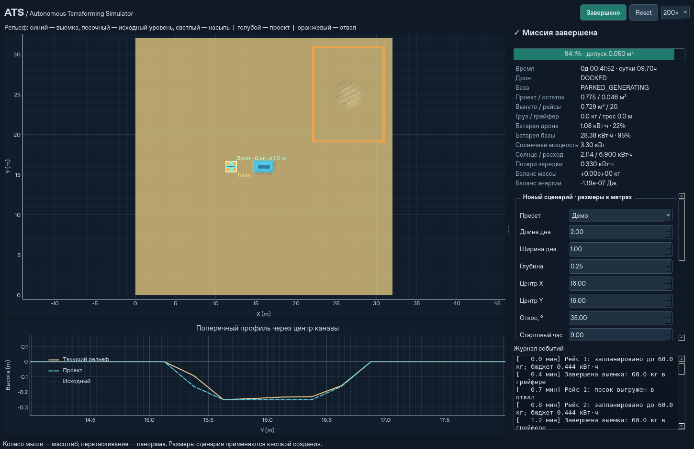

# Autonomous Terraforming Simulator (ATS)

Работающее настольное приложение на Python: автономный электрический мультикоптер с грейфером выкапывает канаву с откосами, переносит песок в отвал, возвращается на мобильную солнечную базу и заряжается. Вычислительный движок работает независимо от Qt. Вода и эрозия **не реализованы**.



## Установка и запуск

Нужен **Python 3.11+**. Команды выполняются из корня репозитория. Зависимости и пакет устанавливаются в отдельное виртуальное окружение.

**Windows, PowerShell:**

```powershell
git clone https://github.com/TopoLM21/Autonomous-Terraforming-Simulator-ATS-.git
cd Autonomous-Terraforming-Simulator-ATS-
py -3 -m venv .venv
.\.venv\Scripts\python.exe -m pip install -e ".[test]"
.\.venv\Scripts\python.exe -m ats
```

**Ubuntu:**

```bash
git clone https://github.com/TopoLM21/Autonomous-Terraforming-Simulator-ATS-.git
cd Autonomous-Terraforming-Simulator-ATS-
sudo apt-get update
sudo apt-get install -y python3-venv libegl1 libopengl0 libxcb-cursor0 libxkbcommon-x11-0 libxcb-icccm4 libxcb-image0 libxcb-keysyms1 libxcb-render-util0
python3 -m venv .venv
.venv/bin/python -m pip install -e '.[test]'
.venv/bin/python -m ats
```

Для приватного репозитория GitHub потребуется обычный настроенный доступ Git. Системные библиотеки Ubuntu в команде выше нужны Qt; даже `offscreen` требует `libegl1`. Для обычного GUI нужно рабочее окружение Wayland либо X11. Весь движок и CLI доступны на сервере без дисплея, без импорта PySide6 и без этих библиотек Qt.

После активации venv можно использовать короткие команды:

```bash
python -m ats
python -m ats --headless --steps 10000 --seed 42
python -m ats --headless --preset medium --steps 200000 --json medium.json
python -m ats --headless --preset large --steps 2000000 --json large.json
python -m ats --headless --start-hour 0 --roughness 0.01
python -m pytest -q
```

`--steps` — **верхний предел** виртуальных секунд; `COMPLETED` и `BLOCKED` останавливают расчёт раньше. Если предел достигнут с `RUNNING`, миссия ещё идёт: это особенно важно ночью и для большого пресета. CLI выводит JSON; код выхода 2 означает `BLOCKED`, неверные аргументы тоже завершаются с кодом 2. Полная миссия большого пресета занимает много виртуальных суток при стандартных панелях.

Для теста интерфейса на Linux без дисплея:

```bash
QT_QPA_PLATFORM=offscreen python -m pytest -q tests/test_gui.py
```

## Управление

- **Start / Pause**: запустить или приостановить автономную работу. **Reset** возвращает применённый сценарий к исходному состоянию.
- Скорость **1× / 10× / 50× / 200×** меняет число физических шагов. Сам шаг всегда **1 с**. При недостаточной скорости компьютера моделирование замедляется, а интерфейс остаётся доступным.
- Колесо мыши масштабирует карту, перетаскивание сдвигает её. Высота отображается цветом и рельефной подсветкой; голубые границы обозначают дно и откосы, оранжевые — отвал. Пунктир показывает план текущего рейса.
- На панели сценария можно выбрать пресет, размеры **плоского дна**, глубину, положение X/Y, угол откоса, начальный час, неровности, seed и площадь панелей. Изменения применяются кнопкой **«Создать новый сценарий»**. Неверная геометрия даёт объяснение и сохраняет текущий сценарий.
- Ветер, пылеобразование и видимость пыли меняются сразу. Скрытие пыли отключает только слой отображения; поле продолжает рассчитываться.
- Профиль проходит поперёк канавы через её центр и показывает текущий рельеф, исходную поверхность и проект. Телеметрия содержит объёмы, груз, оба аккумулятора, генерацию, расход, потери и ошибки балансов. В журнале есть рейсы, выемка, осыпание, зарядка, переезд и завершение.

| Пресет | Длина × ширина дна × глубина, м | Проектный объём на сетке, м³ |
|---|---|---:|
| Демо, по умолчанию | 2 × 1 × 0,25 | 0,775266 |
| Средний | 5 × 1,5 × 0,5 | 6,329547 |
| Большой | 10 × 2 × 1 | 39,219996 |

Значения включают **боковые и торцевые откосы**, поэтому отличаются от произведения трёх размеров. Допуск завершения — остаток **менее 0,05 м³**, пустой грейфер, посадка и затухшее осыпание. Процент показывает фактическую выемку; статус `COMPLETED` может появиться до 100% из-за этого допуска.

## Что реализовано по этапам A–D

**A. Грунт:** сетка `128×128`, ячейка `0,25 м`, `float64`; плоская или воспроизводимо неровная поверхность; проект по расстоянию до прямоугольника дна; конечный слой сухого песка; распределённый захват и выгрузка; консервативное осыпание между восемью соседями; закрытые края; проверка вместимости отвала.

**B. Автономность:** конечный автомат `DOCKED/CHARGING → TAKEOFF → TO_DIG → LOWER_GRABBER → SCOOP → LIFT_GRABBER → TO_DUMP → DUMP → RETURN → LANDING`; конечные скорости; проверка всего отрезка полёта относительно земли и базы; мощность по взлётной массе; расход на лебёдку; оценка полного рейса с возвращением, запасом модели и резервом 20%; ограниченные батареи; периодическое солнце; потери зарядки; ночное ожидание; жадный выбор выемки и отвала; редкий реальный переезд гусеничной базы с пристыкованным дроном, проверкой маршрута, энергозатратами и сложенными панелями. Неосуществимые сценарии дают `BLOCKED` с причиной.

**C. Интерфейс:** PySide6, интерактивная карта pyqtgraph с hillshade, профиль, все основные настройки и пресеты, Reset, независимое управление ускорением, телеметрия, ограниченный журнал. QTimer выделяет ограниченный бюджет вычислений на кадр; изображения рельефа не пересчитываются каждый физический шаг.

**D. Пыль и доводка:** поле `32×32`, перенос ветром с обратной трассировкой, диффузия и затухание, эмиссия по мощности/высоте/стадии работ, полупрозрачное облако; численные и интеграционные тесты, проверка Qt без экрана, профилировка, CLI-отчёты и документация.

## Физика и численные допущения

Все внутренние единицы — SI; электрическая энергия выводится в кВт·ч. Настраиваемые константы собраны в [ats/config.py](ats/config.py).

**Геометрия.** Для точек внутри прямоугольного дна проектная высота равна `-depth`; снаружи используется `min(initial_reference, -depth + tan(angle) * distance_to_rectangle)`. Стандартный угол — 35°. Значения берутся в центрах ячеек, так что объём имеет погрешность пространственной дискретизации; высота исходной ровной поверхности — 0 м. Ориентация канавы только вдоль X.

**Масса.** Плотность — постоянные `1600 кг/м³`. Масса на карте — `density * cell_area * sum(height - floor)`, где `floor=-3 м` задаёт согласованный неподвижный нижний уровень. Выемка уменьшает высоты на объём захваченного песка и увеличивает груз; выгрузка выполняет обратный перенос. Захват не выходит за локальный избыток над проектом и грузоподъёмность. После осыпания отдельные ячейки могут стать ниже проекта: алгоритм осыпания не подменяется искусственным ограничением проектом.

**Осыпание.** Восемь соседей проверяются последовательными непересекающимися парами. Для превышения допустимой разницы высот переносится 45% превышения: одна ячейка теряет ровно то, что получает другая. Диагонали учитывают расстояние `sqrt(2) * cell_size`. Нет периодического переноса через границы. Порог уклона `1e-9 м` и порог затухания `1e-10 м³/шаг` убирают бессмысленные перерасчёты на уровне машинных чисел; песок при остановке расчёта не удаляется. Это модель релаксации уклона, а не DEM и не расчёт реального времени схода лавины.

**Отвал.** Выгрузка распределена по соседним клеткам; при нехватке локального места область последовательно расширяется вокруг выбранной точки. Предельная насыпь — устойчивый профиль с запасом по уклону, отступом от границ и высотой до 2,5 м. Стандартная область `(22, 19, 9, 12)` м вмещает около `98,59 м³` по этому консервативному критерию. Её ограничение моделирует отведённую площадку, а не исчезновение материала; при отказе груз остаётся в дроне.

**Полёт.** Это кинематический мультикоптер, без динамики двигателей и шести степеней свободы. Горизонтальная и вертикальная скорости ограничены отдельно. Для безопасных прямых маршрутов используется общий крейсерский уровень с запасом над максимальной допустимой насыпью; аппарат держится выше минимальной рабочей высоты. На выемке работает трос. Геометрические препятствия MVP — рельеф и база. При столкновении расчёт блокируется в предыдущей позиции, без скачка сквозь препятствие.

**Мощность.** `P_hover = 18 кВт * ((105 кг + cargo) / 105 кг)^1.5`, горизонтальный полёт/маневрирование умножает мощность на 1,08. Лебёдка потребляет 500 Вт на оборудование плюс `m*g*height / (efficiency * lift_time)` при подъёме песка; КПД 0,8. Бюджет рейса учитывает округление длительностей к шагу 1 с, всю дорогу, операции, подъём, возвращение и посадку; добавлен запас 25% к оценке, отдельно сохраняется резерв батареи 20%. Это **модельные оценки, не результаты испытаний**. Разгрузка объединяет операции грейфера; рекуперации нет.

**Солнце и зарядка.** Излучение — положительная полусинусоида от 06:00 до 18:00, максимум 1000 Вт/м². Панели 20 м² при КПД 20% дают максимум 4 кВт. Источник поступает в энергобаланс базы; аккумулятор базы и зарядка дрона интегрируются совместно, избыток учитывается как ограниченная генерация (`curtailed`). Зарядное устройство берёт не более 8 кВт **на входе**, дрон получает 90%. Зарядка разрешена только после посадки. Ночью нет генерации, а в движении панели сложены. Начальные заряды обоих аккумуляторов по умолчанию 100% и входят в начальную энергию.

Проверяемое равенство:

```text
E_drone + E_base + E_flight + E_base_used + E_charge_losses + E_curtailed
= E_initial + E_solar_generated
```

**База.** Прямой гусеничный путь проверяется с шагом не больше половины ячейки, с учётом опорного радиуса, локального уклона и запрета канавы/отвала. Переезд возможен после нескольких рейсов, при заметном сокращении маршрута и ограничении частоты; движется и пристыкованный дрон. Поиск обходных путей не реализован: при небезопасном прямом маршруте база остаётся на месте.

**Пыль.** Концентрация безразмерна и характеризует только видимость. Она может выйти из карты с ветром, но **никогда не вычитается из массы песка**. Нет CFD, воды, эрозии, погоды и переносимой массы аэрозолей.

## Проверки и результаты

Тесты проверяют многократные захваты/выгрузки/осыпания и закрытые границы; массы груза и проекта; солнечные пределы, ночное ожидание, зарядные потери и одновременную генерацию/зарядку; работу лебёдки; оба аккумулятора; безопасные движения дрона и базы; детерминизм; завершение всех пресетов с ограничением числа шагов; невозможные сценарии и препятствие; перенос пыли; Start/Pause/Reset и смену сценария в настоящем Qt-окне без дисплея.

Результаты последней проверки и полных миссий находятся в [docs/VALIDATION.md](docs/VALIDATION.md), JSON-отчётах и [JUnit XML](docs/test-results.xml). Полный набор включает длительную миссию большого пресета; он занимает примерно полторы минуты в среде разработки. Матрица GitHub Actions прошла на Windows/Ubuntu с Python 3.11/3.12, включая Qt offscreen. Физический дисплей в этой среде не проверялся.

Минимальная воспроизводимая профилировка:

```bash
python -m cProfile -s cumulative -m ats --headless --preset medium --steps 10000
```

## Структура и дальнейшие границы

`terrain.py` отвечает за геометрию и песок, `drone.py` — параметры/движение дрона, `solar_base.py` — энергию и путь базы, `planner.py` — рейсы, `simulation.py` — связанный физический цикл и события, `dust.py` — пыль, `gui.py` — отображение. Движок не использует Qt, время компьютера или случайные события после воспроизводимой инициализации.

Ограничения: одна машина, один материал, heightfield без пещер и вертикальных стен; дискретный механический захват; приближённая электрическая модель; прямые маршруты; заданная площадка отвала; нет сохранения/загрузки промежуточного состояния и 3D. Эти ограничения не мешают автономному завершению стандартных миссий.

Для будущей воды/эрозии потребуется отдельное поле глубины воды и консервативный расчёт потоков с собственным устойчивым подшагом; учёт осадка и обмена между грунтом/взвесью с раздельными балансами массы; согласование мокрого грунта с откосами и нагрузкой грейфера; дополнительные тесты сухого/мокрого перехода и визуальные слои. В этой версии такие изменения не начинались.

Исходное ТЗ сохранено в [docs/TECHNICAL_SPEC.md](docs/TECHNICAL_SPEC.md).
