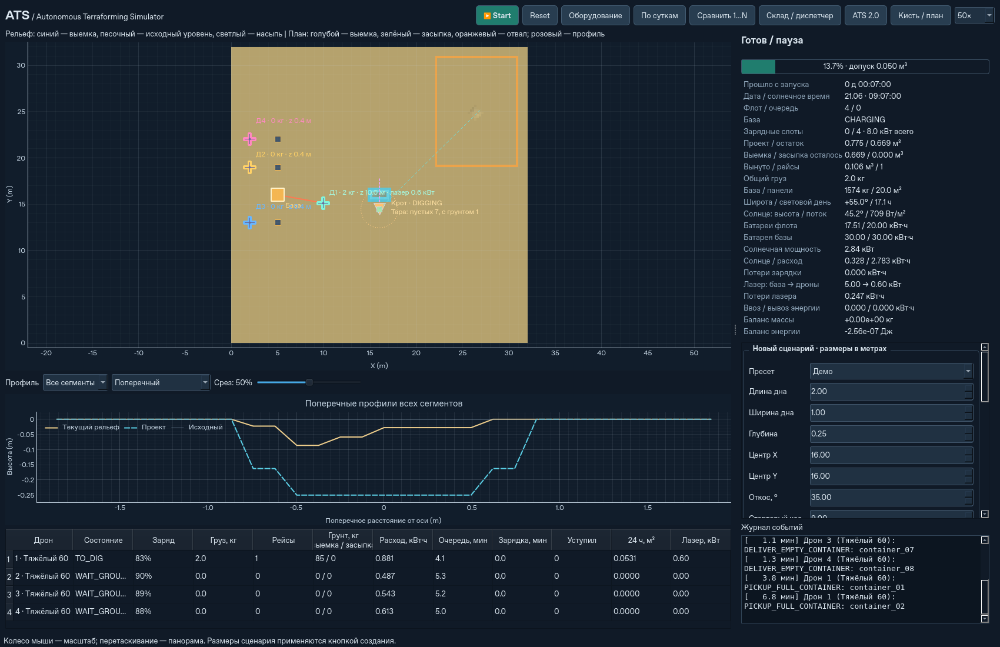
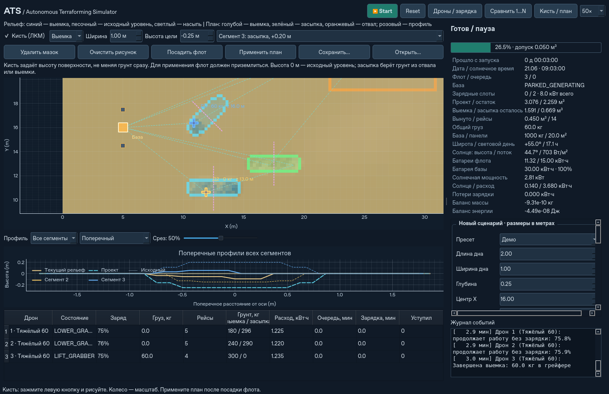
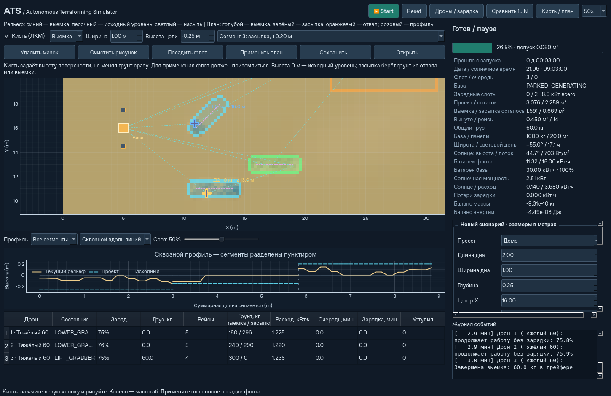

# Autonomous Terraforming Simulator (ATS 2.0)

Работающее настольное приложение на Python: флот из 1–6 автономных электрических мультикоптеров с грейферами выкапывает канаву с откосами, переносит песок в отвал, возвращается на мобильную солнечную базу и заряжается. Можно задать разные модели и сравнить независимые миссии с разным числом дронов. Вычислительный движок работает независимо от Qt. Вода и эрозия **не реализованы**.

**ATS 2.0 — основной режим запуска**: автономный «Крот-160», четыре дрона,
многоразовые ёмкости, поштучные батареи, наземная смена модулей и диспетчер.
Пресеты, кисть, карта и комплектации сохранены. Прежний движок оставлен для
совместимости и регрессионных расчётов, скрыт из GUI (`--mode legacy`).

**Реальный рельеф и скорость копания:** кнопка **Ландшафт / импорт DEM…** открывает
встроенную офлайн-карту Каттары и побережья по NOAA ETOPO1, импорт ASC/NPZ/GeoTIFF,
профиль произвольного коридора и выбор локального рабочего участка.
Высоты кисти на DEM задаются в **метрах относительно уровня моря (MSL)**.
Мелкие блоки сохраняются только там, где грунт изменился. Стандартный дрон
постепенно набирает до 60 кг за 10 с (до 6 кг/с); увеличение ковша не увеличивает
скорость копания автоматически. [Запуск, форматы и ограничения](docs/ATS2_LANDSCAPE.md).

**Проект канала:** нарисуйте линию от моря внутрь выбранной сухой впадины,
задайте ширину дна, глубину **ниже уровня моря** и отступ от берега (10 м по
умолчанию). **Разметить канал → Начать копание выбранного участка** создаёт
готовый план выемки, базу и отвал. Доступны карты до **1024 м**, широта берётся
из координат базы и влияет на генерацию. [Работа с проектом канала](docs/ATS2_CHANNEL_PROJECT.md).

## ATS 2.0: запуск логистики



После установки ниже:

```bash
python -m ats
python -m ats --panel-area 100
python -m ats --headless --mode logistics --drones 4 --steps 20000 --json logistics-report.json
python -m ats --headless --mode hybrid --drones 4 --preset medium --steps 345600
python -m ats --headless --mode logistics --laser-profile realistic_reference --steps 20000
python -m ats --headless --preset medium --batch-experiments --steps 345600 --json comparison.json
python -m pytest -q
```

В GUI кнопка **Новый эксперимент** создаёт новый прогон: Крот / смешанная команда,
1–6 дронов, ёмкости, индивидуальные зарядные слоты, одна/две батареи дрона,
двухслотовый Крот или явно названный четырёхслотовый эксперимент, числовая площадь панелей,
профили лазера. **Склад / диспетчер** открывает сводку оборудования по группам:
полные, частично заряженные и разряженные батареи, грейферы, ёмкости и прочие модули.
Двойной щелчок раскрывает ID, место, SOC, грунт и резервы экземпляров выбранной группы. На карте есть Крот, радиус стрелы, контейнеры,
маршруты и контур большого поля панелей. Скорости 1000×/2000× сохраняются.

По умолчанию **все дроны начинают с грейферами и копают**. Пустые ёмкости заранее
расставлены у Крота; постоянного резервного курьера нет. Когда готовы **¾ ёмкостей**
(6 из 8) либо SOC Крота **ниже 10%**, один дрон завершает перенос своего грунта,
садится в сервисный док, меняет грейфер на подвес за 45 с и становится курьером.
Он последовательно вывозит ёмкости, возвращает тару, доставляет заряженные батареи
и забирает снятые. Остальные копают. После обслуживания очереди курьер меняет
инструмент обратно. Если ему нужна полная зарядка, его может сменить готовый дрон;
одновременно транспортное задание выполняет один аппарат.

Неполная последняя партия вывозится при завершении выемки или посадке флота.
Сервис также вызывается, если Крот не может продолжить работу без тары, переноса
оборудования либо безопасного энергетического запаса на полный цикл. Для совместного
подъёма собирается вся команда. Масса инструментов, время операций и энергия учитываются;
запрос зарядки дрона выполняется до 100%. Стратегия показана в телеметрии и на карте.
В **Новом эксперименте** есть переключатель стратегии; `--courier-strategy responsive`
сохраняет прежнее обслуживание по мере появления заданий, `--no-idle-digging` —
строгую транспортную логистику.

**Площадь панелей** задаётся числом в новом эксперименте, CLI (`--panel-area 123.5`)
либо в боковой панели. Кнопка **«Применить площадь панелей сейчас»** меняет установку
без сброса времени, грунта, зарядов и полётов. Площадь увеличивает массу панелей
при сохранении кг/м² и КПД. Для поля больше 20 м² проверяется место и выполняется
развёртывание за 300 с с расходом 200 Вт; до его окончания генерации нет.
При невозможной геометрии сохраняется текущая установка. Остановите движущуюся
базу перед изменением панелей.

**Склад / диспетчер → Инвентарь → Добавить батареи на базу** принимает поставку
в текущую миссию. Выберите тип батареи дрона или Крота, 1–128 модулей и SOC 0–100%.
Это новые физические ID и зарядные слоты; масса и внешняя энергия поставки входят
в отчёт. Пустые батареи сначала заряжаются, полные сразу доступны для автоматической
замены. Время, полёты и существующие резервы сохраняются. Начальные настройки
запаса при этом не меняются: Reset начинает новый прогон без прошлых поставок.

В таблице флота механическая замена показана состоянием `SWAPPING_BATTERIES`,
в окне склада — ID старых/новых модулей, оставшееся время и счётчик замен.
При низком SOC и наличии полного совместимого комплекта замена длится 60 с;
если готового комплекта нет, работает контактная зарядка до 100%. На коротком
демо батареи могут не успеть разрядиться до порога. Инвентарь обновляет только
открытую вкладку; диспетчер показывает последние 200 заданий, полный архив остаётся
в JSON-отчёте. [Испытания исправлений](docs/ATS2_FOLLOWUP_VALIDATION.md).

Базовая логистика: четыре дрона с параметрами существующего оборудования,
Крот 160 кг + две установленные батареи по 11 кг / 1,5 кВт·ч, ещё две батареи на
базе, восемь контейнеров по 5 кг / 55 л / 90 кг полной массы. Контейнерный груз
включает песок, тару и подвес 2 кг. Предел берётся из **предела рамы**, а «60 кг»
в имени старого дрона относится к его грейферу. Копание, перевозка, возврат тары,
доставка батарей, боковой док, возврат/зарядка снятых модулей выполняются с временем
и энергозатратами. Общая стропа 12 кг доставляется отдельным рейсом до подъёма.
Силовые батареи Крота перед групповым перелётом снимаются.

Посадочные доки сохраняют общий предел **8 кВт входа / КПД 90%**. У каждого
сменного модуля теперь свой постоянный зарядный слот **до 1,5 кВт**. Снятые батареи
могут заряжаться одновременно; общий инвертор, аккумулятор и панели базы ограничивают
доступную мощность. Посадочные доки получают питание первыми, оставшаяся мощность
равномерно делится между неполными модулями с учётом их пределов. Смена дроновой
батареи происходит после посадки, занимает 60 с и использует реальные заряженные
модули склада. Запрос зарядки сохраняется до 100%.

Вкладка **Склад / диспетчер → Зарядные слоты** показывает ID слота и батареи,
её положение, SOC, фактическую и предельную мощность. Слот закреплён за физическим
модулем, в том числе за временно установленным на дроне или Кроте: пока модуль
работает вне склада, его слот пуст. При замене возвращённая батарея занимает свой
слот. Корпус и контроллер слота добавляют к массе базы по 1 кг — настраиваемое
модельное допущение `charger_slot_mass_kg`. Аккумуляторы самой базы заряжаются
своим контуром. Режим общей очереди сохранён для прежних сравнительных сценариев:
`--module-charge-mode shared --module-charge-ports 4`.

В **Новом эксперименте** доступны **«Запасных комплектов на дрона»**
(0–64) и **«Запасных модулей Крота»** (0–128). Комплект содержит столько модулей,
сколько установлено на соответствующем дроне. Например, четыре дрона с двумя
установленными батареями и двумя запасными комплектами дают 8 установленных и
16 запасных дроновых модулей; совместимые модули используют общий склад.
Слоты Крота считаются отдельно от его запаса. Дополнительные батареи увеличивают
начальную энергию и массу склада; масса базы корректна ещё до первого шага.
Настройки относятся к новому прогону и сохраняются в JSON.

```bash
python -m ats --mode logistics --drone-spare-sets 2 --excavator-spare-batteries 4
```

Явные флаги запаса переопределяют также загруженный `--configuration`; без них
сохраняются числа из JSON. Причина наземного ожидания показывается на карте и в
подсказке состояния флота. Запрос полной зарядки выполняется до 100%, в том числе
перед совместным переносом. [Испытания запаса и диспетчера](docs/ATS2_SPARES_DISPATCH_VALIDATION.md).

`existing_legacy` сохраняет пользовательские настройки лазера. Исходный предел
8 кВт приёмника в работающем коде — **электрический**. `realistic_reference`
использует одну модельную установку 5 кВт электрического входа / 300 кг с разделением
мощности между каналами: примерно 600 Вт электричества и 900 Вт тепла на одном
приёмнике при хорошей видимости. Пыль вдоль луча, затухание, перекрытие, ориентация,
оптический предел и нагрев реально влияют на передачу. Масса приёмника 2,8 кг
входит в массу дрона. Ориентиры ARC 800 Вт peak / ~600 Вт avg / 2,8 кг опубликованы;
масса передатчика, КПД, оптика, тепловые параметры и весь профиль Крота — **модельные
допущения**, не спецификация серийной техники.

Конфигурация эксперимента сохраняется/загружается в GUI либо:

```bash
python -m ats --mode logistics --save-configuration experiment.json --headless --steps 0
python -m ats --configuration experiment.json
```

Это настройки нового прогона, не checkpoint текущего мира. Поставки батарей в ходе
миссии оформляются отдельным действием в инвентаре. Площадь панелей, порог зарядки,
лимит зарядной шины и включение/мощность лазеров меняются сразу. Изменение остальных
физических предметов задаётся новым экспериментом. Автоматическая физическая смена
батарей работает в ходе миссии. [Проверки основной версии и новой стратегии](docs/ATS2_PRIMARY_STRATEGY_VALIDATION.md).

Результаты этапов A–F, таблицы S0–S9, полные протоколы и ограничения —
[ATS2_VALIDATION.md](docs/ATS2_VALIDATION.md). Параметры и устройство расширения —
[ATS2_IMPLEMENTATION.md](docs/ATS2_IMPLEMENTATION.md); исходное
[ТЗ ATS 2.0](docs/ATS2_TECHNICAL_SPEC.md).



## Установка и запуск

Нужен **Python 3.11+**. Команды выполняются из корня репозитория. Зависимости и пакет устанавливаются в отдельное виртуальное окружение.

**Windows, PowerShell:**

```powershell
git clone https://github.com/TopoLM21/Autonomous-Terraforming-Simulator-ATS-.git
cd Autonomous-Terraforming-Simulator-ATS-
py -3 -m venv .venv
.\.venv\Scripts\python.exe -m pip install -e ".[test]"
.\.venv\Scripts\python.exe -m ats
```

**Ubuntu:**

```bash
git clone https://github.com/TopoLM21/Autonomous-Terraforming-Simulator-ATS-.git
cd Autonomous-Terraforming-Simulator-ATS-
sudo apt-get update
sudo apt-get install -y python3-venv libegl1 libopengl0 libxcb-cursor0 libxkbcommon-x11-0 libxcb-icccm4 libxcb-image0 libxcb-keysyms1 libxcb-render-util0
python3 -m venv .venv
.venv/bin/python -m pip install -e '.[test]'
.venv/bin/python -m ats
```

Для приватного репозитория GitHub потребуется обычный настроенный доступ Git. Системные библиотеки Ubuntu в команде выше нужны Qt; даже `offscreen` требует `libegl1`. Для обычного GUI нужно рабочее окружение Wayland либо X11. Весь движок и CLI доступны на сервере без дисплея, без импорта PySide6 и без этих библиотек Qt.

Для GUI устанавливается **PySide6-Essentials**: он предоставляет используемые модули `PySide6.QtCore`, `QtGui` и `QtWidgets`. Общий пакет `PySide6`, а также Addons, WebEngine и PDF не нужны. Это сокращает объём загрузки и место на диске.

Если ранее установка остановилась на `PySide6_Addons`, обновите репозиторий и повторите установку в активированном venv:

```bash
git pull --ff-only
python -m pip install --upgrade pip
python -m pip install -e '.[test]'
python -m ats
```

Новая установка не скачивает Addons. Уже установленные лишние пакеты pip автоматически не удаляет; можно оставить их или создать дополнительное чистое окружение. При сетевом тайм-ауте повторите команду установки с `--timeout 120 --retries 5`. Если ошибка сохраняется, для диагностики нужны её последние строки, версия Python и версия Ubuntu.

После активации venv можно использовать короткие команды:

```bash
python -m ats
python -m ats --headless --steps 10000 --seed 42
python -m ats --headless --preset medium --steps 200000 --json medium.json
python -m ats --headless --preset large --steps 2000000 --json large.json
python -m ats --headless --start-hour 0 --roughness 0.01
python -m ats --headless --latitude 55 --day-of-year 355 --panel-area 30 --base-mass 1500 --steps 10000
python -m ats --drones 3 --charge-slots 2 --charge-threshold 30
python -m ats --headless --equipment equipment.json --steps 10000 --json production.json
python -m ats --headless --plan docs/brush-example.json --drones 3 --charge-slots 2 --steps 120000
python -m ats --headless --drones 3 --charge-slots 1 --wait-mode air --steps 200000
python -m ats --headless --compare-fleet 1,2,3 --charge-slots 2 --steps 20000 --json comparison.json
python -m pytest -q
```

`--steps` — **верхний предел** виртуальных секунд; `COMPLETED` и `BLOCKED` останавливают расчёт раньше. Если предел достигнут с `RUNNING`, миссия ещё идёт: это особенно важно ночью и для большого пресета. CLI выводит JSON; код выхода 2 означает `BLOCKED`, неверные аргументы тоже завершаются с кодом 2. Полная миссия большого пресета занимает много виртуальных суток при стандартных панелях.

На Python 3.11 установщик автоматически выбирает PySide6-Essentials ниже 6.12: в Qt 6.12 выявлен дефект счётчика ссылок при отправке сигналов, вызывающий падение GUI при завершении процесса. Проверена версия 6.11.2. На Python 3.12 и новее прежний диапазон сохраняется. Если уже установлена 6.12 с Python 3.11, повторите `python -m pip install -e ".[test]"` после `git pull`; Addons не нужны.

Для теста интерфейса на Linux без дисплея:

```bash
QT_QPA_PLATFORM=offscreen python -m pytest -q tests/test_gui.py
```

## Управление

- **Start / Pause**: запустить или приостановить автономную работу. **Reset** возвращает применённый сценарий к исходному состоянию.
- **«Оборудование»**: сначала количества панелей, аккумуляторов базы и посадочных мест. Новая стандартная панель — **1 м² / 4 кг**, аккумулятор базы — **5 кВт·ч / 50 кг**. Масса, площадь и ёмкость рассчитываются автоматически. Галочка **«Подробные параметры»** раскрывает типы модулей, массы, КПД и лазеры. Сохранённые пользовательские типы сохраняют свои размеры и характеристики. Во вкладке **«Дроны»** показан список; двойной щелчок открывает выбранную модель, её батареи, грейфер и приёмник. Есть заготовки «Тяжёлый 60» / «Лёгкий 30» и JSON комплектаций. В ATS 2.0 панельные изменения и разрешённые лимиты применяются без сброса; для другого начального состава базы/флота есть отдельная кнопка **«Новый прогон с этим оборудованием»**. Горячая поставка сменных батарей остаётся в инвентаре.
- **«Сравнить 1…N»**: независимые расчёты для первых 1, 2, …, N моделей текущего состава; одинаковые участок, seed, солнце, база и зарядные слоты. Таблица показывает время завершения, рейсы, расход, ожидание и начальный запас энергии. Расчёт можно остановить. В CLI `--compare-fleet` сохраняет массив таких же отчётов; если запрошено больше моделей, имеющийся состав повторяется.
- Скорость **1× / 10× / 50× / 200× / 1000× / 2000×** задаёт целевой темп. Физический шаг всегда **1 с**. В строке состояния показаны **цель, фактическое ускорение и частота обновления**. При 1000×/2000× карта обновляется примерно до 5 раз/с, при 200× — до 10 раз/с; остальные физические шаги продолжают рассчитываться. Темп зависит от сценария и компьютера, ускорение 2000× не гарантируется. [Замеры ускорения и открытия инвентаря](docs/ATS2_COMPACT_UI_VALIDATION.md).
- Колесо мыши масштабирует карту, перетаскивание сдвигает её. Высота отображается цветом и рельефной подсветкой; голубые границы обозначают дно и откосы, оранжевые — отвал. Пунктир показывает план текущего рейса.
- На панели сценария можно выбрать пресет, размеры **плоского дна**, глубину, положение X/Y, угол откоса, начальный час, неровности и seed. В группе **«База и солнце»** задаются широта и стартовая дата (календарь или сезонные даты); площадь панелей и масса базы отображаются по комплектации. Изменения солнца применяются кнопкой создания сценария; эти настройки доступны ниже в прокручиваемой панели. Неверная геометрия даёт объяснение и сохраняет текущий сценарий.
- Ветер, пылеобразование и видимость пыли меняются сразу. Скрытие пыли отключает только слой отображения; поле продолжает рассчитываться.
- Профиль показывает текущий рельеф, исходную поверхность и проект. Выберите отдельный сегмент или «Все сегменты»: поперечные срезы всех мазков отображаются совместно; ползунок 0–100% перемещает срез вдоль линии. Режим «Сквозной вдоль линий» показывает продольный профиль выбранного сегмента либо всех последовательно. Между раздельными сегментами стоят разрывы и пунктирные границы; ось — сумма длин мазков, соединяющие промежутки не включены. Розовые линии на карте показывают расположение профиля. Телеметрия содержит объёмы, груз, оба аккумулятора, генерацию, расход, потери и ошибки балансов, а также массу базы, площадь панелей, широту, продолжительность дня, высоту солнца и поток в Вт/м². В журнале есть рейсы, выемка, осыпание, зарядка, переезд и завершение. «Грунт, кг» в таблице флота показывает выемку / засыпку; подсказка заряда содержит нижний порог и число полных зарядок.
- **«Статистика»**: выработка дронов и **добытый Кротом грунт в кг и м³**, за выбранные сутки, всю миссию и последние 24 часа. У дронов учитывается выгрузка, у Крота — фактическая выемка в ковш. Это разные операции над одним грунтом. Вкладка **«Время работы»** показывает занятия и доли времени: копание, перевозки, совместный подъём, зарядка, смена батарей/инструмента, движение, подготовка и ожидание. Каждая физическая секунда относится к одному занятию машины; пауза не добавляет время. При снятии дрона история сохраняется. Сутки идут от полуночи местного солнечного времени; первые и текущие сутки могут быть неполными.
- Цвета и подписи различают дроны на карте; квадраты рядом с базой обозначают зарядные места. Нижняя таблица показывает заряд, груз, рейсы, вынутую массу, расход энергии, минуты очереди/зарядки и число уступлений для каждого аппарата. Батарея флота в общей телеметрии — сумма всех батарей.
- **«Прошло с запуска»** — длительность миссии в полных сутках и `ЧЧ:ММ:СС`. **«Дата / солнечное время»** — дата и текущие часы на участке. Например, `0 д 00:42:52` при старте в 09:00 означает 42 мин 52 с работы и часы `09:42:52`, а не прошедшие 9,7 суток. Солнечный полдень всегда 12:00; часовые пояса, долгота и уравнение времени не учитываются.

| Пресет | Длина × ширина дна × глубина, м | Проектный объём на сетке, м³ |
|---|---|---:|
| Демо, по умолчанию | 2 × 1 × 0,25 | 0,775266 |
| Средний | 5 × 1,5 × 0,5 | 6,329547 |
| Большой | 10 × 2 × 1 | 39,219996 |

Значения включают **боковые и торцевые откосы**, поэтому отличаются от произведения трёх размеров. Допуск завершения — остаток **менее 0,05 м³**, пустые грейферы, посадка всех дронов и затухшее осыпание. Процент показывает фактическую выемку; статус `COMPLETED` может появиться до 100% из-за этого допуска. После завершения миссии полная зарядка не требуется: начатая зарядка продолжается до 100%, пока работа ещё требуется.

## Размер и масштаб карты

Новый запуск открывает поле **64 × 64 м** вместо 32 × 32 м. В параметрах нового
сценария и окне **ATS 2.0** можно выбрать сторону от **32 до 256 м**. Ячейка
остаётся 0,25 м: поле увеличивается физически, координаты базы и проекта сохраняются
в метрах. Например:

```bash
python -m ats --mode logistics --map-size 128 --drone-spare-sets 2
python -m ats --map-size 32
```

Кнопки **+ / −**, колесо мыши и **Вся карта** управляют масштабом. **Развернуть
карту / F11** открывает карту на весь экран; **Esc** или **F11** возвращает её
в окно. Состояние симуляции и кисть сохраняются. Для перемещения карты перетаскиванием
отключите рисование кистью.

Загруженные конфигурации и планы сохраняют прежний размер поля. Сохранённый рельеф
нельзя молча растянуть на другую сетку — для изменения размера создайте новый
сценарий. Программный `Config()` сохраняет 32 × 32 м для совместимости прежних
расчётов. На больших сетках шаг и обновление изображения требуют больше времени.
[Результаты проверки слотов и карты](docs/ATS2_CHARGING_MAP_VALIDATION.md).

## Кисть, выемка и засыпка

Кнопка **«Кисть / план»** открывает инструменты на карте. ЛКМ рисует линию, щелчок — круговую площадку; один мазок — один сегмент. Колесо масштабирует карту, для панорамирования отключите галочку кисти.

1. Выберите **«Выемка»** либо **«Засыпка»**, ширину и **абсолютную целевую высоту** в метрах. 0 м — исходный уровень, отрицательное значение задаёт дно, положительное — насыпь. Для полного восстановления канавы до 0 м охватите кистью её дно и откосы.
2. Нарисуйте сегменты. Голубой обозначает выемку, зелёный — засыпку. Можно удалить выбранный мазок или очистить рисунок. В местах перекрытия последний мазок задаёт цель.
3. Нажмите **«Посадить флот»**, если аппараты в воздухе. Они завершат текущие переносы и приземлятся без запуска новых рейсов; окно приостановит расчёт.
4. Нажмите **«Применить план»**, затем Start. Применение сохраняет фактический грунт, массу, энергию и часы, меняя только проект; прогресс начинается для нового этапа. Области базы, посадочных площадок и отвала защищены. Невозможный переход высот между мазками выдаёт объяснение вместо бесконечной переделки.
5. **«Сохранить…» / «Открыть…»** работают с JSON плана. Сохраняются мазки, рельеф на начало этапа, координаты базы, угол откоса и параметры исходной поверхности. Reset возвращает этот стартовый рельеф; батареи и время стартуют по настройкам сценария. Открытие файла создаёт новый сценарий, а не продолжает сохранённый физический шаг.

Сухой песок для засыпки сначала берётся из отвала **выше исходной поверхности**, затем из запланированной выемки. Выемка может сразу отправляться в засыпку. Дрон резервирует и место, и объём назначения; оставшийся груз при уменьшении дефицита сохраняется и перенаправляется. Грунт не появляется из ничего. При исчерпании источника выдаётся BLOCKED с причиной; цель не считается выполненной. Для готовой поверхности цель продолжает отслеживаться при последующих осыпаниях.

Дно мазка имеет заданную ширину, боковые и торцевые переходы строятся по углу откоса сценария. В пределах карты проверяются восемь соседних направлений. Для кистевого плана база остаётся на месте: её текущий поиск переезда рассчитан на прямоугольный пресет.



## Что реализовано по этапам A–D

**A. Грунт:** сетка до `1024×1024` (новый запуск `256×256`), ячейка `0,25 м`, `float64`; плоская или воспроизводимо неровная поверхность; проект по расстоянию до прямоугольника дна; конечный слой сухого песка; распределённый захват и выгрузка; консервативное осыпание между восемью соседями; закрытые края; проверка вместимости отвала.

**B. Автономность:** конечный автомат `DOCKED/CHARGING → TAKEOFF → TO_DIG → LOWER_GRABBER → SCOOP → LIFT_GRABBER → TO_DUMP → DUMP → RETURN → LANDING`; конечные скорости; проверка всего отрезка полёта относительно земли и базы; мощность по взлётной массе; расход на лебёдку; оценка полного рейса с возвращением, запасом модели и резервом 20%; ограниченные батареи; периодическое солнце; потери зарядки; ночное ожидание; жадный выбор выемки и отвала; редкий реальный переезд гусеничной базы с пристыкованным дроном, проверкой маршрута, энергозатратами и сложенными панелями. Неосуществимые сценарии дают `BLOCKED` с причиной.

Расширение флота: отдельный автомат и параметры каждого дрона, серии переносов между зарядками с настраиваемым нижним порогом и зарядкой до 100%, резервирование слотов и очереди, наземное/воздушное ожидание, безопасные перелёты к зарядке, разведение рабочих точек и маршрутов, общий баланс массы и энергии всех аппаратов.

**C. Интерфейс:** PySide6, интерактивная карта pyqtgraph с hillshade, профиль, компактные количества оборудования с раскрытием параметров, групповой инвентарь, статистика, настройки и пресеты, Reset, телеметрия и журнал. Расчёт работает ограниченными пакетами между событиями Qt; частота отрисовки регулируется отдельно от физических шагов.

Редактор флота позволяет настраивать разные модели и зарядные места; таблица сравнивает аппараты в одной миссии, отдельное окно рассчитывает независимые миссии флотов 1…N.

**D. Пыль и доводка:** поле `32×32`, перенос ветром с обратной трассировкой, диффузия и затухание, эмиссия по мощности/высоте/стадии работ, полупрозрачное облако; численные и интеграционные тесты, проверка Qt без экрана, профилировка, CLI-отчёты и документация.

## Физика и численные допущения

Все внутренние единицы — SI; электрическая энергия выводится в кВт·ч. Настраиваемые константы собраны в [ats/config.py](ats/config.py).

**Геометрия.** Для точек внутри прямоугольного дна проектная высота равна `-depth`; снаружи используется `min(initial_reference, -depth + tan(angle) * distance_to_rectangle)`. Стандартный угол — 35°. Значения берутся в центрах ячеек, так что объём имеет погрешность пространственной дискретизации; высота исходной ровной поверхности — 0 м. Ориентация канавы только вдоль X.

**Масса.** Плотность — постоянные `1600 кг/м³`. Масса на карте — `density * cell_area * sum(height - floor)`, где `floor=-3 м` задаёт согласованный неподвижный нижний уровень. Выемка уменьшает высоты на объём захваченного песка и увеличивает груз; выгрузка выполняет обратный перенос. Захват не выходит за локальный избыток над проектом и грузоподъёмность. После осыпания отдельные ячейки могут стать ниже проекта: алгоритм осыпания не подменяется искусственным ограничением проектом.

**Осыпание.** Восемь соседей проверяются последовательными непересекающимися парами. Для превышения допустимой разницы высот переносится 45% превышения: одна ячейка теряет ровно то, что получает другая. Диагонали учитывают расстояние `sqrt(2) * cell_size`. Нет периодического переноса через границы. Порог уклона `1e-9 м` и порог затухания `1e-10 м³/шаг` убирают бессмысленные перерасчёты на уровне машинных чисел; песок при остановке расчёта не удаляется. Это модель релаксации уклона, а не DEM и не расчёт реального времени схода лавины.

**Отвал.** Выгрузка распределена по соседним клеткам; при нехватке локального места область последовательно расширяется вокруг выбранной точки. Предельная насыпь — устойчивый профиль с запасом по уклону, отступом от границ и высотой до 2,5 м. Стандартная область `(22, 19, 9, 12)` м вмещает около `98,59 м³` по этому консервативному критерию. Её ограничение моделирует отведённую площадку, а не исчезновение материала; при отказе груз остаётся в дроне.

**Полёт и предотвращение столкновений.** Это кинематический мультикоптер, без динамики двигателей и шести степеней свободы. Горизонтальная и вертикальная скорости ограничены отдельно. Крейсерские уровни разнесены на 3 м, выше максимальной допустимой насыпи. Минимальное расстояние между центрами аппаратов — 2 м; проверяется весь взаимный отрезок движения за шаг, включая пересечение между его концами. При конфликте аппарат уступает и строит боковой обход с конечной скоростью. Точки выемки и выгрузки резервируются на время операций. На выемке работает трос. Рельеф и база также проверяются; при небезопасном движении расчёт блокируется в предыдущей позиции. Удар, повреждения, форма винтов, взаимодействие струй и столкновения тросов не моделируются.

**Мощность.** `P_hover = 18 кВт * ((105 кг + cargo) / 105 кг)^1.5`, горизонтальный полёт/маневрирование умножает мощность на 1,08. Лебёдка потребляет 500 Вт на оборудование плюс `m*g*height / (efficiency * lift_time)` при подъёме песка; КПД 0,8. Бюджет рейса учитывает округление длительностей к шагу 1 с, всю дорогу, операции, подъём, возвращение и посадку; добавлен запас 25% к оценке, отдельно сохраняется резерв батареи 20%. Это **модельные оценки, не результаты испытаний**; рекуперации нет.

**Разгрузка.** Дрон зависает над отвалом и **не садится на песок**. В состоянии `DUMP` грейфер опускается на тросе 5 с, у поверхности раскрывается и передаёт груз карте, затем пустой грейфер поднимается 5 с. Свободное падение песка с высоты не моделируется. Во время полёта грейфер подтянут до троса 1 м; при работе трос достигает местной поверхности. Дрон расходует энергию висения и лебёдки; после раскрытия масса груза и мощность висения уменьшаются. Для зарядки дрон садится на слот базы; при занятых местах доступны отдельные площадки ожидания рядом с базой.

**Солнце и зарядка.** Для горизонтальных панелей используется простая геометрия ясного неба: склонение `δ = 23,44° * sin(2π * (day−80)/365)`, часовой угол `H = 15° * (hour−12)` и `sin(α) = sin(latitude)*sin(δ) + cos(latitude)*cos(δ)*cos(H)`. Поток `G = 1000 * max(sin(α), 0)` Вт/м², мощность `G * area * efficiency`. Восход, закат и длина дня следуют из этой геометрии; поддерживаются северные/южные широты, полярные день и ночь. Дата меняется в полночь, год повторяется через 365 дней без високосного дня. По умолчанию: **55° с. ш., 21 июня, 20 м², КПД 20%** — около 852 Вт/м² и 3,41 кВт в полдень, световой день 17,1 ч. Предел 1000 Вт/м² относится к солнцу в зените, а не к полудню любой широты. Наклон/слежение панелей, облака, атмосферные потери и тени не рассчитываются: это геометрическая оценка, а не прогноз погоды.

Источник поступает в энергобаланс базы; аккумулятор базы и зарядка флота интегрируются совместно, избыток учитывается как ограниченная генерация (`curtailed`). По умолчанию зарядные слоты делят **8 кВт суммарной входной мощности**, дроны получают 90%. Свободная доля мощности перераспределяется между остальными заряжающимися батареями. Мощность ограничена доступной энергией базы и солнца. Контактная зарядка разрешена только после посадки в выделенный слот; стоящий рядом дрон не заряжается. Лазерная передача питает аппарат в воздухе отдельно от этого профиля. Профиль зарядки — **30% → 100%** по умолчанию. После выгрузки аппарат может сразу лететь на следующую выемку; выше нижнего порога он не подзаряжается после каждого переноса. При достижении порога запрашивается возврат и зарядка до 100%; запрос сохраняется и после пересечения нижнего порога вверх. Ранний возврат допустим, если текущей энергии не хватает на следующий рейс с возвращением и резервом 20%. Полный заряд проверяется с численным допуском менее 1 мкДж. Нижний порог задаётся отдельно для модели и не может быть ниже её резерва. Порог 100% включает зарядку после каждого переноса; полностью заряженный аппарат при этом может вылететь.

**Очередь.** Свободный слот резервируется на подлёте и освобождается после безопасного взлёта. Очередь обслуживается по прибытии среди аппаратов, готовых к перелёту. По умолчанию дрон садится рядом с базой и выключает двигатели. Альтернативный режим — ожидание в воздухе с расходом энергии висения. До исчерпания резерва аппарат приземляется: бюджет сохраняет энергию на посадку и последующий перелёт к зарядке. Переход с площадки на зарядный слот выполняется реальным полётом, а не переносом координат.

Ночью нет генерации, а в движении панели сложены. Начальные заряды всех аккумуляторов по умолчанию 100% и входят в начальную энергию. При сравнении большее число дронов увеличивает этот начальный запас; одинаковые панели и зарядные устройства остаются общим ограничением. Поэтому больше аппаратов не гарантирует более короткую миссию.

Проверяемое равенство:

```text
sum(E_drone) + E_base + sum(E_flight_and_winch) + E_base_used + E_charge_losses + E_curtailed
+ E_laser_losses + E_exported_equipment
= E_initial + E_solar_generated + E_imported_equipment
```

**База.** Прямой гусеничный путь проверяется с шагом не больше половины ячейки, с учётом опорного радиуса, локального уклона, путей всех платформ и запрета канавы/отвала. Переезд возможен после нескольких рейсов, при заметном сокращении маршрута и ограничении частоты, когда все дроны пристыкованы. Вместе с базой движутся только пристыкованные аппараты. При нехватке слотов и дронах на площадках ожидания база остаётся на месте. Поиск обходных путей базы не реализован.

Масса базы — сумма установленного оборудования. Стандартные **1000 кг**: шасси с приводом/управлением 585 кг + 6 батарей × 50 кг (по 5 кВт·ч) + 20 панелей × 4 кг (по 1 м²) + посадочное место 20 кг + зарядное устройство 15 кг. Дополнительный слот добавляет 20 кг, каждая панель или батарея — собственную массу; массы пристыкованных дронов добавляются отдельно. Простая оценка движения: `P_move = 1000 Вт * (base_mass + sum(docked_drone_mass)) / 1105 кг`. При стандартной массе базы и одного дрона получается исходная оценка 1 кВт; более тяжёлая база расходует больше энергии. Скорость остаётся заданными 0,2 м/с. Динамика разгона, тяговое сцепление и нагрузка на грунт не моделируются.

**Модули дрона и энергия оборудования.** Стандартный аппарат: рама 60 кг + 2 батареи × 15 кг (по 2,5 кВт·ч) + ковш 15 кг = 105 кг без груза. Объём ковша 0,0375 м³ при плотности 1600 кг/м³ даёт 60 кг грунта. Увеличение ковша повышает груз до предела рамы (по умолчанию 120 кг); радиус захвата индивидуальный, от размера ячейки до половины безопасного расстояния между дронами. Мощность висения меняется как `P_ref * (installed_mass / reference_mass)^1.5`; груз дополнительно входит в полную лётную массу. Опорные 105 кг / 18 кВт и другие характеристики — настраиваемые инженерные оценки, а не паспорт конкретной машины.

Новый батарейный модуль устанавливается **пустым**. При снятии батарей экспортируется их доля текущей энергии: модель предполагает одинаковый относительный заряд всех подключённых модулей. Тип сохраняемой батареи определяется ёмкостью одной штуки; переименование не заменяет аккумулятор, смена ёмкости означает замену пустым модулем. Увеличение числа сохраняет имеющийся заряд в кВт·ч, а не процент. Новый доставленный дрон получает указанный начальный заряд (по умолчанию 100%); эта внешняя энергия записывается отдельно как импорт. Снятие аппарата экспортирует оставшийся заряд, а его прошлый расход сохраняется в балансе. Можно убрать все батареи базы и заряжать от текущей солнечной мощности, без ночного запаса. Расход и потери монтажа не моделируются.

**Лазерная передача энергии.** Установите передатчик базы для позиции дрона (1–6) и отметьте «Установлен» у его приёмника. Передатчик можно включать/выключать без снятия оборудования. Его мощность — **электрический вход из базы**, КПД — преобразование электричества в свет. Предел приёмника — **полезный электрический выход**, его КПД — преобразование света в электричество. При типовых 20 кВт, 50% и 45% аппарат получает 4,5 кВт при полном попадании луча, а 15,5 кВт учитываются как потери. Повышение входа до 40 кВт уже упирается в типовой приёмник 8 кВт: дальнейшее увеличение входа не увеличивает его выход. Если двигатели с грузом потребляют около 37 кВт, поддержка 8 кВт лишь уменьшает расход батареи; для полного покрытия нужен приёмник соответствующей мощности и достаточный запас энергии базы.

Радиус равномерного круглого пятна: `r = r0 + distance * divergence_mrad / 1000`; расходимость — полуугол, типовые r0 = 0,10 м и 2 мрад. Доля захваченного света: `min(1, receiver_area / (π*r²))`. Учитываются дальность, рельеф, корпус базы и другие дроны. Линза находится на 0,5 м выше крыши; приёмник идеально ориентирован к лучу. Во время движения базы передатчики сложены. На земле используется контактный зарядный слот. В полёте лазер работает непрерывно: энергия сначала покрывает текущий расход, избыток повышает заряд до 100%; запрос полной зарядки сохраняется до её завершения. При полном заряде в воздухе дрон освобождает очередь/резерв слота и может продолжить работу. Планировщик рассчитывает следующий рейс и аварийное возвращение по запасу батареи **без предположения, что луч останется доступен**.

Контактная зарядка имеет приоритет по энергии после собственного потребления базы. Лазеры делят оставшуюся энергию батареи и текущей генерации пропорционально запрошенной входной мощности. Передатчики автоматически снижают мощность при насыщении приёмника или отсутствии места в батарее сверх текущего расхода. Переполнения батареи и дополнительной энергии не возникает. Отдельно показываются вход базы, полезная передача и потери; вход лазера является переносом энергии, а не ещё одним расходом двигателей. Общий баланс включает только конечный расход и потери, поэтому энергия не считается дважды.

Красные линии на карте — работающие лучи. Столбец **«Лазер, кВт»** показывает реально полученную мощность за последнюю физическую секунду. Подсказка сообщает причину ограничения/отсутствия связи и полученные кВт·ч. Подсказка заряда показывает текущий, самый длинный и общий полёт в секундах. JSON содержит `laser_transfer_enabled: true`, `lasers` с геометрией, состояниями и ограничениями, `laser_input_kwh`, `laser_received_kwh`, `laser_losses_kwh` и показатели каждого дрона. Старые комплектации с передатчиками загружаются с типовыми радиусом и расходимостью; их передача теперь работает.

Модель использует идеальное наведение и равномерное пятно, без облаков, атмосферного рассеяния, пылевого ослабления, тепловых ограничений, отражений и дифракции. Геометрия луча фиксируется в начале физической секунды; затенение другим дроном проверяется по его корпусу радиуса четверти безопасного расстояния (типично 0,5 м). Ограничения и параметры — инженерная модель, не расчёт оптической системы конкретной машины. Контрольное сравнение и балансы — [docs/laser-validation.json](docs/laser-validation.json).


**Пыль.** Концентрация безразмерна и характеризует только видимость. Она может выйти из карты с ветром, но **никогда не вычитается из массы песка**. Нет CFD, воды, эрозии, погоды и переносимой массы аэрозолей.

## Проверки и результаты

Тесты проверяют многократные захваты/выгрузки/осыпания и закрытые границы; массы груза и проекта; солнечные пределы, ночное ожидание, зарядные потери и одновременную генерацию/зарядку; работу лебёдки; все аккумуляторы; безопасные движения дронов и базы; детерминизм; завершение всех пресетов с ограничением числа шагов; невозможные сценарии и препятствие; перенос пыли; Start/Pause/Reset и смену сценария в настоящем Qt-окне без дисплея. Проверки флота дополнительно отслеживают зарядку только по запросу, продолжение работы без подзарядки, 100% после начатой зарядки, резерв, число слотов, непрерывное расстояние между дронами, общий предел мощности, наземную/воздушную очередь и отдельные модели.

Результаты последней проверки и полных миссий находятся в [docs/VALIDATION.md](docs/VALIDATION.md), JSON-отчётах и [JUnit XML](docs/test-results.xml). Полный набор включает длительную миссию большого пресета; он занимает примерно полторы минуты в среде разработки. Матрица GitHub Actions прошла на Windows/Ubuntu с Python 3.11/3.12, включая Qt offscreen. Физический дисплей в этой среде не проверялся.

Минимальная воспроизводимая профилировка:

```bash
python -m cProfile -s cumulative -m ats --headless --preset medium --steps 10000
```

## Структура и дальнейшие границы

`equipment.py` — состав и производные характеристики оборудования, `equipment_ui.py` — редактор и суточная таблица, `laser.py` — геометрия и энергопередача оптических связей; `productivity.py` — фактические выгрузки по дням и последние 24 часа; `terrain.py` отвечает за геометрию и песок, `drone.py` — параметры/движение дрона, `solar_base.py` — энергию и путь базы, `planner.py` — рейсы, `traffic.py` — проверку сближений, `simulation.py` — физический цикл флота, очередь и события, `comparison.py` — независимые сравнения, `plan.py` — кистевой план и файлы, `profiles.py` — численные профили, `plan_ui.py` — ввод кистью, `dust.py` — пыль, `gui.py` и `fleet_ui.py` — отображение. Движок не использует Qt, время компьютера или случайные события после воспроизводимой инициализации.

Ограничения: до шести дронов и одна база, один материал, heightfield без пещер и вертикальных стен; дискретный механический захват; приближённая электрическая модель; локальные обходы без глобальной оптимизации движения; заданная площадка отвала; сохраняются планы со стартовым рельефом, но не текущее состояние автоматов, батарей и часов; нет 3D. Монтаж проходит мгновенно после безопасной посадки; логистика доставки и размеры раскладки панелей/слотов не рассчитываются. Фактические безопасные площадки проверяются на карте. CLI `--base-mass` сохранён для совместимости и выводит массу шасси после вычитания стандартных модулей; для точной комплектации используйте `--equipment`. Заготовки моделей не основаны на испытаниях конкретных аппаратов. Эти ограничения не мешают автономному завершению стандартных миссий.

Для будущей воды/эрозии потребуется отдельное поле глубины воды и консервативный расчёт потоков с собственным устойчивым подшагом; учёт осадка и обмена между грунтом/взвесью с раздельными балансами массы; согласование мокрого грунта с откосами и нагрузкой грейфера; дополнительные тесты сухого/мокрого перехода и визуальные слои. В этой версии такие изменения не начинались.

Исходное ТЗ сохранено в [docs/TECHNICAL_SPEC.md](docs/TECHNICAL_SPEC.md).
