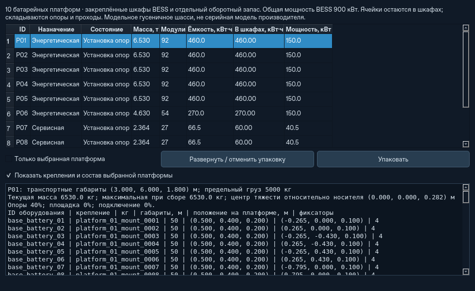

# Гусеничные батарейные платформы

Новые комплексы с автокомпоновкой шасси получают отдельные энергетические
носители BESS, сервисные носители сменных модулей и грузовые платформы для
сложенных солнечных кассет. Состав определяется реальным количеством модулей,
их массой, объёмом и посадочными местами. Общая энергия BESS по-прежнему хранится
в одном DC-балансе; физические базовые модули отражают его заряд. Заряд оборотного
запаса учитывается отдельно, только в соответствующих `BatteryModule`.

## Управление

Окно **«Батарейные платформы»** открывается кнопкой в правой панели карты либо
через **Управление ▾ → Батарейные платформы…**. Таблица показывает назначение,
состояние, текущую массу, число батарей, ёмкость, энергию на борту и мощность.
Флажок раскрывает состав выбранного носителя: ID оборудования и крепления,
массу, размеры, положение, число фиксаторов и текущий центр тяжести.

Команды **Упаковать** и **Развернуть / отменить упаковку** применяются ко всей
батарейной группе или только к выбранному носителю. Требуется ход модельного
времени. Общая шина BESS остаётся доступна при упаковке и перевозке; закрытая
сервисная платформа не заряжает сменный запас и не начинает обмен.
Пустые носители после снятия батарей сохраняют свои ID и массу: автоматического
исчезновения шасси нет. Новые поставки добавляют пустые базовые батареи либо
явно учитываемый заряд сменных модулей; старые крепления остаются на местах.

При переезде группа завершает текущие операции, собирает имущество, складывает
батарейные площадки и солнечное поле, затем начинает движение. На новом участке
сначала резервируются места батарейных носителей, затем планируются панели.
Можно сохраняться во время установки, обмена, упаковки и движения.

## Модельные параметры

Это условная конструкция ATS, **не паспорт серийного изделия**. Параметры
расположены в `ats/battery_platforms.py`, геометрия шасси — в `ats/base_layout.py`.

| Элемент | Значение по умолчанию |
|---|---|
| Шасси | Гусеничное, 6 × 3 м; высота оборудования 1,8 м |
| Сухое шасси | 1570 кг, допустимый полезный груз 5000 кг |
| BESS | Шкафы, преобразователь, охлаждение, опоры и площадки: ещё 360 кг на носитель |
| Преобразователь BESS | 150 **кВт активной мощности**, двунаправленный предел DC-шины |
| Собственная нагрузка BESS | 100 Вт сверх контроллера шасси |
| Сервисная оснастка | Стеллаж, механизм обмена, управление, опоры и площадки: 280 кг |
| Сервисная шина | До 100 кВт, дополнительно действуют номиналы каждого зарядного гнезда и общей шины |
| Собственная нагрузка сервиса | 25 Вт сверх контроллера шасси |
| Обменное место | Отдельный ID посадочной площадки, передняя половина сервисного носителя |
| Базовый модуль 5 кВт·ч | 50 кг, 0,5 × 0,4 × 0,2 м; размеры других рецептов масштабируются по объёму |
| Крепление | Четыре условных фиксатора на место; индивидуальные ID и координаты |
| Опоры / площадка / подключение | 30 / 20 / 5 с, привод 200 Вт на действующий носитель |
| Рабочая зона | Полоса шириной 5 м и длиной 7 м с учётом мостиков между соседними носителями |
| Подача батарей | Условная боковая направляющая с приводом 200 Вт, до 1,5 м/с, минимум 5 с на операцию |
| Обмен на дроне | Прежние 60 с; подача и возврат добавляются отдельно |

Транспортный контур сервисного носителя с припаркованным аппаратом учитывает
условную высоту аппарата 1 м над площадкой: до 2,8 м. Посадочная поверхность
остаётся на высоте 1,8 м. Время развёртывания частично готового носителя считается
по фактическим долям опор, площадки и подключения. Разные носители работают
параллельно, если мощности шины хватает; при нехватке питания операции ждут.

Внутри шкафа используются кассетные места; детальная кинематика направляющих,
соединителей и захватов не моделируется. Перевозка между шкафом и обменным местом
проходит по заданной боковой линии, с подъёмом и опусканием. Энергия включает
привод, подъём, сопротивление движению и модельные потери разгона; КПД механизма
0,8, сопротивление 0,1. Тормозная энергия в накопитель не возвращается.

## Обслуживание и безопасность

Все установленные и сменные мобильные батареи имеют собственные зарядные гнёзда,
даже когда модуль находится на дроне или Кроте. ID модуля, зарядника и крепления
сохраняются при обмене. Диспетчер предпочитает ближайший совместимый полный модуль.
Физический сервис требует индивидуальных гнёзд; экспериментальный общий зарядник
сохранён в прежнем режиме `battery_platforms=None`.
На каждом носителе один механизм обслуживания; общий участок подачи блокируется
на время операции. Обмен выполняется как «подать → заменить → вернуть снятое».
Снятый модуль начинает заряжаться после закрепления в своём гнезде. Батареи,
возвращённые курьером, также проходят конечную операцию помещения в шкаф.

Отмена до механического обмена возвращает заряженные модули обратно; после обмена
сначала завершается возврат снятых. Груз и заряд не удаляются. Запрос упаковки
отменяет ещё не начатые доставки из соответствующих шкафов и ждёт безопасного
окончания активных операций. Зарядка останавливается без округления накопленной
энергии. Готовность одного сервисного носителя позволяет обслуживать его дрон
во время монтажа PV или подготовки других носителей. Исправление смены крюка
из предыдущего этапа сохранено.

Размещение проверяет полный контур опор и проходов, морскую маску, уклон,
перепад высот, план выемки, резерв отвала, панели и соседнюю технику. Изменение
опорных ячеек повторно проверяется; дальние изменения грунта не запускают полный
поиск солнечного поля. Масса и центр тяжести рассчитываются для каждого носителя,
перегруз препятствует движению. Масса неподвижного общего имущества распределяется
по его грузовому манифесту; передачи внутри оборудования и динамика грунтовых
контактов остаются приближёнными. Это не расчёт прочности конструкции, ветровой
устойчивости, осадки или ресурса батарей.

## Энергетическая комплектация

Подбор 24/7 учитывает массу дополнительной оснастки, собственную нагрузку,
индивидуальные гнёзда, пределы BESS и мощность привода всего состава. Базовые
2550 кВт·ч — это **25,5 т самих батарей**, до добавления шкафов и шасси. При
стандартном ограничении 5 т они требуют **шесть энергетических носителей**,
а не одного. За шкафами и аппаратами закреплены отдельные места: площадь не
распределяется усреднённо между всеми шасси.

Зимний подбор по-прежнему использует консервативный профиль: 80% времени полёта
с полным ковшом, 95% загрузки Крота, горизонтальные панели и запас по энергии 30%.
Номинальная оценка оборота включает ещё 20 с местной подачи/возврата на обмен.
Очереди и попадание аппарата на удалённое обменное место могут увеличить реальное
обслуживание; энергетический паспорт не гарантирует определённую выработку грунта.
Паспорт относится к рабочему состоянию после монтажа, а не к первому часу сборки.

Реальные ориентиры для дальнейшего проектирования:
[Atlas Copco ZBC250-575](https://www.atlascopco.com/en-ca/construction-equipment/products/energy-storage-systems-can/zbc-250-575)
и [Hextronics Atlas для DJI M300/350](https://docs.hextronics.cloud/product/spec-sheet-atlas.pdf).
Их параметры не переносились на наше шасси или тяжёлые аппараты. Мощность в кВА
не считается автоматически мощностью в кВт. Колёсные прицепы, тягачи и монтаж
летающими дронами в этот этап не входят.

## Совместимость и испытания

Формат сохранения — **8**, читаются версии **1–7**. В старых миссиях остаётся
прежнее размещение и обслуживание (`battery_platforms=None`): батареи не получают
выдуманные новые места и не переставляются при загрузке. Автоматического перевода
старой агрегатной миссии на физические шкафы нет; новые платформы создаются вместе
с новым комплексом. Горячие поставки и команды упаковки работают в новых миссиях.
Габариты и взаимное расположение уже закреплённых носителей нельзя мгновенно
изменить настройкой: такой вариант задаётся новому шаблону.

Проверки и измерения этого этапа записываются в
[`ats2/battery-platform-validation.json`](ats2/battery-platform-validation.json).
Запуск: `python -m pip install -e '.[test]'`, затем `python -m pytest -q` и
`python -m ats`. Отдельного сервера и сетевых данных для работы не требуется.

Контроль 28 октября 2026: **540 тестов**, без ошибок и пропусков, и **10 групп
CLI**. Полный набор выполнялся тремя непересекающимися группами файлов; новые
регрессии находятся в `tests/test_battery_platforms.py`. Проверены частичные
стадии и отмена, дефицит энергии, перегруз, независимая работа сервисов, вода под
краем опор, занятые механизмы, пополнение с сохранением креплений, изменение PV
после снятия/добавления батарей, точное продолжение сохранений и переезд двух
комплексов A→B→A со слоистым грунтом. Исторические тесты агрегатной компоновки
оставлены в прежнем режиме. Дополнительно загружено настоящее сохранение версии
7, созданное кодом `5af6667`: весь отчёт совпал, зимний статус остался «готово».

| Контроль на этом Linux-исполнителе, Python 3.12 | Модельное / реальное время |
|---|---:|
| Прежний фиксированный сценарий 14 × 4 на `5af6667` | 31,9× |
| То же сохранение после изменений | 32,1× |
| Новые 14 × 4: 84 носителя, 28 PV-секций, установившаяся работа | 14,5× |
| Тот же новый сценарий, Qt offscreen | 9,9× |

Первые две строки используют один входной checkpoint и 300 модельных секунд;
разница укладывается в изменчивость короткого измерения. Новый сценарий имеет
другую нагрузку: карта 512 м с ячейкой 1 м, 68 м² панелей и 30 кВт·ч базовых
батарей на комплекс. Это малый ручной комплект с начальным запасом энергии,
а не проверка его зимней автономности. Все 14 комплексов продолжали работу;
балансы грунта и оборудования лучше 1e-7 кг, энергии — лучше 0,002 Дж.
Максимальный одиночный шаг — 0,238 с. За короткий GUI-контроль максимальная пауза
контрольного таймера составила 0,256 с; на карте 111 Qt-объектов. Offscreen не
заменяет измерение на компьютере пользователя и не воспроизводит прежнее
минутное зависание около 23 модельных часов.

Зимние комплекты также проверены отдельно: 31° — 7286 м² / 2570 кВт·ч /
23 носителя, 55° — 30341 м² / 3075 кВт·ч / 64 носителя. На 55° построение модели
заняло 5,57 с, максимальное принудительное обновление GUI — 0,090 с. В окне
батарейных платформ 11 строк, на карте 83 Qt-объекта. Сохранение и загрузка после
12 секунд частичного развёртывания заняли 1,62 / 1,78 с с точным совпадением
отчётов. Проверка энергетики охватывает повторные расчётные сутки; полный
многосуточный производственный прогон большого комплекта здесь не выполнялся.
Windows и CI нового коммита не запускались: этап оставлен локально без push.

Для повторяемого нового сценария:

```bash
python scripts/benchmark_battery_platforms.py --complexes 14 --steps 300 --output battery-benchmark.json
```

Измерение начинается после монтажа и короткого прогрева; подготовка ограничена
1000 модельными секундами, выполнение — заданным лимитом реального времени.
Можно добавить `--save-state benchmark.atsstate`. Входом служит новый синтетический
сценарий; пользовательские сохранения не изменяются.


