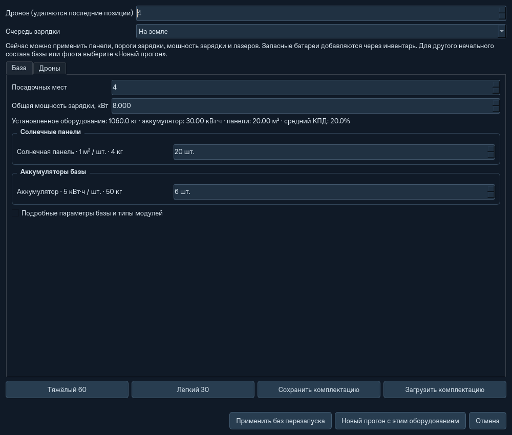
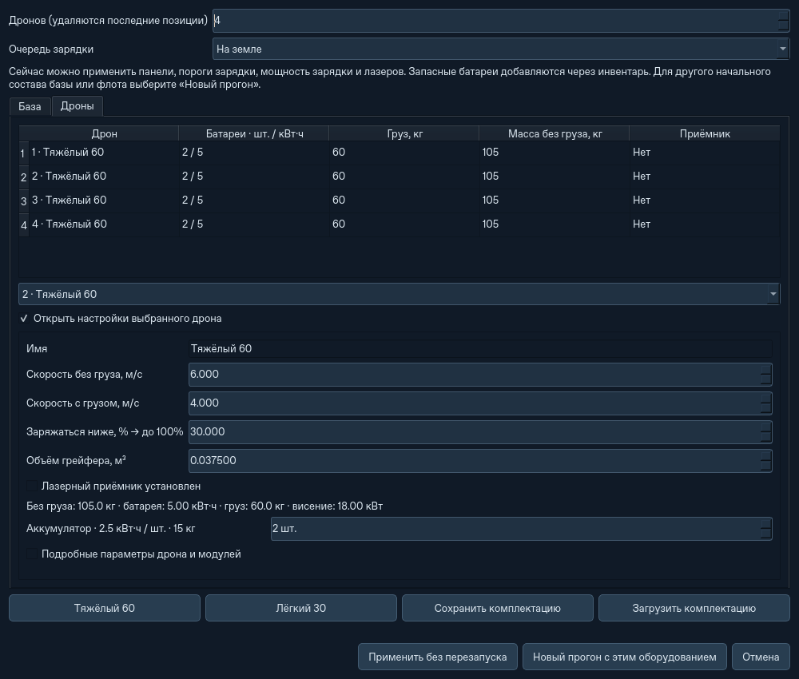
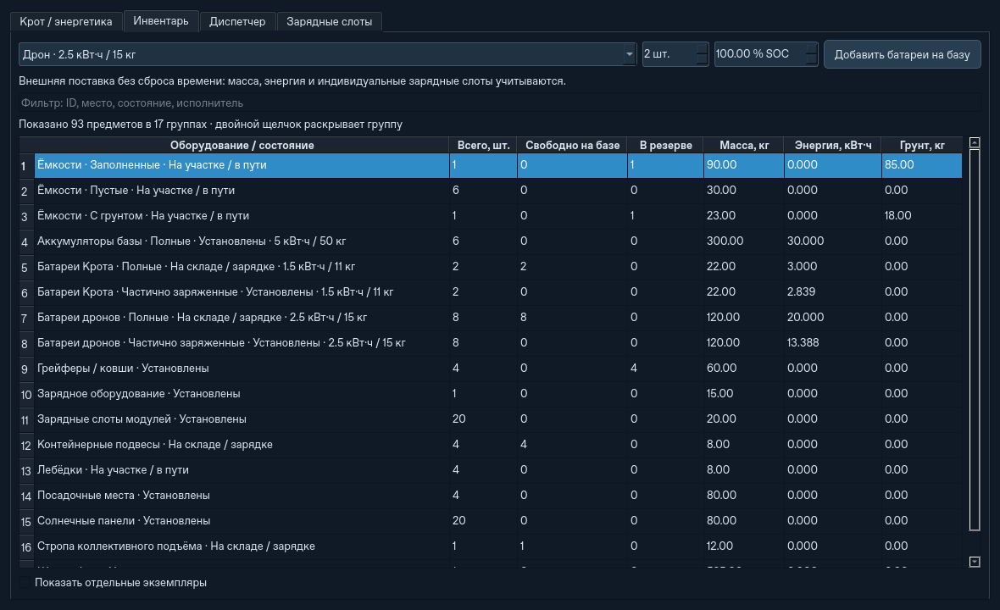
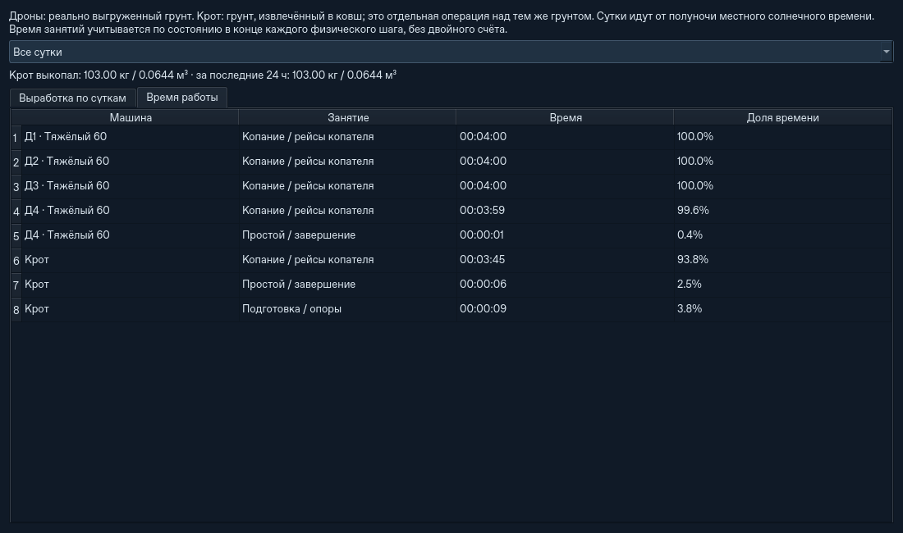

# Компактное оборудование, статистика и ускорение

2026-10-19. Существующий движок ATS 2.0 сохранён; вода и эрозия не добавлены.

## Управление оборудованием

**Оборудование → База** показывает количества панелей, батарей и посадочных мест,
мощность зарядки и сводные площадь/ёмкость/массу установленного оборудования.
Параметры типов, массы, КПД и лазеры раскрывает галочка **Подробные параметры**.
У каждого типа собственный счётчик, поэтому разные ёмкости батарей и разные панели
не сливаются в один условный модуль. Новая стандартная панель — **1 м², 4 кг,
КПД 20%**, батарея базы — **5 кВт·ч, 50 кг**. Начальные 20 м² и 80 кг панелей
сохранены. Загруженные типы остаются прежними, включая панели другого размера.
При изменении площади на целое число панелей одного типа меняется количество;
специальные дробные площади и смеси типов по-прежнему поддерживаются.

**Оборудование → Дроны** открывает общий список. Двойной щелчок либо выбор позиции
и галочка открывают карточку конкретного дрона. В ней доступны количество батарей,
объём грейфера, приёмник, скорости и порог зарядки; подробные характеристики скрыты
отдельной галочкой. Изменение одного дрона не затрагивает остальные позиции.

Применение панелей и разрешённых лимитов без сброса работает как раньше. Для
изменения начального физического состава базы/флота ATS 2.0 есть явная кнопка
**Новый прогон с этим оборудованием**. Кнопка применяет конфигурацию нового мира;
это не горячая поставка. Запасные батареи добавляются в текущую миссию через инвентарь.
Масса склада и снятых инструментов добавляется к массе базы в самой миссии;
редактор отдельно показывает массу установленного оборудования.

## Инвентарь

Склад открывается сводкой групп. Батареи разделены по типу, ёмкости, месту и SOC:
полные, частично заряженные, разряженные (≤10%). Установленные модули отделены от
запаса. Для каждой группы показаны количество, свободные на базе, резерв, масса,
энергия и грунт. Есть группы грейферов, пустой/заполненной тары, подвесов, лебёдок,
панелей, зарядных слотов и прочего оборудования.

Двойной щелчок или **Показать отдельные экземпляры** раскрывает выбранную группу.
Режим **Все экземпляры** возвращает полный список с ID. Фильтр работает и для
названий групп, и для физических полей экземпляров. Группировка только читает
инвентарь: каждый предмет входит ровно в одну группу, резервы и владельцы сохраняются.
По умолчанию таблица отдельных экземпляров не строится и `asdict` для всех предметов
не вызывается.

## Выработка и время

В телеметрии и **Статистике** показано, сколько Крот выкопал в кг и м³: всего,
за сутки и последние 24 часа. Учитывается фактическая масса, извлечённая в ковш,
а не заданная ёмкость ковша или расчётная производительность. Выработка дронов
по-прежнему означает реально выгруженный грунт. Эти операции не суммируются
как независимые объёмы добычи одного материала.

Вкладка **Время работы** показывает время и долю занятий каждой машины: копание,
курьер, коллективный подъём, зарядка, смена батарей и инструмента, перелёт/движение,
подготовка и ожидание. Учёт дискретный, по состоянию в конце физического шага.
Рейсы копателя включают полёт и работу с грунтом; зарядка означает режим зарядки,
в том числе ожидание питания в доке. Каждая секунда относится к одному занятию;
сумма равна времени существования машины в работающей симуляции. Пауза не считается.
Интервал через полночь делится между сутками. История снятых дронов сохраняется.
В JSON добавлены `drones[].activity`, `retired_drones[].activity`,
`excavator.activity`, `excavated_m3`, `daily_excavation` и суточная/24-часовая выработка Крота.

## Что ограничивало ускорение

Прежде GUI запускал расчёт раз в 40 мс и давал ему бюджет 12 мс, после чего
обновлял графики, таблицы и карту. Поэтому высокие цели могли упираться в один
темп задолго до 2000×. Требования поддерживать 60 FPS не было: основной таймер
имел частоту около 25 Гц. Расчёт последовательный; одно занятое ядро на многоядерном
процессоре может выглядеть как небольшая общая загрузка CPU.

Теперь вычислительный таймер может выполнять пакеты подряд, с бюджетом до 30 мс
при высоком ускорении. Отрисовка регулируется отдельно: до 10 Гц при 200× и до
5 Гц при 1000×/2000×. Изменения интерфейса и физика остаются в одном потоке Qt,
между пакетами, без гонок при горячих поставках и смене плана. **Шаг всегда 1 с**:
ни физика, ни ночи, ни зарядка не пропускаются. В строке состояния показаны цель,
измеренный темп и частота обновления. 2000× остаётся целевым максимумом.

Замер: один Linux-хост, Python 3.12.14, PySide6-Essentials 6.12.0, Qt offscreen,
сценарий large / seed42 / карта 64 м / четыре дрона, примерно четыре реальные
секунды на каждый свежий запуск. Сравнение выполнено последовательно, без тестов
параллельно. База сравнения — код `6b8a59d`.

| Выбранная скорость | Было, фактически × | Стало, фактически × |
| ---: | ---: | ---: |
| 50 | 49,76 | 49,75 |
| 200 | 94,08 | 175,15 |
| 2000 | 103,63 | 201,28 |

В последнем случае процесс использовал около одного CPU-ядра, а физические шаги
заняли 3,12 из 3,86 с. Остаточное ограничение — стоимость самого расчёта.
Результат зависит от сцены, сетки и компьютера; замер не обещает такой темп повсюду.

Открытие инвентаря включает создание диалога, первую таблицу и обработку событий.
Обновление — медиана пяти повторов; создание мира не входит в замер.

| Запасных комплектов / дрон | Предметов было / стало | Строк было / стало | Открытие было / стало, мс | Обновление было / стало, мс |
| ---: | ---: | ---: | ---: | ---: |
| 1 | 83 / 93 | 83 / 15 | 31,27 / 29,64 | 7,42 / 5,37 |
| 20 | 387 / 397 | 387 / 15 | 52,55 / 38,74 | 13,90 / 5,17 |
| 64 | 1091 / 1101 | 1091 / 15 | 101,51 / 34,34 | 29,36 / 9,84 |

Разница в десять предметов — представление прежних 20 м² как двадцати панелей
по 1 м² вместо десяти по 2 м², при той же суммарной массе и генерации.
[Полные измерения](ats2/compact-ui-performance.json).

## Проверки

**226 тестов прошли за 164,30 с** на Linux / Python 3.12.14.
[JUnit](ats2/compact-ui-tests-312.xml). После уточнения подписей и ширины полей
повторены 18 проверок интерфейса и статистики.

Новые проверки покрывают реальные количества и сохранение скрытых параметров,
разные типы батарей/панелей, нулевую комплектацию, выбор одного дрона, группировку
без потери массы/энергии/резервов, детализацию без полной сериализации,
полночь, срок существования/снятие дронов, выработку Крота и независимость
вычислительных пакетов от перерисовки. Прежние тесты сохраняют проверки грунта,
энергии, диспетчера, лазера, смены ролей, кисти и масштабирования.

Контрольные миссии на карте 64 м завершились в прежние моменты:
ATS 2.0 — **1259 с**, строгая логистика — **3861 с**.
Крот выкопал соответственно **412,00** и **1176,33 кг**; учёт времени каждой машины
равен времени миссии. Ошибка массы — 0 кг, ошибка энергии меньше 0,000001 Дж.
