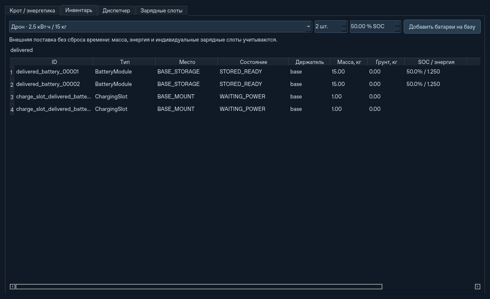

# ATS 2.0 по умолчанию: партия курьера и живой инвентарь

2026-10-19. Расширение существующего приложения; вода и эрозия не добавлены.

## Запуск и управление

```bash
python -m ats
python -m ats --preset medium --panel-area 100 --drone-spare-sets 2
python -m ats --headless --preset medium --panel-area 200 --steps 345600 --json mission.json
```

Обычный запуск открывает ATS 2.0: Крот, четыре дрона, восемь ёмкостей,
индивидуальные зарядные слоты, карта 64 м. Старый движок скрыт из окна экспериментов,
но сохранён для регрессионных проверок и явного `--mode legacy`. Программный
`Config()` по-прежнему совместим с прежним движком. Загруженные настройки ATS 2.0
сохраняются; прежние планы и конфигурации без логистики открываются в ATS 2.0,
если старый режим не указан явно.

**Новый эксперимент** позволяет задать площадь панелей числом, число дронов,
тару, запас батарей и стратегию. **База и солнце → Применить площадь панелей сейчас**
меняет площадь в текущем мире. Сохраняются рельеф, часы, заряды, полёты и задания.
Плотность массы и КПД существующих панелей сохраняются. После полного снятия панели
можно установить снова: новая установка по умолчанию имеет 4 кг/м² и КПД 20%.
Поле больше 20 м² требует свободного места и 300 с развёртывания при расходе
200 Вт. До окончания развёртывания генерации нет. Геометрически невозможная
установка и изменение панелей при движении базы отклоняются без изменения мира.

## Диспетчер партии

Все дроны начинают с установленными грейферами и сразу получают работу копателей.
Пустые ёмкости находятся у Крота с начала миссии. Курьер не резервируется постоянно.

- Порог партии: округлённые вверх ¾ всех ёмкостей, для восьми — шесть.
- Второй триггер: SOC установленного банка Крота ниже 10%.
- Один выбранный дрон завершает свою выгрузку, возвращается в реальный сервисный
  док и физически меняет грейфер на подвес за 45 с с расходом энергии.
- Курьер последовательно обслуживает ёмкости и батареи; остальные копают.
  Его собственный запрос зарядки выполняется до 100%; при необходимости готовый
  аппарат принимает роль, не создавая второго одновременного грузового задания.
- Когда очередь обслужена, курьер возвращает грейфер и снова копает.

Последняя неполная партия вывозится при завершении выемки и запросе посадки.
Диспетчер также разрешает обслуживание, если продолжению мешает отсутствие тары,
необходимость переезда/переноса либо энергетический запас на полный цикл.
Это предотвращает ожидание недостижимого порога. Совместный перенос Крота сохраняет
проверки всей команды, массы, нагрузки и энергии.

Прежний порог остановки Крота выше 20% заменён для этой стратегии на
`max(10% ёмкости, энергия полного цикла)`. Предварительная доставка батарей выше
10% не запускается, пока партия не активна. Если запасных модулей нет, Крот ждёт,
а независимые копатели продолжают работать. Политика задаётся `batch_courier`,
`courier_fill_fraction`, `courier_low_soc`. Прежняя политика доступна через
`--courier-strategy responsive`, строгие перевозки — через `--no-idle-digging`.

## Поставки без перезапуска

**Склад / диспетчер → Инвентарь**: выберите существующий тип батареи дрона или
Крота, количество 1–128 и SOC 0–100%, нажмите **Добавить батареи на базу**.



Поставка создаёт новые физические ID и собственные слоты. Прежние предметы,
резервы и назначения сохраняются. Энергия записывается как внешний ввоз,
вместе с массой батарей и контроллеров; начальный энергетический бюджет не меняется.
Пустые модули используют обычную конечную зарядку, полные доступны для реальной
механической замены. Отчёт содержит `battery_deliveries`, счётчик поставок,
ввоз энергии и массы. Вызов API:

```python
world = sim.logistics
template = sim.drone.battery_ids[0]
world.replenish_batteries(template, count=2, soc=0.5)
sim.set_panel_area(100)
```

Поставка — внешнее прибытие непосредственно на базу; отдельная доставка извне
карты и её транспортные расходы не моделируются. Смена батарей и дальнейшие
перевозки требуют обычного времени и энергии. Runtime-поставки не меняют
начальные настройки запаса: Reset не повторяет поставки предыдущей миссии.
Конфигурация сохраняет параметры нового прогона, а не checkpoint текущего мира.

## Проверки

**215 тестов прошли за 174,60 с** на Linux / Python 3.12.14 / PySide6-Essentials
6.12.0. [JUnit](ats2/primary-strategy-tests-312.xml).

GitHub Actions прошёл на **Ubuntu и Windows с Python 3.11 и 3.12**:
в каждом задании **215 тестов**, затем прежний CLI, запуск ATS 2.0 по умолчанию
и строгая логистика с реальными заменами батарей и проверкой балансов.
Код `4a6e1ee0f2132de38a968c1bb945f347f2ef061d`.
[CI](https://github.com/TopoLM21/Autonomous-Terraforming-Simulator-ATS-/actions/runs/39264643893),
[протокол](ats2/primary-strategy-ci-results.json).

| Окружение | Тесты | Время, с |
| --- | ---: | ---: |
| Ubuntu, Python 3.12 | 215 passed | 145,55 |
| Ubuntu, Python 3.11 | 215 passed | 202,72 |
| Windows, Python 3.12 | 215 passed | 222,22 |
| Windows, Python 3.11 | 215 passed | 217,50 |

Набор включает 24 новые проверки: запуск по умолчанию,
четыре работающих копателя до порога, ровно один курьер при 6/8 и SOC <10%,
реальные смены инструмента и батарей, возврат к копанию, завершение неполной партии,
поставки во время полёта и их атомарная валидация, отсутствие бесплатной энергии,
восстановление строгой логистики после поставки, горячая площадь и невозможная
геометрия, JSON/CLI и реальные кнопки Qt. Существующие тесты проверяют прежнюю
физику, кисть, масштабы карты, лазер, резервирование и коллективный подъём.

CLI: новый запуск на карте 64 м завершился за **1259 с**, строгая логистика —
за **3861 с** с реальными заменами батарей дронов и Крота.

## Контрольные миссии

Seed 42, поле 32 м, ячейка 0,25 м, четыре дрона, восемь ёмкостей, один запасной
комплект на дрона, два запасных модуля Крота, лазер выключен. В последней строке
на 300-й секунде поставлены восемь дроновых и два модуля Крота с SOC 100%:
это **23 кВт·ч дополнительной внешней энергии** и 152 кг вместе со слотами.

| Сценарий / стратегия | Панели, м² | Поставка, кВт·ч | Миссия, с | Расчёт, с | Замены дронов / Крота |
| --- | ---: | ---: | ---: | ---: | ---: |
| demo / партия | 20 | 0 | 1259 | 2,55 | 0 / 0 |
| medium / партия | 20 | 0 | 19183 | 21,38 | 10 / 1 |
| medium / партия | 200 | 0 | 8144 | 17,05 | 12 / 0 |
| medium / прежнее обслуживание | 20 | 0 | 26368 | 22,92 | 11 / 2 |
| medium / партия и поставка | 100 | 23 | 6096 | 10,68 | 12 / 0 |

Все пять миссий завершились. В medium курьер впервые вызван на **1090-й секунде
при шести заполненных ёмкостях**. При новой стратегии все четыре дрона выполняли
копание, максимум один одновременно выполнял перевозку. В demo вывезена последняя
партия из четырёх ёмкостей. Масса грунта сохранилась точно, максимальная ошибка
энергии — **1,51 × 10⁻⁶ Дж**. [Метрики и события партий](ats2/primary-strategy-comparison.json).

Время расчёта измерено на одном Linux-хосте без GUI; оно зависит от нагрузки.
Сравнение политик включает разную начальную расстановку тары и инструментов.
Строка с поставкой имеет увеличенный энергетический запас. Это контрольные
детерминированные сценарии, а не обещание одинакового ускорения на любом плане.
