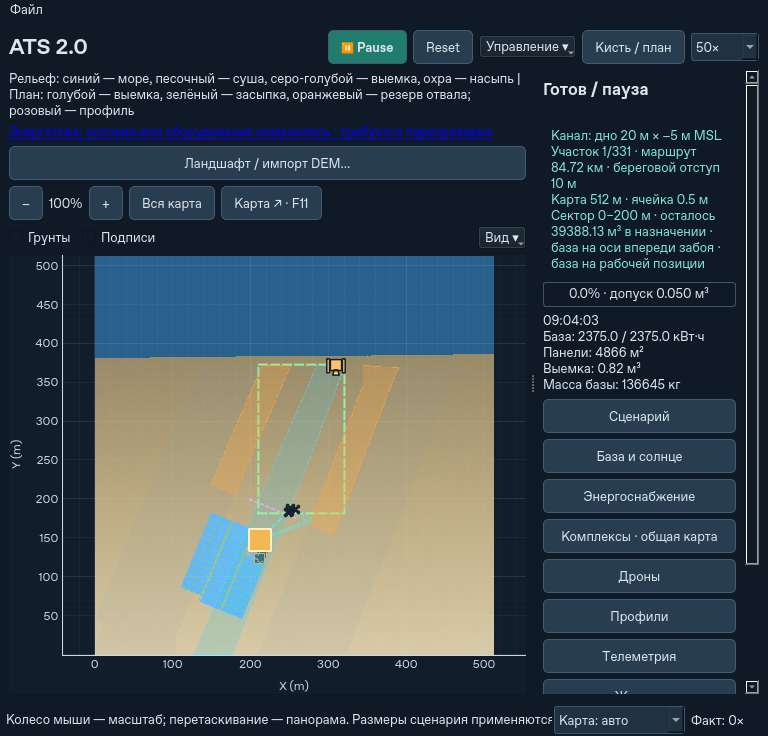

# База на оси будущего канала

7 ноября 2026. Этап поверх `91b6ade`, без изменения балансов грунта или энергии.

## Как включить

В **Управление ▾ → Ландшафт / импорт DEM… → Стоянка базы** доступны:

- **На оси · впереди забоя** — выбор по умолчанию для нового проекта GUI.
- **Сбоку от канала** — прежняя стоянка сбоку от середины рабочего сектора.

Выберите режим, затем **Разметить канал → Начать копание выбранного участка**.
При открытии старого проекта отображается его прежний режим. Изменение этого
поля создаёт новый проект; работающая техника при этом не переставляется.

Headless сохраняет прежний выбор по умолчанию. Для новой осевой миссии:

```bash
python -m ats --headless --qattara \
  --channel-route docs/ats2/qattara-channel.json \
  --base-strategy axis_ahead --cut-policy natural --airspace shared_lanes \
  --steps 120 --save-state axis.atsstate --json axis.json
```

Режим можно также записать в JSON маршрута как `"base_strategy": "axis_ahead"`.
Значение `bank` сохраняет боковые стоянки.



## Где стоит и когда едет

«На оси» относится к поперечному положению базы. По длине она стоит **впереди
рабочего сектора**, на нетронутой опоре. Копать под ней запрещает геометрия
рабочего фронта. После завершения и вывоза грунта сектора база физически
переезжает, а прежняя опорная площадка входит в следующую выемку.

Сектора остались фиксированными, по 200 м с последним коротким остатком.
Небольшое продвижение забоя внутри сектора не вызывает сборку панелей.
Складывание, движение и раскрытие используют прежнюю механику, расходуют время
и энергию. Крот продолжает собственные локальные перемещения. Не начатый
перенос Крота отменяется, если дроны уже завершили его текущий сектор; начатая
групповая операция должна закончиться.

Проверяется весь транспортный и раскрытый габарит: носители, крылья и ход
раскрытия PV, батарейные опоры, рабочие проходы, посадочные места и площадки
ожидания. Нельзя занимать воду, насыпь или резерв отвала, раскопанный грунт,
путь чужой техники либо опасный откос. Дальность до краёв сектора проверяется
через прежний энергетический планировщик, каждый рейс — отдельно с грузом.

Торцевой откос проверяется по консервативному выносу: перепад до проектного
дна делится на тангенс самого слабого угла исходного/рыхлого грунта в модели;
добавляются две ячейки и габариты оборудования. Это упрощённый критерий,
без сцепления или прочности скального массива. Поперечная ширина канала
не прибавляется к продольному отступу обычного сектора. На поворотах проверяется
расстояние в пространстве до прежней выемки; одной величины пикетажа недостаточно.
У настоящего конца проекта сохраняется округлый торец исходного плана.
Ячейки под опорами не замораживаются, закон осыпания не изменён.

На широком канале допускаются дополнительные ряды стоянок внутри будущего
дна, если полностью помещаются носители и проезды. За последним сектором
используется сухая площадка продолжения оси. Если места, проезда или запаса
энергии не хватает, возникает понятная блокировка; скрытого перехода к частым
коротким переездам или бесплатного перемещения нет.

## Несколько комплексов

Осевые комплексы делят **один текущий сектор**. Выемка каждого сектора
распределяется по объёму, свободная команда может помочь соседней. Следующий
сектор разрешается только после завершения работ и вывоза грузов всей группой.
Передняя база выезжает первой, затем следующие; реальные коллизии остаются
включены. Пока все базы не прибыли, новые захваты грунта запрещены. Зарядка,
обслуживание, часы и энергетика продолжают рассчитываться.

Новые комплексы добавляются на нетронутый участок впереди общего фронта.
Добавление во время перестановки группы отклоняется с объяснением.

## Граница окна

Переход в соседнее окно остаётся явной командой в диалоге ландшафта. Если
конечная стоянка следующего сектора ещё не входит в старое окно, разрешена
**промежуточная остановка в перекрытии**, впереди уже отработанного забоя.
Физический переезд и безопасное переключение координат сохраняются.

После переключения окна группа проходит оставшийся путь к конечным
стоянкам. До этого следующий сектор не копается, даже если панели уже
раскрылись на промежуточной площадке. Сохранение на этой стадии сохраняет
прежнюю границу безопасной опоры, а не превращает остановку в рабочую базу.
Если полного комплекса нет в перекрытии, переход по-прежнему отклоняется.

Вернуться в сохранённое окно можно при наличии безопасного пути и опоры.
Завершённый канал не становится проездом по дну: раскопанный грунт остаётся
запрещён для этих стоянок. Это ограниченный режим существующих окон,
не полностью скользящая карта.

## Совместимость и проверка

Проект осевого канала имеет версию 3. Идентификаторы проектов версий 1/2
сохраняются; при отсутствии нового поля выбирается `bank`. `.atsstate` v19
читает v1–18, `.atsregion` v8 читает v1–7. Старые файлы не переписываются.
Обратное чтение новых осевых файлов старой программой не поддерживается.

```bash
python -m pytest -q
python -m pytest -q tests/test_axis_stations.py tests/test_axis_station_ui.py
python scripts/benchmark_channel_space.py --base-strategy axis_ahead \
  --procedural --output axis-start.json
```

Проверки охватывают обычную работу, реальный переезд, освобождение прежней
опоры, общий фронт/очередь двух баз, нехватку места, поворот рядом с прошлой
выемкой, естественное осыпание слоёв, устаревший приказ Крота, отмену подготовки,
сохранение в пути и на промежуточной остановке, A→B→A, поштучный инвентарь,
состав грунта и энергетический баланс. Отдельно проверен реальный GUI-старт
прибрежной Каттары с 45 носителями, раскрытием PV и восстановлением снимка.

Итог 7 ноября: **800 тестов прошли**, затем повторно 53 проверки осевого/
регионального поведения и 35 проверок прибрежной геометрии/GUI после финального
уточнения торцевого контура. Прошли все 32 команды/проверки CLI из workflow
и 4 новых для двух осевых комплексов с точным продолжением снимка.
[Результаты восстановления и повторной проверки](axis-stations-validation.json).

Контроль прежнего режима на одном снимке 14 комплексов / 56 дронов, слоистая
сетка 512² × 1 м, 20 м² PV на комплекс, шаг 1 с: два прогона по 120 с до/после.

| Режим | `91b6ade` | После изменения |
|---|---:|---:|
| Без GUI, медиана фактора | 52,9× | 55,9× |
| Qt offscreen, медиана фактора | 47,0× | 46,8× |

Хеш полного физического отчёта одинаков во всех восьми прогонах. Это короткий
контроль отсутствия регрессии, не обещание ускорения и не замер FPS Windows.
Большой солнечный комплект проверяется отдельно, а не подменяется этим
облегчённым контрольным снимком. Подготовка сложного наземного маршрута
остаётся синхронной. Зависания после 23 модельных часов этим этапом не
воспроизводились и не объявляются устранёнными.

Осевое положение не гарантирует минимальной длины рейса для любого канала:
при узком дне отступ от торцевого забоя может оказаться длиннее пути с боковой
стоянки. Поэтому оба режима доступны. Здесь нет оптимизатора размещения,
который автоматически выбирал бы лучший из них.

На реальном прибрежном DEM Каттары с одинаковыми 45 носителями, 4866 м² PV,
2375 кВт·ч BESS и процедурными неровностями получены следующие расстояния:

| Дно / глубина ниже MSL | Окно в обоих режимах | Среднее до выемки сбоку → на оси | Максимум сбоку → на оси |
|---|---:|---:|---:|
| 20 / 5 м | 512 м | 222,1 → 156,3 м | 247,6 → 267,5 м |
| 250 / 10 м | 1024 м | 460,2 → 183,3 м | 587,3 → 298,9 м |

Это горизонтальные расстояния от фактических посадочных мест к равномерной
выборке ячеек текущего сектора в начальной расстановке. Они не включают набор
высоты, второй участок до отвала, погрузку, очередь и зарядку. Средний маршрут
улучшился; до дальнего края узкого сектора он немного вырос, поэтому проверка
энергобюджета остаётся необходимой. Начальная подготовка осевого комплекса
заняла 5,6 с / 10,9 с соответственно; пиковый RSS отдельного процесса около
394 / 391 МиБ. Это две конкретные карты, а не верхние оценки памяти.

Отдельный контроль осевой Каттары с 45 носителями, слоистым грунтом и
процедурными неровностями: два прогона начальных 120 модельных секунд,
медиана 32,0× без GUI и 21,7× Qt offscreen. Максимальная пауза доставки
событий GUI — 0,90 с; однотипный физический отчёт совпал во всех четырёх
прогонах. Отклик ещё не ограничен временем одного кадра: этот этап не
переносит планировщик маршрутов в фон.

## Восстановление перед публикацией, 9 ноября

Среда с неопубликованным локальным `dd724fd` была заменена. Производственные
изменения и тесты восстановлены из журнала той же задачи поверх `91b6ade`.
Контрольные Git-отпечатки `regional.py`, `shared_site.py` и промежуточного
`simulation.py` совпали с записанными 7 ноября. Снимок интерфейса и результаты
полного набора/CLI получены заново; прежние таблицы выше относятся к замерам
7 ноября. Функциональность этапа не расширялась. Восстановленный коммит имеет
новый SHA; отсутствие прежнего локального объекта не скрывается.
