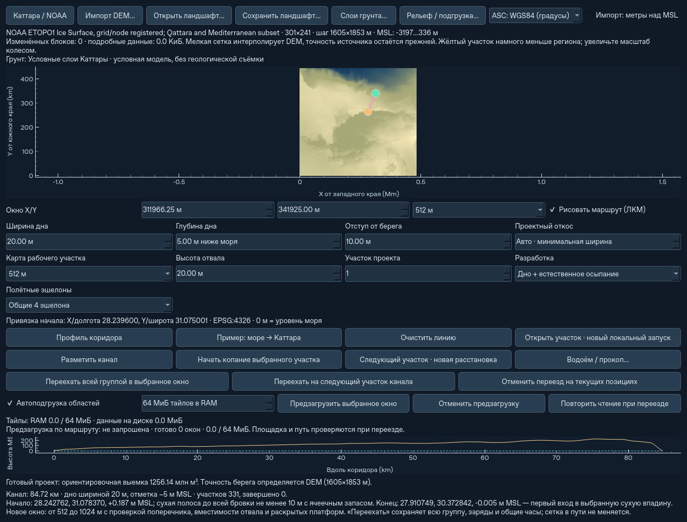

# Широкий канал, береговая бровка и размещение базы

Этап поверх `8ddf94d`, 6 ноября 2026. Реализованы проверки места и новый
отсчёт берегового отступа. Размещение базы впереди забоя ниже описано как
следующий возможный режим; в этом этапе оно не включается.

**Обновление 7 ноября:** следующий этап уже реализовал осевые стоянки,
общий фронт группы и промежуточную остановку у границы рабочего окна.
[Текущие правила и проверки](axis-stations.md).

## Что изменилось

В **Ландшафт / импорт DEM…** размер рабочего участка теперь является
предпочтительным размером **новой расстановки**. Если выбранный участок не
подходит, новый проект пробует следующие размеры вплоть до **1024 м**.
Проверяются:

- Поперечник в районе рабочей стоянки: ширина дна плюс откосы от местной
  поверхности до отметки дна MSL. Числовой проектный угол, слоистый точный
  профиль и консервативный контур естественного осыпания учитываются отдельно.
- Реальная вместимость боковых отвалов с осыпаемыми бортами и заданным
  запасом, а не только наличие хотя бы одной клетки отвала. При недостатке
  сообщаются требуемый и доступный объёмы.
- Полный транспортный и раскрытый габарит оборудования, крылья PV, опоры,
  рабочие проходы, посадочные места и зоны ожидания. Центр базы на суше сам
  по себе не подтверждает пригодность площадки.

Обычная растровая маска проекта и существующие проверки грунта, воды,
проходимости и полётной энергии сохраняются. Пробный поперечник — проверка
габарита исходного регионального рельефа, а не второй баланс грунта или точная
инженерная съёмка. Он использует 4097 отсчётов; фактическая целевая поверхность
и занятость рассчитываются прежним движком на рабочей сетке.

Перед выездом проверяются также настоящие координаты собственных дронов,
ожидающих на земле: корпус базы не может проехать сквозь них между двумя
свободными конечными точками. Если дрон сел после выбора пути, текущая
подготовка переезда освобождается для повторного выбора пути. Техника и заряд
не переставляются мгновенно. Дроны, уже состыкованные с базой, перевозятся
существующим механизмом.

Пример: на контрольном синтетическом берегу канал шириной 20 м, глубиной 5 м
MSL и исходным окном 32 м получает окно 128 м. В этом примере используется
малый комплект с 20 м² панелей без модульных PV-носителей. При этом не меняются ID проекта,
его разбивка по длине, накопленный прогресс, количество оборудования и грунт.
В `georeference.channel.window_fit` записаны запрошенный/действительный размер,
ячейка, поперечник и проверенная вместимость отвала.

Автовыбор не меняет сетку действующей симуляции. Явно указанное окно и
физический региональный переезд сохраняют размер, разрешение и требования
перекрытия. При недостатке места возвращается понятная ошибка до начала
переезда/земляных работ. Полностью наблюдаемый глобальный сектор по-прежнему
подтверждается механизмом `sector_progress`; обрезанный поперечник не считается
законченным. Максимальный размер активного окна остаётся 1024 м. Несколько
километров потребуют отдельного выбора укрупнения ячейки и расширения
нынешних ограничений хранения состава; этот этап их не меняет.

## Береговой отступ

В новом проекте введена защита **всей верхней бровки**: между морем и любым
изменяемым грунтом остаётся сухая полоса не уже заданного отступа, с запасом
двух расчётных ячеек. Расстояние на сетке консервативно при диагональном берегу.
Защита включает боковой и продольный откос. Достижение полной глубины
происходит дальше от берега после спуска откоса; осевая отметка маршрута не
означает мгновенный выход на полную глубину.

Прежняя защита воды уже существовала, но отступ по оси не защищал весь широкий
косой поперечник. На синтетическом стенде с вертикальным берегом x=79,5 м
при заданных 10 м прежний край изменяемой ячейки доходил до берега. Новый
режим проверяет всю ячейку, включая её край, и сохраняет минимум 10 м суши.

Откос от защищённой полосы опирается на её настоящие исходные высоты, включая
сухую возвышенную бровку. Максимальная линейная свёртка по восьми соседям
вычисляет ограничивающую поверхность за O(число ячеек), без повторной
релаксации всей карты на каждый метр отступа. Это ограничение проекта;
существующее физическое осыпание материалов остаётся отдельным расчётом.

Расчёт читает исходный ландшафт с окружением за пределами рабочего окна.
Достаточная ширина окружения ограничивается глубиной, углом, береговым
отступом и верхней оценкой изменения исходных высот. Поэтому после ухода
моря за край окна защита не исчезает. Одинаковые мировые клетки в перекрытии
получают одинаковые ограничения; грунт не становится новым заданием из-за
смены окна. При далёком море используется пустая защита без подробного чтения.

Подготовка ограничена сеткой с окружением 2048×2048; неподходящие крайние
параметры диагностируются. Это отдельная временная память проектирования,
а не лимит RAM файлового кэша Landscape. Рабочие маска и высотный предел
сжимаются в JSON-совместимые данные плана с привязкой к мировому началу
и ячейке. Производный распакованный кэш в снимок не попадает.
Изменений высот, состава, энергии или инвентаря эта подготовка не делает.
Полностью закрытая береговой защитой трасса в текущем окне диагностируется
до поиска площадок; пустая выемка не приводит к ошибке редукции массива.

Точность береговой линии ограничена исходным DEM и расчётной ячейкой.
Вода и эрозия по-прежнему не вмешиваются в рабочую землеройную миссию.

## Совместимость

Новый проект канала имеет версию 2 и `shore_reference=crest`. Прежние проекты
версии 1 сохраняют `axis`, геометрию, прежний ID и целевой профиль. Открытие
такого проекта в диалоге и повторное нажатие «Разметить» с прежними параметрами
не создаёт вместо него новый проект. Изменение геометрии создаёт новый проект
по прежним правилам; уже изменённый ландшафт остаётся в Landscape.

Снимок `.atsstate` версии **18** читает версии **1–17**. Регион с новым
береговым проектом использует `.atsregion` **7**, читаются **1–6**.
Гидрологический формат не меняется. Старые файлы при чтении не переписываются.

## База на будущей трассе — оценка следующего режима

Сейчас `_sector_site_safe`, `safe_layout_route`, размещение солнечных крыльев
и проходов исключают **весь** проектный контур `design_work`. Участок будущего
канала поэтому закрыт для базы, даже если грунт там ещё цел. Простая замена
точки стоянки не создаёт работоспособного нового порядка разработки.

Возможен режим **«впереди забоя»**:

1. Выбрать стоянку на ненарушенном грунте впереди рабочего сектора. Отступ
   учитывает полный раскрытый комплекс и возможный откос забоя; для глубокого
   канала одного зазора в несколько метров недостаточно.
2. Зарезервировать опорную площадку и путь вперёд для всей группы. Текущие
   задания дронов и Крота не должны разрабатывать эту зону. Прогноз осыпания
   должен исключать подкоп стоянки с соседних ячеек; запрета забирать грунт
   непосредственно под гусеницами недостаточно.
3. Полностью вывезти грунт позади стоянки, сложить оборудование и физически
   переехать на следующую площадку. Старую площадку освободить для копания
   только после ухода всех носителей и безопасного завершения обслуживания.
4. Для конца проекта, препятствия, нехватки места или энергии иметь явную
   остановку/боковую стоянку. Несколько комплексов должны резервировать общую
   трассу и пропускать друг друга без пересечения полных габаритов.

Пример масштаба: при высоте забоя 20 м и условном угле 32° горизонтальный
откос занимает около 32 м. Для поля длиной 108 м к этому прибавляется примерно
54 м от центра до края и технический зазор. Дроны при передней стоянке могут
летать дальше до начала сектора; их энергобюджет потребуется перепроверять.

Существующие 200-метровые сектора полезны и здесь, но текущий контроллер
требует полного завершения сектора перед штатным переездом. Ему понадобится
отдельное состояние передней стоянки и освобождения опорной зоны. Механизмы
физического складывания, маршрутов, инвентаря и сохранений можно использовать
повторно. Многокилометровый streaming или новый физический движок для этого
сам по себе не требуется.



## Проверка

```bash
python -m pytest tests/test_channel_space.py tests/test_channel.py \
  tests/test_window_boundaries.py tests/test_coastal_compact.py tests/test_regional.py -q
python -m pytest -q
```

**786 тестов прошли** на Linux / Python 3.12.14 / NumPy 2.5.4 / PySide6 6.12.0.
Полный набор выполнен тремя независимыми процессами: 60 + 364 + 362 теста,
общее реальное время 313,90 с. Добавлено 18 случаев в `test_channel_space.py`.
Проверены береговой отступ всего контура, разные высоты бровки, старый ID,
прежние проекты в UI, отсутствие работ внутри охранной полосы, вместимость,
полные габариты, ожидающие дроны, сохранения, увеличенная сетка и A→B→A.

Прошла **41 команда проверки CLI**: 10 прежних групп (32 команды), точное
продолжение естественной выемки и встречного солевого обмена (6 команд),
а также расширенный канал с сохранением/продолжением, совпавшим с непрерывным
прогоном (3 команды). В реальном Qt offscreen проверен прибрежный комплект
45 платформ; весь диалог помещается в 1250×950 пикселей. Windows / CI для
этого локального этапа не запускались.

Холодный старт прибрежного комплекта Каттары, 45 платформ, 4866 м² PV,
окно 512 м / 1024² ячеек по 0,5 м, в отдельных процессах:

| Исходный ландшафт | Старт `8ddf94d` → новый, с | Пиковая RSS до → после, МиБ |
|---|---:|---:|
| DEM без процедурных деталей | 4,53 → 4,67 | 372 → 393 |
| DEM с обычными процедурными деталями | 4,97 → 6,13 | 371 → 394 |

Это одиночные измерения всей подготовки и создания `Simulation`, без Qt.
Пик RSS включает весь процесс, а не только кэш тайлов. Береговая защита
добавляет около 1,2 с к запуску с процедурными деталями на этой машине;
подготовка проекта остаётся синхронной. Сжатый береговой пакет на данном
стенде занимает около 0,3 МиБ. После старта высоты и маска берутся из кэша,
окружающий DEM заново на каждом физическом шаге не читается. Новая береговая
цель отличается от прежней намеренно; побитовая эквивалентность этих двух
новых миссий не заявляется.

Контроль физического шага: **один и тот же** старый снимок 14×4, 20 м² PV
на комплекс, без модульных PV-носителей, 512² ячеек по 1 м. За 120 модельных
секунд медиана без GUI — **3,264 → 3,259 с** (по два повтора), Qt offscreen —
**3,909 → 3,843 с** (по четыре). Разброс GUI составлял 3,60–4,19 с, поэтому
это проверка отсутствия заметной регрессии на малом стенде, не обещание
ускорения. Все физические отчёты до/после совпали по SHA-256. Максимальный
интервал между Qt-событиями в этом контроле — около 0,136 с.

```bash
python scripts/benchmark_channel_space.py --output startup.json
python scripts/benchmark_channel_space.py --procedural --output startup-procedural.json
# Для старой версии передайте --root с отдельным checkout 8ddf94d.

python scripts/benchmark_world_terrain.py --runtime-fixtures fixtures
python scripts/benchmark_runtime.py --state fixtures/world14-work.atsstate \
  --steps 120 --trials 2 --mode both --offscreen --output runtime.json
```

Для сравнения физического шага используйте один снимок в обоих checkout.
[Числа, версии, хэши и результаты проверок](channel-space-validation.json).
Короткий offscreen-прогон не является измерением FPS пользовательского
рабочего стола и не подтверждает устранение прежних зависаний после
23 модельных часов.
