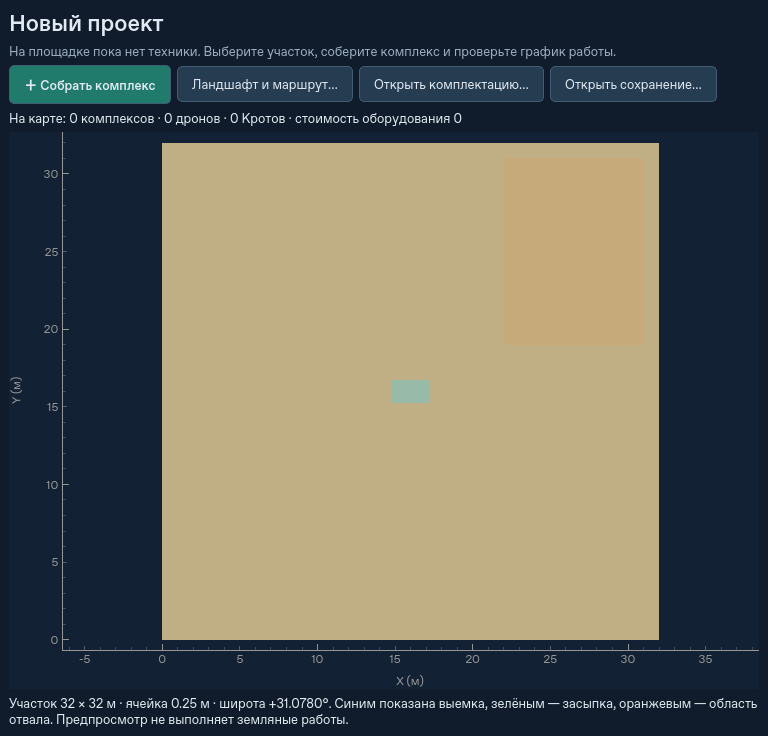
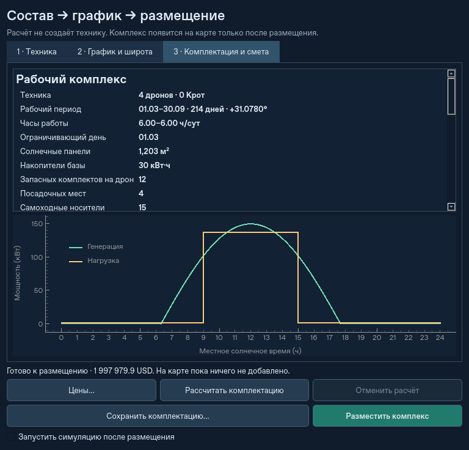

# Пустая площадка, сборщик комплекса и рабочий календарь

Обычный `python -m ats` открывает площадку без `Simulation`, базы, дронов,
Крота и физического инвентаря. Есть только настройки участка и предпросмотр
рельефа. Исходная широта — 31,078°; для географического DEM она берётся
из координат участка. Ранее сохранённая миссия открывается непосредственно
в рабочем интерфейсе со своим временем, техникой и грунтом.



## Порядок работы

1. При необходимости откройте **«Ландшафт и маршрут…»**, выберите DEM,
   участок и план канала. В пустом проекте эта команда готовит участок,
   не создавая незаметно базу. Региональный переезд доступен после размещения.
2. **«＋ Собрать комплекс» → «Техника»**: количество дронов 1–16,
   предложено 4. Количество Кротов — 0–10; смешанная команда требует минимум
   двух дронов. Для Кротов сборщик предлагает по 8 ёмкостей на машину;
   это общий запас, его можно изменить до размещения.
   **«Подробные параметры…»** открывает прежний редактор модулей.
3. **«График и широта»**: период включительно, в том числе через Новый год;
   готовые варианты март–сентябрь, полгода от выбранной даты, весь год.
   Календарь модели содержит 365 дней. Время — местное солнечное.
4. Выберите круглосуточную работу, фиксированную дневную смену или весь
   световой день. Поле часов — минимальная длительность фиксированной смены
   даже в самый короткий день выбранного периода. Если она не помещается
   в световой день, расчёт сообщает дату и предлагает уменьшить смену.
5. **«Рассчитать комплектацию»** выполняет подбор в фоне. Просмотрите состав,
   массу, раскрытый габарит, контрольный день, суточный график и смету.
   Можно отменить расчёт или сохранить `.atstemplate`, не создавая технику.
6. **«Разместить комплекс»** проверяет действительные контуры оборудования,
   грунт, воду, выемку, отвал и соседей. Автовыбор ищет безопасную стоянку;
   ручная точка не заменяется другой молча. Недостаток места даёт ошибку,
   а не отключает коллизии. Установка на существующий DEM не меняет его
   разрешение ради размещения. После доставки можно автоматически включить
   ход симуляции или оставить паузу.

В рабочем окне **«＋ Комплекс»** открывает тот же сборщик для добавления
следующего комплекса на общей карте, до прежнего лимита 20 баз. Для увеличения
площадки техника безопасно завершает рейсы и садится; отмена возвращает прежние
команды. Общий грунт и модельное время сохраняются. Вместимость карты и
площадь раскрытия проверяются; 20 максимальных комплексов не обязаны помещаться.
Кнопка **«Энергоснабжение»** для нового календарного комплекса показывает
принятый расчёт, не предлагает незаметно заменить его круглосуточным.
Прежние ручные редакторы и окна инвентаря доступны во время работы.

## Как считается работа и энергия



Смена фиксированной длины расположена симметрично солнечному полудню;
«весь световой день» следует восходу и закату существующей солнечной модели.
Календарь повторяется ежегодно. Вне периода или смены диспетчер не начинает
новую выемку, рейс или перенос Крота. Уже взятый груз безопасно довозится,
незавершённая операция заканчивается, техника возвращается; зарядка,
обслуживание и физический ход времени продолжаются. Конец смены не обрезает
полёт, материал или расход энергии. В отдельных сценариях подготовка стоянки
и безопасное перемещение базы могут продолжаться как обслуживание.

Подбор использует существующие `power_design`, `base_layout`, `winter_power`
и батарейный инвентарь. Каждая дата периода проверяется на двух последовательных
суточных циклах: баланс энергии, ночной запас, восстановление заряда,
мощность преобразователя и сервисных платформ, оборот сменных комплектов.
Начальные полные батареи сами по себе не подтверждают повторяемую автономность.
Панели и BESS покрывают суточный цикл, а не запас электричества на полгода.

Исходные допущения видны в **«Параметры расчётной нагрузки»**: 80% рабочего
времени дрона в полёте с полным грейфером, 95% загрузки Крота, 80% модельного
солнечного прихода, 30% запаса суточной энергии, 20% резерва BESS. Собственные
потребители работают и вне смены. Применяются прежние потери зарядки,
ограничения мощности, масса и габариты носителей. Это расчётный профиль,
а не обещание фактической производительности или любой погоды. Полярная ночь
и другие дни без солнечной генерации дают явный отказ для повторяемого
солнечного режима; новый источник энергии автоматически не добавляется.

Предел числа базовых аккумуляторных модулей увеличен с 1000 до 10 000,
чтобы разрешить расчёт для 16 тяжёлых дронов. Это программный предел;
нагрузка шасси, число носителей, место и мощность всё равно проверяются.

## Ориентировочная стоимость

**«Цены…»** содержит редактируемые цены 19 категорий оборудования. Начальные
USD-значения — условные допущения модели, не предложения поставщиков.
Можно выбрать USD, RUB, EUR или условные единицы; курс не подставляется,
при смене валюты цены следует ввести самостоятельно.

Смета отдельно учитывает рамы, грейферы, рабочие и сменные батареи, панели,
шасси, приводы раскрытия, BESS и сервисные шкафы, зарядные контроллеры,
посадочные места, силовую коммутацию, Крота, ёмкости и подвесное оборудование.
Запасной комплект учитывается один раз, независимо от заряда или текущего
места установки. Пустые копии шаблона не являются приобретённой техникой.
В работающем мире смета сверяется с физическим инвентарём; горячая поставка
батарей меняет стоимость. Суммы разных валют не складываются друг с другом.

Это стоимость имеющегося оборудования, а не денежный счёт проекта. Топливо,
зарплаты, доставка персонала, амортизация, ремонт и управляемая людьми
наземная техника пока не добавлены. Каталог отделён от физики и позволяет
добавлять категории позже без изменения баланса грунта или энергии.
В основном окне и **«Статистике»** показано отношение стоимости оборудования
к общей выемке с начала миссии. До первой добычи значение не определено.
Это капитальная оценка, а не полная себестоимость. [Кроты, формула и новые
проверки](krot-fleet-and-cost.md).

## Совместимость и пределы

Новые снимки имеют версию 21; читаются версии 1–20. Старые сохранения не
получают новый рабочий календарь, цены или комплектацию автоматически.
В них отсутствие календаря сохраняет прежнюю работу без ограничения смен;
неизвестная смета отображается явно. Более старая версия ATS должна отказаться
читать новый снимок, а не молча потерять график. Оригиналы файлов не меняются.

Шаблон нового сборщика хранит оборудование, календарь и каталог, но не грунт,
рейсы или технику. Старый шаблон с дополнительными поставленными батареями
следует импортировать через прежнее окно **«Комплексы · общая карта»**:
сборщик явно отказывается заменять такой запас стандартной рецептурой.

Явные `--energy-preset qattara-season` и `--energy-preset winter24h` сохраняют
прежний запуск готовой миссии. Headless и `--mode legacy` сохраняют сценарии.
На одной базе поддерживается до 10 Кротов; их количество выбирается до
размещения. Горячее добавление корпуса Крота к уже работающей базе пока
не предусмотрено. До 16 дронов и 10 Кротов — предел состава, а не обещание линейного
роста выработки. На маленьком забое часть флота ждёт безопасной свободной точки;
ширина, вместимость отвала, зарядка и коллизии продолжают ограничивать работу.
На отдельном широком плане проверена одновременная работа всех 16 аппаратов.
Полностью пустой проект пока не является `.atsstate`:
снимок фиксирует физическую миссию после размещения, комплектация сохраняется
отдельно.

## Проверки и короткие замеры

Для исходного этапа сборщика (`7afd935`) локально проверены 867 уникальных
тестов и 36 CLI-команд на Linux / Python 3.12. Новые проверки нескольких
Кротов и капитальной оценки приведены [отдельно](krot-fleet-and-cost.md).
В полном прогоне осталось одно старое ожидание автоматического создания базы;
оно заменено проверкой пустой площадки, весь соответствующий файл повторно
прошёл. Также повторно прошли все тесты сборщика после усиления сценария
16 дронов: широкий забой, реальный груз у каждого, сохранение и продолжение.
Windows и новая CI-матрица до публикации не проверены.

Пример одной модели нагрузки при 31,078°, период 01.03–30.09, четыре дрона
без Крота, исходные условные USD-цены:

| График | Панели, м² | BESS, кВт·ч | Носители | Смета, USD |
|---|---:|---:|---:|---:|
| Круглосуточно | 4775 | 2330 | 45 | 5 773 500 |
| 6 ч днём | 1203 | 30 | 15 | 1 997 980 |
| Весь световой день | 2261 | 340 | 22 | 2 848 760 |

Это проверки электрического профиля на двух повторных сутках каждой даты,
не физический прогон всей стройки за сезон. На контрольном широком забое
все 16 дронов за 40 модельных секунд получили задания и набрали грунт;
баланс массы −1,14×10⁻¹³ кг, энергии −1,13×10⁻⁸ Дж. Отдельный A→B→A двух
комплексов с новым календарём и каталогом, включая загрузку снимка между
переездами, сохранил ID и грунт; общий ход времени — 798 с, ошибка массы 0,
энергии 4,39×10⁻⁷ Дж.

Сравнение с `222d3ee`: одинаковые старые снимки без календарных ограничений,
120 модельных секунд, три прогона каждого режима, без профайлера. Полные
физические отчёты и хэши высот/состава совпали во всех вариантах.

| Сценарий | Без GUI, до → после | Qt offscreen, до → после |
|---|---:|---:|
| Побережье, 45 носителей, 4 дрона | 93,21× → 89,36× | 60,69× → 56,77× |
| 14 комплексов × 4 дрона | 45,22× → 45,13× | 38,30× → 36,18× |

Сценарий 14×4 использует небольшие поля по 20 м², а не 14 сезонных массивов.
На этих коротких замерах вычисления близки к прежним, GUI-медиана примерно
на 6% ниже; ускорения этот этап не обещает. Разброс контейнера заметен,
особенно в одном headless-прогоне 14×4. Новый блок управления также изменил
высоту viewport с 619 до 616 px. Максимальный интервал GUI-событий после
изменения — 0,216 с; это offscreen-проверка, не FPS домашнего компьютера.
Расчёт дневного комплекса в отдельной UI-проверке занял 1,64 с, размещение
0,34 с, максимальный интервал heartbeat — 0,38 с с построением результата.

Полные числа, ограничения методики и сведения о повторных тестах:
[`complex-builder-validation.json`](complex-builder-validation.json).
Эти испытания не воспроизводят зависание после 23 модельных часов.

Команды из корня установленного проекта:

```bash
python -m pytest -q
python -m pytest -q tests/test_complex_setup.py tests/test_complex_setup_ui.py tests/test_work_schedule.py
python scripts/benchmark_runtime.py --state your-before-update.atsstate --steps 120 --trials 3 --mode both --offscreen --output builder-runtime.json
```

Для сравнения двух checkout передавайте `--root /path/to/checkout` и один
снимок старого формата, который читают обе версии. Снимок версии 21
движком, поддерживающим только версию 20, не читается. Исходный файл
сохранения benchmark не изменяет.
