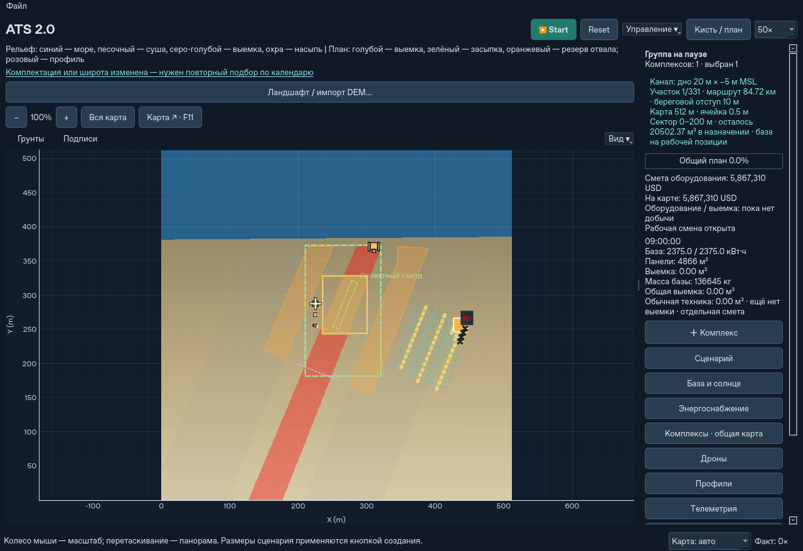

# Габариты, участок канала и наземный проезд

Открытие: **«Управление ▾ → Экскаватор и самосвалы…»** на общей карте
или **«Обычная техника…»** в самостоятельной площадке. Первая вкладка
содержит размеры машин, ширину съезда и автовыбор участка канала.
[Полная инструкция](conventional-equipment.md).

| Оборудование | Начальные модельные габариты, м |
|---|---:|
| Корпус экскаватора | 6 × 3 × 3 |
| Самосвал | 7 × 2,8 × 3,2 |
| Топливная база | 8 × 8 × 3 |

Это условные модели, не спецификации производителя. Рабочая досягаемость
ковша задаётся отдельно от размеров корпуса. Отрисовка использует реальные
координаты в метрах; наземные проверки сохраняют запас описанного круга.
Полная автомобильная кинематика, радиус поворота колёс и расчёт осадки шин
здесь не добавлялись.

Автовыбор проверен на приложенном маршруте Каттары: канал с дном шириной
20 м на отметке −5 м, окно 512 м, условные слои грунта, четыре дрона и один
Крот с сезонным комплектом из 45 солнечных платформ. Выбрана отдельная
наземная захватка с осью съезда вдоль канала и сухой стоянкой.
Размещение само по себе не копает грунт и не продвигает часы.

Пунктир — **проектный съезд**. Его готовность определяется фактическими
высотами, полным габаритом и проездом. Выемка учитывает сохраняемую дорогу,
поддерживающие откосы, глубину работы ковша и опоры машин. Остатки грунта
учитываются в общем ландшафте, даже если наземная техника не может их снять.
Экскаватор готовит поперечные участки съезда и переходит на уже проходимую
пониженную площадку. Если следующий участок оказался под защитой собственных
гусениц, машина сначала физически меняет рабочую позицию. При ограниченном
поиске следующая группа вариантов проверяется после ожидания, а интерфейс
различает исчерпание поиска и отсутствие безопасного места.

Два подтверждённых механизма прежнего застревания:

- Выгрузка могла расширять пятно насыпи; последующее осыпание могло дойти
  до колёс или обратного проезда. Теперь самосвал использует ограниченную
  вместимость и устойчивый предел высоты относительно защищённых зон.
  Непоместившийся грунт остаётся в кузове.
- Поиск мог исключить из своего окна верх известного съезда. В контрольном
  карьере глубиной 20 м безопасная дорога существовала, но лежала вне прежних
  границ поиска. Теперь его область включает известную ось съезда.

Автоматически назначается первый конечный участок. Перегон обычной бригады
по всем следующим участкам и межрегиональные переезды остаются отдельным
этапом. Старые сохранения читаются с прежней расстановкой и геометрией;
загрузка не исправляет уже изменённый рельеф бесплатным перемещением грунта.
Новая автоматическая планировка и геометрия поддерживаемого съезда относятся
к новому размещению парка. Для уже засыпанного проезда потребуется физически
освободить путь; исправление выгрузки предотвращает новые такие ситуации.

[Условия испытаний и результаты](conventional-access-validation.json).
[Присоединение соседних областей, если поперечник не помещается](active-window-expansion.md).
Короткие проверки не подтверждают устранение прежних зависаний после
23 модельных часов.
