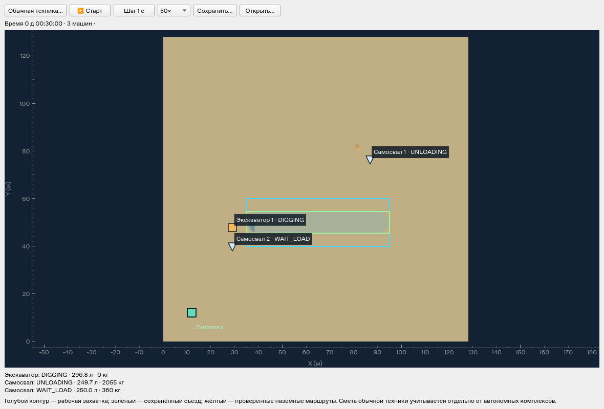

# Обычная землеройная техника

Один гусеничный экскаватор, 1–16 самосвалов и топливная база могут работать
на одной физической карте с 1–20 автономными комплексами или самостоятельно.
Высоты, материалы, осыпание, план выемки и модельные часы общие. Рабочие
участки и расходы разделены; второго баланса грунта нет.

## Открытие

1. В новом проекте задайте выемку через «Ландшафт и маршрут…».
2. Нажмите **«Экскаватор, самосвалы и топливная база…»**. Откроется отдельная
   площадка без дронов, Кротов, солнечных панелей и покупки автономной базы.
3. В окне **«Обычная техника…»** задайте прямоугольную захватку, координаты
   топливной базы, парк, смены и цены. «Разместить» приобретает парк один раз.
4. Нажмите «Старт». Окно показывает выемку, сохраняемый съезд, реальные
   положения машин и маршруты. «Шаг 1 с» выполняет тот же физический шаг.
5. Для совместной работы нажмите **«＋ Автономный комплекс…»** в окне
   обычной площадки. Откроется тот же сборщик состава, графика и сметы.
   После размещения откроется общая карта с обеими видами техники.

Можно начать и с автономной техники. В действующем проекте доступно
**«Управление ▾ → Экскаватор и самосвалы…»**, в том числе при нескольких
комплексах на общей карте. Выберите отдельную захватку и место топливной базы.
Пересечение с установленной техникой, действующим рейсом, резервом задания
или циклом Крота отклоняется с причиной. Работу на остальных участках
останавливать не требуется.

Добавление первого автономного комплекса на уже работающую обычную площадку
сохраняет изменённый грунт и его состав, положения машин, груз, топливо,
запасы, расходы, историю и часы. Обычный парк повторно не приобретается.
Новая автономная техника получает свою стоимость и начальную энергию.
Проверяется весь будущий раскрытый габарит и место для работы за пределами
обычной захватки. Если места нет, размещение отклоняется; прежняя площадка
продолжает существовать без сброса. Большую комплектацию может потребоваться
уменьшить или заранее подготовить карту большего размера.

Следующие автономные комплексы добавляются через **«＋ Комплекс»** или
**«Комплексы · общая карта»** — до 20 автономных комплексов всего.
На одной общей карте пока размещается одна обычная бригада. Её диспетчер
и смета доступны при выборе любого автономного комплекса: смена выбранной
базы не создаёт второй парк. Раздельные региональные окна для смешанной
группы не используются.

Параметры существующего плана задают глубину и материалы. Прямоугольник
захватки ограничивает работу экскаватора, но не превращает весь прямоугольник
в новую выемку. Топливная база и машины должны помещаться на сухой безопасной
площадке. Неподходящий участок отклоняется без удаления уже приобретённого
оборудования.

Если позже нужны дроны, заранее оставьте в общем плане отдельную выемку
за пределами обычной захватки и её отступа. Первый автономный комплекс
не размещается, если для него не осталось работы вне этого резерва.

## Разделение участков и передача работы

Прямоугольник обычной захватки и защитный отступ исключаются из новых
автономных заданий. Отступ учитывает размер грейфера и досягаемость Крота,
поэтому закрытая для них область несколько шире показанного прямоугольника.
Дроны и Кроты получают оставшуюся часть общего плана; высоты и грунт
по границе не копируются и не сбрасываются. Положения обычных машин,
их стоянки и топливная база остаются физическими препятствиями.

Резерв не освобождается при обеде, выходном, ручной паузе или отсутствии
топлива. Сначала обычная техника должна закончить свою часть выемки,
вывезти весь груз и физически вернуться на парковки базы. Только между
шагами расчёта резерв снимается, а оставшиеся рампа и защитная полоса
передаются дронам для завершения профиля. Это завершение наземного этапа,
а не утверждение, что весь проект уже выкопан до дна. Если безопасная
полка или обратный путь недоступны, участок сохраняется за обычной бригадой;
недоступный остаток не объявляется выполненным.

После передачи техника и топливная база продолжают занимать место.
Грунт под стоящими машинами не становится доступным для копания. Расходы
обычной бригады сохраняются отдельно, включая зарплату по действующему
договору; передача участка не удаляет парк и не отменяет договор.

В проекте канала по умолчанию включено **«Автоматически выбрать участок канала
и топливную базу»**. Перед покупкой выбирается стартовая конечная захватка
оставшейся выемки и проверяются её полный поперечник с откосами, сухая база,
парковки, подъезд и место под съезд заданного уклона. Ось съезда следует
прямому отрезку канала; длины вокруг поворота не складываются в фиктивную
прямую дорогу. На общей карте у дронов остаётся отдельная работа, действующие
рейсы и резервы заданий сохраняются. Неподходящее размещение отклоняется до
покупки. Если участок или съезд не помещается, увеличьте карту, измените
параметры проекта либо отключите автовыбор и задайте захватку вручную.

Выполненный автовыбор сохраняется как конкретные координаты. Загрузка не
переставляет существующую технику и не выбирает ей другое место. Это выделение
первого участка; автоматический перегон обычной бригады по всему региональному
каналу пока не реализован. Для плана кистью остаётся ручное назначение участка.

## Физический цикл

В первой вкладке задаются длина, ширина и высота машин. Начальные модельные
габариты: экскаватор **6 × 3 × 3 м**, самосвал **7 × 2,8 × 3,2 м**;
топливная база занимает **8 × 8 м**. Это условная комплектация, не паспорт
конкретного производителя. На карте корпуса показаны в метрах и поворачиваются
по направлению движения. Маленькие маркеры помогают найти технику при отдалении.
Высота корпуса и габарит опор участвуют в проверках препятствий. Наземный
планировщик использует консервативный описанный круг: он оставляет запас для
поворота, поэтому не всякий проход шириной с кузов считается допустимым.
Ширина съезда проверяется относительно выбранных размеров машин.

- Баки при покупке пустые. Дизель поступает из конечного запаса базы через
  один пост 30 л/мин; остальные машины ждут очереди. Скорость и число постов
  являются параметрами модели.
  Полная начальная заправка экскаватора и двух самосвалов требует 1600 с
  работы одного поста; это штатная подготовка, её видно по наполнению баков.
- Экскаватор выбирает доступную рабочую полку. Машины перемещаются по
  наземным маршрутам с проверкой полного габарита, воды, уклона и соседей.
  A* ограничен локальным окном и числом узлов. Путь пересчитывается при
  назначении и изменениях на маршруте; ближайший физический шаг проверяется
  всегда. Сложный далёкий объезд может потребовать другой захватки.
  Защитный предел первого этапа — 1200 узлов на один поиск; исчерпание
  этого предела не доказывает отсутствие обхода на всей карте.
- Ковш работает циклами, а не мгновенно. Состав слоя влияет на длительность;
  фактически снятая масса и объём ограничены вместимостью ковша и кузова.
  Пакеты SoilLoad переходят в самосвал и затем в физический отвал.
- Самосвал подъезжает к экскаватору, ждёт погрузки, перевозит грунт и тратит
  время на разгрузку. Если отвал или путь недоступны, груз остаётся в кузове.
- Разгрузка использует ограниченную локальную вместимость. Проверяются колёса,
  соседние машины, парковки и полный обратный проезд; высота насыпи ограничена
  устойчивым конусом относительно этих зон, чтобы осыпание не перекрыло выезд.
  При недостатке безопасного места выгружается часть кузова, остальной грунт
  сохраняется и перевозится к следующей точке. Автоматическое расширение
  пятна выгрузки на всю карту для самосвала не используется.
- Перед рейсом проверяются время до обеда/конца смены, обратный путь и топливо
  с резервом. Возврат и дозаправка входят в работу смены. При неожиданной
  блокировке безопасного возвращения показывается причина; аварийное время
  учитывается отдельно.

Съезд задаётся сохраняемой поверхностью с модельным уклоном 12% и шириной
9 м, с проверкой достаточной ширины для полного габарита машины. Экскаватор также сохраняет грунт под машинами и запас устойчивости
вокруг опор. Он не снимает эту защиту ради формального завершения плана.
Остаток съезда и недоступный остаток выемки показываются отдельно.
На смешанной площадке дроны получают рампу и защитную полосу после
безопасного завершения наземного этапа. Без дронов этот остаток сохраняется;
экскаватор не уничтожает единственный выезд ради формального завершения.
Это упрощённая кинематика и устойчивость по текущей модели осыпания;
осадка колёс, устройство дорог и полноценная геомеханика не реализованы.

## Люди и расходы

Применены обычные ограничения статей 117–120 закона Египта №14/2025:
до 8 рабочих часов в день, до 48 в неделю, час перерыва, не более 5 часов
работы подряд и еженедельный отдых. Выходной по умолчанию — пятница.
Каждую смену обслуживает отдельная бригада: один машинист и водитель на
каждый самосвал. Одна/две смены: по 9 часов присутствия и 8 рабочих часов.
Три смены: по 8 часов присутствия и 7 рабочих часов, суммарно до 21 часа
работы машины в сутки. Подменных операторов для непрерывных 24 часов нет.

Зарплата начисляется по календарному времени договора, включая оплачиваемый
выходной и простой; расчётный месяц — 30 модельных суток. Ориентиры gross: машинист 16 625 EGP/месяц, водитель
16 218 EGP/месяц. Это оценки обследования зарплат, не официальная ставка
в Каттаре. Дизель — 20,5 EGP/л; расчётный курс — 53,55 EGP/USD.
Все цены и ставки редактируются до приобретения парка. [Проверенные источники и даты](conventional-sources.md).

Модель не рассчитывает ежегодные/праздничные отпуска, налоговые и страховые
взносы, специальные ограничения жары и оформление исключительных работ.
Счётчик аварийной работы не является автоматическим оформлением законного
сверхурочного режима или компенсационного отгула.

Питание выдаётся на смену, питьевая вода списывается во время активной работы.
Запасы конечны и пополняются через окно снабжения с учётом поставки. Бытовое
потребление лагеря круглые сутки, жильё и доставка людей пока не моделируются.
Масла/ремонт представлены редактируемым расходом USD на моточас.

Модельные цены покупки: экскаватор 120 000 USD, самосвал 80 000 USD,
база 25 000 USD. Это не предложения производителя. В отдельной смете:

`USD/м³ = (разовая покупка парка + зарплаты + израсходованное топливо,
питание, вода и обслуживание) / фактически добытый объём`.

Неизрасходованный склад учитывается как запас и стоимость закупленного
инвентаря, а не повторный расход при каждой выдаче. До первой выемки
цена за кубометр не показывается. Капитал и расходы автономного комплекса
в этот показатель не входят; амортизация вместо разовой покупки не применяется.

## Сохранение и воспроизведение

Используется общий `.atsstate`, версия 22, со всеми состояниями машин, грузом,
топливом, материалами, счётчиками, маршрутом и часами. Старые версии 1–21
читаются без добавления обычного парка. Старые файлы не переписываются.
Экспорт только ландшафта с грузом в самосвалах запрещён: сохраните `.atsstate`.
Смешанная группа сохраняется целиком в том же `.atsstate`: обе системы
техники, единый грунт, резервы и часы. После загрузки можно выбирать любой
автономный комплекс и открыть ту же обычную бригаду, не покупая её повторно.
Сохранение обычной площадки до добавления первого автономного комплекса
также остаётся обычным рабочим сохранением и позволяет продолжить этот путь.

Межрегиональный переезд с обычным парком пока запрещён явно — техника не
телепортируется вместе с автономной группой. Общую карту можно увеличивать
только без изменения размера ячейки; укрупнение сетки с обычной техникой
отклоняется. Изменение уже принятого рабочего плана при размещённом обычном
парке также требует нового проекта.

Воспроизводимый небольшой участок без автономных покупок:

```bash
python scripts/benchmark_conventional.py --steps 1800 --trucks 2 --soil \
  --json traditional.json --save-state traditional.atsstate
python -m ats --load-state traditional.atsstate
python -m ats --headless --load-state traditional.atsstate --steps 600 --json continued.json
```

Физические и UI-проверки:

```bash
QT_QPA_PLATFORM=offscreen python -m pytest -q tests/test_conventional*.py
```

Параметры шасси, расходы и темпы работ условные и явно отделены от зарплатных
источников. Короткие испытания не доказывают устранение прежних зависаний
после 23 модельных часов.

## Результаты первоначального этапа

Числа ниже относятся к исходному этапу обычной техники. Это не замеры
длительной совместной работы с 20 автономными комплексами.

Прошли **932 прежних и 47 новых тестов**; после последних исправлений
повторены все новые случаи и 29 затронутых прежних проверок. Все 32 команды
CLI из 10 групп workflow прошли. Среда: Linux, Python 3.12, Qt offscreen.

При обычном посте 30 л/мин, изначально пустых баках и двух самосвалах первые
1800 модельных секунд дали 2,54 м³ выемки и 1,03 м³ доставки в отвал.
Оставшийся грунт находился в кузовах; ошибка общей массы менее 10⁻⁷ кг.
Расчёт занял около 0,80 с, максимальный отдельный шаг — 29 мс на этой машине.
Это стартовый маленький сценарий, не оценка сменной выработки.

В отдельном контроле 14 × 4 без нового парка, первые 5 модельных секунд,
медианы трёх повторений: 4,53 с до и 4,49 с после, в пределах разброса;
физические отчёты идентичны. Qt offscreen: статическое обновление нового
окна — медиана 7,9 мс в 20 повторениях. Это не реальный FPS пользователя.
[Полные условия, счётчики и численные результаты](conventional-validation.json).




