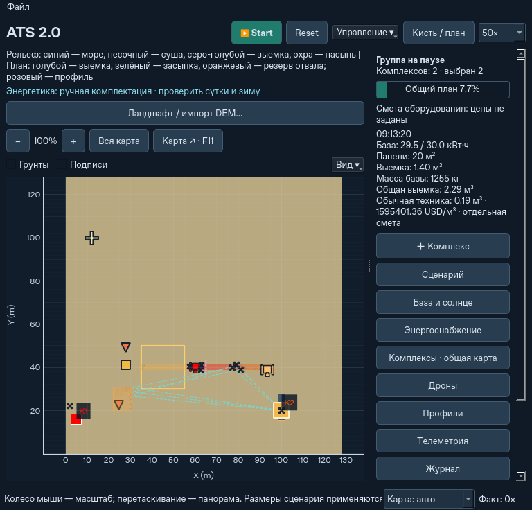

# Обычная и автономная техника на общей карте

Начать можно с любого вида техники. В обычной площадке кнопка
«＋ Автономный комплекс…» открывает сборщик. В автономном проекте обычная
бригада добавляется через «Управление ▾ → Экскаватор и самосвалы…».
[Инструкция и ограничения](conventional-equipment.md).

В контрольном сценарии работают два комплекса по четыре дрона и обычная
бригада из экскаватора и двух самосвалов. У всех один массив высот, состав
грунта и модельные часы. Обычный парк принадлежит одному владельцу, но его
окно доступно при выборе любой автономной базы. Расходы не объединяются.

На 800-й модельной секунде автономные комплексы добыли соответственно
1625,154 и 2580,548 кг, обычная бригада — 0,191180 м³, из них 0,162621 м³
доставлено в отвал. Ошибка общего баланса массы — менее 10⁻⁷ кг.
Сценарий синтетический: карта 128 м, слоистый грунт, ускоренная заправка
3000 л/мин для проверки рабочего цикла. Это не оценка реальной сменной
производительности. Штатный параметр заправки остаётся 30 л/мин.

Проверки и ограниченные замеры записаны в
[conventional-shared-validation.json](conventional-shared-validation.json).
Они не подтверждают устранение прежних зависаний после 23 модельных часов.
