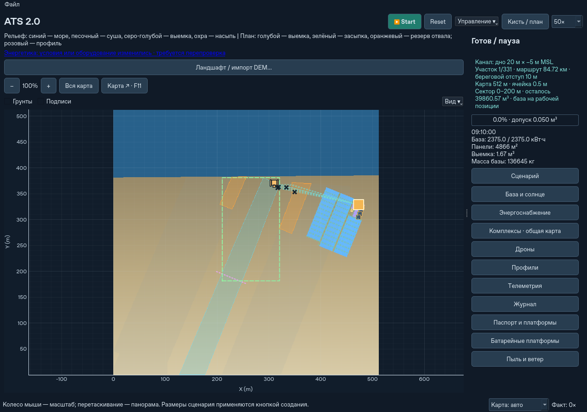

# Фиксированные рабочие сектора канала

Новые подготовленные проекты канала используют сектора по 200 м вдоль
полилинии маршрута. Это замена прежнему скользящему фронту 32 м, который
разрешал очередной переезд после продвижения выемки на 16 м, даже если
сама база перемещалась всего на несколько метров.

## Работа и переезд

Границы привязаны к расстоянию вдоль всего маршрута: 0–200, 200–400 м и далее.
Последний сектор, край локального окна и назначение отдельного комплекса
могут ограничивать реально доступную часть сектора. Её середина используется
для выбора площадки. В общей карте каждый комплекс работает только со своим
назначением; одного общего незарезервированного захвата у двух комплексов нет.

В новом запуске выбирается площадка сбоку от середины первого доступного
сектора. При следующем штатном переезде ищется ближайшая к середине допустимая
точка из площадок проекта, не дальше четверти номинальной длины по маршруту
(минимальный допуск 10 м). Проверяется весь раскрытый состав с опорами,
проездами и посадочными площадками, а также путь сложенных платформ.
Если текущая точка уже попадает в этот допуск и безопасна, повторная сборка
не нужна: небольшое приближение к точной середине не оправдывает сборку поля.
Положение уже доставленной техники при смене назначения не изменяется бесплатно.

Дроны могут копать по всему текущему сектору. Захват не вынимает грунт через
его границу. Крот самостоятельно меняет локальные позиции в пределах сектора;
дальность стрелы, устойчивость и ограничения движения сохранены. Закон осыпания,
плотности, заданная поверхность и интеграция энергии с шагом 1 с не менялись.

После достижения проектного профиля частичные контейнеры отправляются в
финальную партию курьера, не ожидая заполнения 75% тары. Следующий сектор
открывается после окончания релаксации, посадки дронов, опорожнения грузов,
ковша и контейнеров и завершения активных переносов. Незаконченная доковая
операция завершается либо атомарно отменяется без перестановки инструмента
перед упаковкой. Остаточный численный допуск
распределён между секторами текущего назначения: вместе они используют не более
10% его допуска; общий допуск завершения миссии дополнительно проверяется;
масса этих остатков остаётся в карте и отчёте.

Складывание PV и батарейных платформ, езда и раскрытие по-прежнему расходуют
время и энергию. Для PV идеальный цикл составляет 221 с в каждую сторону,
носители работают параллельно при доступной мощности. Недостаток энергии
не вызывает телепортацию или пропуск упаковки.
Дроны без посадочного места предварительно получают запас на перелёт,
дожидаются остановки базы и летят к ней существующим режимом возврата.
Их собственная энергия расходуется, а следующий сектор закрыт до посадки;
транспортная масса базы включает только действительно пристыкованные машины.

## Недоступность и ручное управление

При входе в сектор проверяются оба конца и наиболее удалённая боковая точка
на возможность возврата хотя бы одного дрона даже без груза с установленным
резервом. Это ранняя проверка невозможности, а не обещание полёта с полным ковшом:
каждый реальный рейс отдельно проверяет груз, мощность и текущий заряд прежним
планировщиком. Нет площадки/пути — `BLOCKED_SECTOR_SITE`; недостаточна дальность —
`BLOCKED_SECTOR_RANGE`. Грунт и оборудование сохраняются.

Если работа не продвигается в течение штатного `stall_timeout_s` (1800 с),
нет активного переноса и нет обоснованного ожидания зарядки, обслуживания или
совместного переноса, выдаётся `BLOCKED_SECTOR_NO_PROGRESS` с причиной.
Автоматического возврата к частым коротким переездам нет. Подбор площадок
ограничен площадками проекта; произвольный поиск нового наземного объезда
в этом этапе не добавлялся.

Посадка и отмена подготовки переезда сохранены. Региональная команда
«Переехать всей группой» может выполняться до завершения сектора: она собирает
и перевозит технику существующим механизмом. Безопасная точка прибытия
принимается для текущего сектора, чтобы сразу не складывать поле снова ради
небольшой корректировки позиции. Другие окна автоматически не открываются.

## Сохранения

Новый снимок `.atsstate` имеет версию 11; читаются версии 1–10.
При загрузке старой миссии сектор выбирается по её текущему фронту.
Координаты, ID, высоты, состав грунта, заряды, грузы, общие часы и задания
не пересоздаются. Уже назначенный короткий переезд может один раз завершиться.
Назначенные старым планировщиком захваты за границей сектора могут закончиться;
новые рейсы таких исключений не получают. Неактуальный резерв отвала
перепроверяется с сохранением занятой и зарезервированной земли.

Существующие файлы не переписываются при чтении. Старое аппаратное устройство
PV/BESS остаётся прежним. Импортированные конфигурации, явно не содержащие
`sector_length_m`, сохраняют старый контроллер до загрузки старого снимка
или создания нового подготовленного проекта канала; это оставлено для
воспроизводимых прежних экспериментов. В расширенной конфигурации параметр
находится в `plan.channel.operations.sector_length_m`.

## Проверка

Полный набор: **629 тестов**, без ошибок и пропусков, плюс все **10 групп CLI**
из workflow Ubuntu/Windows, выполненные локально на Linux/Python 3.12.
Сама Windows и удалённый CI этого локального этапа не запускались: push не выполнялся.

Регрессии в `tests/test_sectors.py` проверяют неподвижную базу при продвижении
фронта, вывоз остатка, один переезд между секторами, последний короткий сектор,
границу захвата, недоступность площадки/дальности, несколько комплексов,
точное продолжение в работе и в пути, миграцию старого снимка, интерфейс
и региональный переезд A → B → A без дополнительной местной сборки.

В автономном сценарии с сохранённым незавершённым профилем длиной 430 м
выполняются два штатных переезда вместо следования за каждым продвижением
фронта. Итоговые тесты и ограниченные замеры приведены в
[машинном отчёте](fixed-work-sectors-validation.json).

Для повторения замеров подготовьте отдельный checkout `f250d84`. Следующие
команды создают временные синтетические снимки прежнего формата 10,
которые читаются обоими вариантами контроллера:

```bash
python scripts/prepare_sector_benchmark.py --root /path/to/f250d84 --output /tmp/sector-inputs
python scripts/benchmark_runtime.py --root /path/to/f250d84 --state /tmp/sector-inputs/coast45-v10.atsstate --steps 240 --trials 2 --mode both --offscreen --output /tmp/before.json
python scripts/benchmark_runtime.py --state /tmp/sector-inputs/coast45-v10.atsstate --steps 240 --trials 2 --mode both --offscreen --output /tmp/after.json
```

Для `heavy14-start-v10.atsstate` используйте 20 шагов, для
`heavy14-work-v10.atsstate` — 30. Это расчёт на общей карте с 56 дронами,
630 носителями и 4866 м² PV на комплекс. Построение снимков и прогрев
не включаются во время измеряемых шагов. Старая версия не читает новый
формат 11, поэтому для сравнения нужны именно такие исходные снимки.



### Короткие замеры

Linux/Python 3.12, Qt offscreen, окно 1280×900, карта «авто», фиксированный
физический шаг 1 с. В каждой строке два запуска каждого варианта в порядке
до/после/после/до, одинаковые исходные снимки версии 10. Загрузка снимка
исключена. В таблице медиана модельных секунд за реальную секунду.

| Сценарий | Без карты: f250d84 → сектора | С интерфейсом: f250d84 → сектора |
|---|---:|---:|
| Прибрежная Каттара, 45 носителей, 600–840 с | 70,19× → 64,11× | 58,84× → 52,64× |
| 14 × 4, 630 носителей, первые 20 с раскрытия | 3,48× → 3,39× | 2,46× → 2,40× |
| 14 × 4, полётный цикл 235–265 с | 5,98× → 5,59× | 5,11× → 5,16× |

Последняя строка — состояние после раскрытия PV, Кроты ждут перевозки мешков;
это не непрерывное копание всеми 14 Кротами. В прибрежном случае Крот копает
весь измеряемый интервал. Карта побережья — 512 м с ячейкой 0,5 м;
синтетическая общая карта группы — 1024 м с ячейкой 2 м, условные слои Каттары.

Скорость рабочей фазы 14 × 4 с UI практически сохранилась. Прибрежный случай
в этих коротких запусках примерно на 10% медленнее с UI; новый контроллер
не является общим ускорением расчёта. Разброс двух запусков заметен, исходные
данные и стоимость кадров приведены в JSON. Это не FPS домашнего компьютера
и не прогноз скорости многосуточной выемки всего канала.

Из ранней проверки дальности убраны 420 запросов общей геометрии за 30 с
группы: проверка выполняется при входе/смене аппаратов, реальные рейсы
продолжают проверять актуальные препятствия и энергозапас. Рамка фиксированного
сектора кэшируется до смены сектора/назначения. Во всех трёх сценариях хэш
физического отчёта до и после этих двух кэшей совпал, как и результаты с UI
и без UI внутри каждого варианта. Модули энергетики, материала и опубликованные
функции кэша геометрии `f250d84` сохранены.

Максимальные наблюдавшиеся ошибки в CLI и замерах: масса грунта
7,28 × 10⁻¹² кг, масса оборудования 0 кг, энергия 0,000124 Дж.
