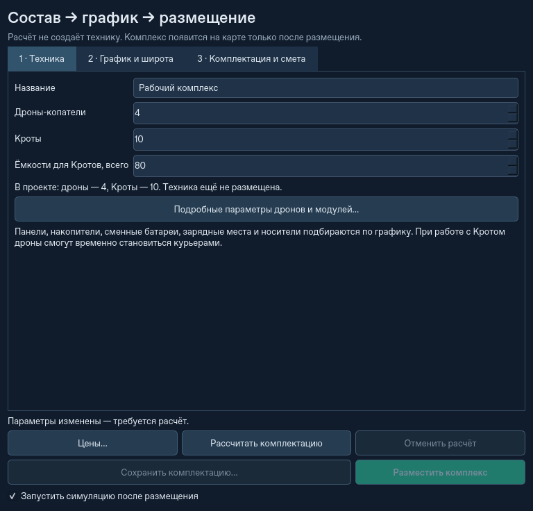
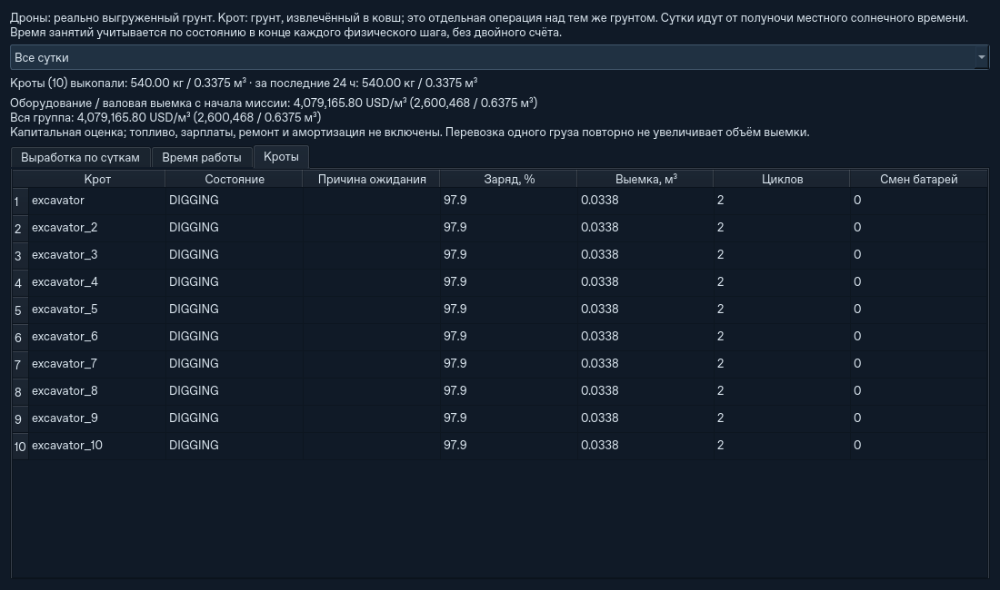

# До десяти Кротов и капитальная оценка выемки

## Управление

**«＋ Собрать комплекс» → «1 · Техника» → «Кроты»**: 0–10 машин на базу.
Дроны по-прежнему выбираются отдельно, 1–16; смешанной команде нужно минимум
два дрона. Сборщик предлагает 8 ёмкостей на Крота, например 80 на десять.
Поле ёмкостей означает общий запас комплекса, а не число на одну машину.
Количество можно изменить до расчёта, но нужно хотя бы по одной ёмкости
на Крота. Расчёт, предварительная смета, календарь, шаблоны и размещение
работают для всего выбранного состава.
В рабочем окне кнопка **«＋ Комплекс»** находится в боковой панели: верхняя
строка остаётся компактной и при нативных размерах кнопок Windows.



У каждого Крота есть постоянный ID, собственные рабочие батареи, буфер,
ковш, раскрытие опор, рабочий цикл, позиция и адресованные ему ёмкости.
Рецепт модели и батарей общий для Кротов одного комплекса; их состояния
и выработка независимы.
Остальные машины и зарезервированные точки перемещения ограничивают забой.
Дроны и Кроты извлекают грунт из одной физической карты. Копание имеет прежнюю
длительность, расход энергии, ограничения вылета стрелы и устойчивости;
число машин не является множителем статистики.

Запасные батареи остаются единым физическим пулом. Рецепт сменных модулей
Крота задаётся **на одну машину**, общее количество умножается на число машин.
У каждого модуля есть один зарядный слот; один модуль не может одновременно
отправиться двум получателям. Ёмкости, задания доставки, боковая замена
модулей и совместный воздушный перенос адресуются конкретному Кроту.
Все Кроты участвуют в массе техники, энергетике, коллизиях и переезде группы.
Смена батареи не приобретает ещё один комплект и не увеличивает смету.

**«Статистика» → «Кроты»** показывает состояния, причины ожидания, заряд,
выемку, циклы и смены батарей. В соседних вкладках есть суточная выработка
и время занятий каждого Крота. Все машины показаны на карте.



На снимке небольшой дневной проект на 21 июня; сезонный состав ниже имеет
другие панели, накопители и смету.

## Что означает цена

В исходном каталоге выбрана **USD**, цены условные и редактируются через
**«Цены…»** в сборщике. Это оценка капитальных вложений в имеющееся оборудование.
Рабочая батарея, запасная батарея и шасси учитываются по одному разу,
независимо от числа рейсов или зарядок. Например, корпус Крота без батарей
имеет исходную модельную цену 70 000 USD, а его батареи, ёмкости и зарядка
считаются отдельными строками.

В основном окне и статистике:

```text
капитальная оценка на м³ = стоимость имеющегося оборудования / валовая выемка с начала миссии
```

Объём берётся из фактически извлечённого грунта, включая ковши и грейферы.
В слоистой модели используется действительный объём состава, а не масса,
делённая на одну условную плотность. Вывоз ёмкости, разгрузка, перенос Крота
и повторный рейс с тем же грузом не являются новой выемкой. Для группы баз
сначала складываются стоимость и объём, затем вычисляется отношение;
среднее арифметическое отдельных USD/м³ не используется.

До первой добычи значение **не определено**. В старом сохранении без каталога
оно неизвестно; цены не подставляются незаметно. Разные валюты не складываются
и автоматически не конвертируются. Выбор суток в статистике не сбрасывает
этот накопительный показатель. При добавлении оборудования его стоимость
входит в текущую оценку. Это не отдельный исторический журнал платежей.

Топливо, зарплаты, логистика персонала, ремонт, амортизация и выручка не
рассчитаны. Поэтому показатель пока нельзя называть полной себестоимостью
земляных работ. На старте его большое значение нормально: стоимость всего
комплекса распределена на первые небольшие объёмы.

## Подбор питания

Число Кротов входит в расчёт рабочей и дежурной нагрузки, мощности, сменных
модулей, зарядных слотов, массы, сервисных платформ и сметы. Контрольный пример:
31,078° с.ш., 01.03–30.09, круглосуточная работа, четыре стандартных дрона,
прежние допущения загрузки и резерва, восемь ёмкостей на Крота:

| Кроты | Панели, м² | BESS, кВт·ч | Носители | Масса техники, кг | Модельная смета, USD |
|---:|---:|---:|---:|---:|---:|
| 1 | 4866 | 2375 | 45 | 137 295 | 5 867 310 |
| 10 | 5697 | 2780 | 52 | 161 395 | 7 411 920 |

Оба электрических профиля проходят повторные сутки всех 214 дат сезона;
это не физический прогон стройки за весь сезон и не гарантия любой погоды.
В этом примере по два запасных модуля на Крота, помимо двух установленных.

## Совместимость и ограничения

Новые снимки имеют версию **21**, читаются **1–20**. Старый одиночный Крот
остаётся той же машиной со своим грузом, модулями, состоянием и координатами;
дополнительная техника при загрузке не появляется. Проверка сохранённого
кэша площадки старого формата выполняется заново, оборудование не меняется.
Более старый движок должен отказать в чтении версии 21. Исходные файлы
сохранений не переписываются.

Корпуса Кротов выбираются до размещения нового комплекса или нового
эксперимента. Горячее добавление/снятие Крота на уже работающей базе пока
не поддерживается. При клонировании получаются новые независимые машины,
а не ссылки на чужие ковши или батареи.

Сохраняется прежняя стратегия **одного курьера партии на базу**. Боковая
замена батарей и групповой воздушный перенос обслуживают по одному Кроту
за раз. Поэтому десять Кротов с четырьмя дронами могут ожидать логистику.
Это не обещание десятикратной выработки. На маленьком забое избыток машин
ждёт безопасного места; отсутствие места для парковки даёт явный отказ.

## Проверки

Регрессии охватывают реальную одновременную выемку 3 и 10 машин, разные
владельцы ресурсов и адреса складов, общий инвентарь, массовый и пофракционный
баланс, энергетику, замену модулей с сохранением в процессе, перенос второго
Крота без перемещения первого, два комплекса на общей карте, старые снимки,
нулевую добычу и валюты. Отдельно размещены 16 дронов с 10 Кротами.

В A→B→A с тремя и десятью Кротами, включая снимок на стадии DRIVE,
сохраняются ID, инвентарь, точные высоты/состав грунта и общий ход времени.
Допуски этих сценариев: масса и состав <10⁻⁷ кг, энергетический остаток
<0,002 Дж. Эти региональные регрессии используют небольшие поля, а не
десять максимальных сезонных баз.

На Linux / Python 3.12 выполнен полный набор из 887 тестов без пропусков;
после него добавлены и отдельно проверены ещё четыре сценария CLI и старых
кэшей. Всего 891 уникальный тест. После исправлений повторно прошли
проверки инвентаря/кэшей, все новые тесты Кротов, UI сборщика, CLI,
региональных переездов и границ окна. Также прошли 36 команд CLI из прежней
матрицы сценариев. Это результаты локального этапа; последующие проверки
Windows и Ubuntu доступны в [GitHub Actions](https://github.com/TopoLM21/Autonomous-Terraforming-Simulator-ATS-/actions/workflows/tests.yml).

Короткое сравнение с родительским `7afd935`: один и тот же снимок версии 20
для каждого сценария, 120 модельных секунд, три повтора каждого режима,
основное окно 1280×900, viewport 1002×616, `auto`, без профайлера.
Полные отчёты и хэши высот/материалов совпали во всех 24 прогонах контроля.

| Сценарий | Без GUI, до → после | Qt offscreen, до → после |
|---|---:|---:|
| Побережье, 45 носителей, 4 дрона, 1 Крот | 85,52× → 77,02× | 40,39× → 56,39× |
| 14 комплексов × 4 дрона × 1 Крот | 24,33× → 25,51× | 21,60× → 21,91× |

Сценарий 14×4 — плоская общая слоистая карта 512 м, ячейка 1 м, поля
по 20 м², начальные рабочие позиции заданы до старта. К началу замера все
14 Кротов копают. Это не 14 полных сезонных солнечных массивов.
На побережье используется офлайн DEM Каттары с процедурным уточнением,
естественным откосом и осевой стоянкой; начало на 240-й модельной секунде.

Есть заметный разброс контейнера: headless побережья до изменения
55,1–86,9×, после 72,0–96,4×; интервалы пересекаются. Эти данные не
доказывают ни ускорение, ни стабильную величину замедления.

Отдельный новый дневной проект: 10 Кротов, 4 дрона, 80 ёмкостей,
13 носителей, карта 256 м / ячейка 0,5 м. На отрезке 100–220 с все десять
копают; медианы 62,85× без GUI и 46,81× с Qt offscreen. Максимальный
интервал GUI-событий в этих трёх прогонах — 0,302 с. Это другая нагрузка,
её нельзя напрямую сравнивать с одиночным прибрежным комплексом.

Продолжение той же новой миссии ещё на 2400 модельных секунд сохранило
`RUNNING`, инвентарь и балансы: масса −9,1×10⁻¹³ кг, энергия −3,64×10⁻⁶ Дж.
Курьер закончил девять полных рейсов с возвратом пустой ёмкости, в том числе
к Кротам №2–9. После заполнения запаса у части машин было реальное ожидание
ёмкостей: один курьер стал ограничением. Это 40 модельных минут,
а не суточное или сезонное испытание производительности.

Полные числа и условия: [`krot-fleet-validation.json`](krot-fleet-validation.json).

Команды из корня установленного проекта:

```bash
python -m pytest -q
python -m pytest -q tests/test_excavator_fleet.py tests/test_excavator_regions.py tests/test_complex_setup_ui.py tests/test_cli.py
python -m ats --headless --mode logistics --excavators 10 --containers 80 --drones 4 --map-size 128 --steps 120 --save-state ten.atsstate --json ten.json
python scripts/benchmark_runtime.py --state your-before-update.atsstate --steps 120 --trials 3 --mode both --offscreen --output krot-runtime.json
```

Для сравнения движков нужен один и тот же снимок версии 20, который читают
обе версии; контрольный движок передаётся через `--root /path/to/checkout`.
Qt offscreen измеряет обработку интерфейса в контейнере, а не FPS Windows
или домашнего компьютера. Короткие испытания не воспроизводят прежние
зависания после 23 модельных часов.
