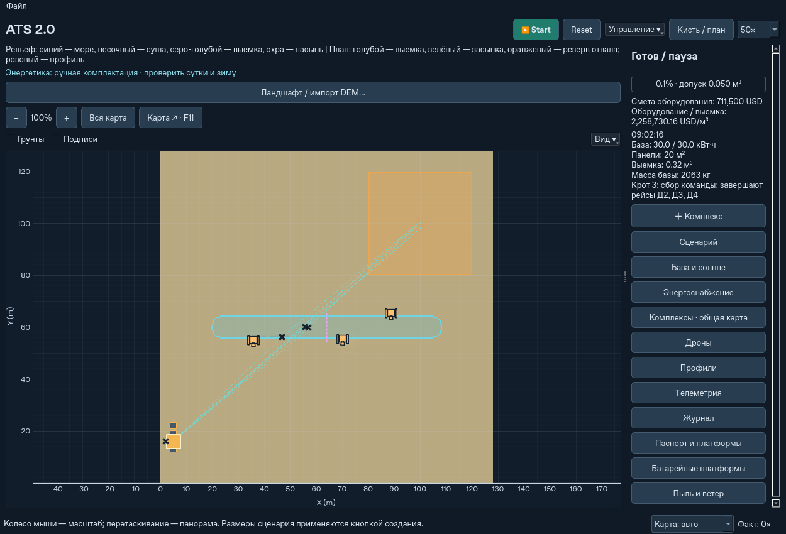

# Координация подготовки и переноса Кротов

Исправлена воспроизводимая ситуация: три заряженных дрона стоят с грейферами,
один курьер обслуживает общий склад, а запрос на перемещение одного Крота
останавливает добычу остальных машин.

## Подтверждённая причина

Прежние `direct_dispatch` и `direct_should_return` останавливали независимое
копание сразу при любом `WAITING_RELOCATION`. У нескольких Кротов такое же
условие останавливало новые циклы остальных машин. При этом `_try_lift`
сначала ждал завершения всех рейсов и смен инструмента и лишь затем
создавал задание доставки строп.

Стропы имели приоритет 6; обычные рейсы с грунтом и пустой тарой — 3 и 4,
батарейные рейсы — 1 и 2. Единственный курьер мог долго разгребать очередь,
пока остальные простаивали. При смене курьера визуально менялся работающий
дрон, а ранний общий запрет оставался. Наличие полного склада батарей
этот запрет не снимало.

В контрольном сценарии этот механизм дал **48 мин 48 с** до начала подготовки
совместного подъёма и **53 мин 12 с** до завершения перемещения.

## Текущее поведение

1. При запросе переноса проверяется площадка. Задание доставки строп
   создаётся сразу, даже если другие аппараты ещё выполняют рейсы.
   Приоритет 2 ставит его перед обычным вывозом грунта и тары; критические
   доставки питания с приоритетом 1 сохраняют преимущество.
2. Пока стропы доставляются, свободные дроны могут копать, остальные Кроты
   продолжают свои циклы при наличии энергии, доступного грунта и тары.
   Машина, которой уже везут стропы, остаётся целью этой подготовки,
   даже если другая машина тоже запросила перенос.
3. Сбор команды начинается после фактической доставки и освобождения строп
   на площадке нужного Крота. Пролёт со стропами над машиной и стропы,
   ещё зарезервированные за незавершённым рейсом, готовностью не считаются.
4. На время сбора новые грузовые рейсы и переоборудования курьеров
   не запускаются. Уже начатые перевозки, выгрузки, смены инструмента,
   зарядка и замены батарей завершаются штатно. Свободные копатели
   завершают свои рейсы и возвращаются.
5. Перед подъёмом по-прежнему проверяются грузоподъёмность и запас энергии
   каждого участника. Затем выполняются снятие батарей, сбор у машины,
   строповка, подъём, полёт, посадка и возврат аппаратов.

Фаза сбора и сам подъём сохраняют прежнюю остановку новых циклов остальных
Кротов. Состав команды подъёма также прежний: используется флот комплекса.
Автоматический подбор минимального числа участников в этот этап не входит.
Ожидание необходимого заряда, питания сервиса или безопасной площадки
остаётся возможным; теперь готовность подготовки отделена от такого сбора.

Если свободные копатели закончили выемку во время доставки строп,
неначатое задание строп отменяется. Перевозимый груз завершает безопасную
доставку. Завершение локальной выемки и сектора сохраняют разные причины
`WORK_COMPLETE` / `SECTOR_COMPLETE`; глобальный проект от этого не отмечается
завершённым.

## Где посмотреть ожидание

На правой панели появляется строка с номером Крота и текущей подготовкой.
При сборе перечисляются аппараты, завершающие рейсы, ожидающие заряд /
замену батарей или смену инструмента. Та же информация доступна:

- **Дроны → Состояние**, подсказка у ожидающего участника команды;
- **Телеметрия → Подготовка переноса**;
- **Управление ▾ → Склад / диспетчер → Крот / энергетика**.

`DOCKED` продолжает обозначать физическую стыковку. Причина ожидания
находится в диагностике; надпись сама по себе не подтверждает получение
зарядной мощности. Когда подготовки нет, пустое новое поле в отчёт
не добавляется, сохраняя прежний состав исторических отчётов.



## Сохранения и физика

Формат `.atsstate` остаётся 21. Фаза подготовки выводится из уже существующих
задач, резервов и местонахождения единственного комплекта строп. Новые
постоянные сущности и второй инвентарь не создаются. После загрузки старого
сохранения техника, груз, заряд и часы продолжаются с прежних значений;
очередь строп получает исправленный приоритет при продолжении.

Порядок рейсов и выработка в ситуации подготовки изменяются намеренно.
Механика полёта, ограничения маршрутов, батареи и массовый баланс работают
через прежние операции движка. Загруженные задания не перебрасываются
другим аппаратам и оборудование не перемещается мгновенно.

## Воспроизводимая проверка

```bash
python -m pytest -q tests/test_lift_coordination.py \
  tests/test_scheduler_utilization.py tests/test_excavator_fleet.py \
  tests/test_service_recovery.py tests/test_landing_queue.py
python scripts/benchmark_lift_coordination.py --output lift-after.json
```

Для сравнения с опубликованной родительской версией на Linux:

```bash
git worktree add --detach /tmp/ats-before-lift 7c93d35
PYTHONPATH=/tmp/ats-before-lift python scripts/benchmark_lift_coordination.py --output lift-before.json
```

В сценарии один комплекс: 4 дрона, 3 Крота, 24 наполненных реальным грунтом
контейнера и 56 полностью заряженных запасных модулей дронов. Запрос
воздушного переноса задаётся явно. Затем штатный движок выполняет все рейсы,
зарядку, смены инструмента и перемещение. Это контролируемое воспроизведение
механизма, а не сохранение пользователя.

| Показатель | Родительский `7c93d35` | Исправленный алгоритм |
| --- | ---: | ---: |
| Начало подготовки подъёма: команда зарезервирована | 2928 с | 216 с |
| Завершение первого переноса | 3192 с | 481 с |
| Работа независимых копателей до сбора | 0 дрон·с | 635 дрон·с |
| Ошибка массы после переноса | 0 кг | менее 10⁻⁷ кг |
| Ошибка энергии после переноса | менее 0,002 Дж | менее 0,002 Дж |

Эти времена относятся к модели, а не к ускорению программы относительно
реального времени. Оставшийся грунт и очередь обычных рейсов сохраняются;
их обработка продолжается после переноса.

Регрессии охватывают 3 и 10 Кротов, ранний запрос строп, устойчивость выбранной цели,
резервы перевозимого груза, небезопасную площадку, окончание выемки,
последовательные переносы двух машин, отмену приказа курьеру и точное
продолжение сохранения в подготовке, сборе команды и групповом полёте.
Команда **«Посадить флот»** откладывает новый подъём и сохраняет возможность
завершить перевозку и выгрузку грунта. Уже начатый совместный перенос
завершается безопасно.

## Пределы проверки

Полный локальный прогон: **932 теста прошли**, включая 14 новых случаев
координации. Выполнены все **32 CLI-команды из 10 групп** текущего workflow.
Среда: Linux, Python 3.12.14, NumPy 2.5.4, Qt 6.12.0, offscreen.
Подлинное сохранение формата 21 от `7c93d35` с прежним приоритетом строп 6
загружено и продолжено: ID, часы и грунт сохранены, приоритет стал 2;
повторное сохранение и загрузка дали точное дальнейшее продолжение.
Проверки исторических форматов v1–v3 сохранили прежние эталонные отчёты.
[Численные результаты, состав проверок и ограничения](lift-coordination-validation.json).

Отдельно сопоставлен короткий запуск общей площадки из 14 комплексов × 4 дрона:
по три повторения первых 5 модельных секунд из одного сохранения, с 20 м² PV
на комплекс и одним Кротом. Медианы времени вычислений составили 4,18 с до
и 4,16 с после исправления; разброс отдельных повторений велик. Физические
отчёты совпали полностью при исключении нового диагностического поля.
Это проверка отсутствия изменения начальной физики; она не доказывает
ускорение, производительность зимнего комплекта или длительной работы.

Интерфейс проверен в Qt offscreen: боковая панель, подсказки таблицы дронов
и фактически открываемое окно диспетчера. Такой запуск не измеряет FPS
на компьютере пользователя. Пользовательское сохранение с многочасовым
ожиданием не предоставлялось; исправлен подтверждённый механизм простоя,
а не все возможные причины ожидания техники.
