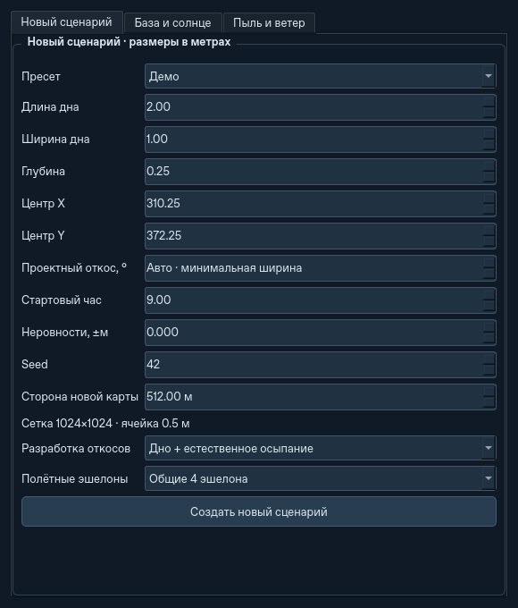

# Естественная выемка, безопасный эшелон и обмен с морем

Этап поверх локального `be0c20d`, 6 ноября 2026. Сохраняются прежние грунтовый
и энергетический балансы, посадка/обслуживание, физическая перевозка платформ
и переходы между перекрывающимися окнами. Водная эрозия не добавлена.

## Управление

Новые миссии обычного запуска `python -m ats` используют **Дно + естественное
осыпание** и **Общие 4 эшелона**. В кнопке **Сценарий**, вкладке **Новый
сценарий**, есть **Разработка откосов** и **Полётные эшелоны**. Это настройки
следующей новой миссии, они не меняют работающий флот незаметно.
Такие же переключатели находятся в **Ландшафт / импорт DEM…** возле параметров
канала. После **Разметить канал → Начать копание выбранного участка** они попадают в миссию.
Если у проекта уже есть подтверждённые интервалы, его критерий завершения
сохраняется и выбор разработки заблокирован: прежний прогресс не превращается
в подтверждение другого задания. Изменения рельефа при чтении не сбрасываются.

Ручные конфигурации, шаблоны и старые сохранения сохраняют выбранные ими
режимы. У низкоуровневого `Config()` и headless-прогона остаются прежние
значения по умолчанию для воспроизводимости существующих экспериментов.
Новые режимы в CLI включаются явно:

```bash
python -m ats --headless --cut-policy natural --airspace shared_lanes \
  --steps 12000 --json natural.json --save-state natural.atsstate

python -m ats --headless --qattara \
  --channel-route docs/ats2/qattara-channel.json --energy-preset qattara-season \
  --cut-policy natural --airspace shared_lanes --steps 600 --json coast-natural.json
```

В `operation_policy` отчёта новых режимов показаны действующий критерий,
консервативная высота неподвижных препятствий и выбранные крейсерские отметки.
В подробной телеметрии GUI видны режим и высоты в метрах MSL.

## Копание дна и осыпание

У выемки две разные маски:

- Полный прогнозный контур сохраняет территорию под возможные откосы,
  отступы отвала, площадки и безопасный переезд. В естественном режиме для
  прогноза используется наиболее пологий из заданных углов естественного
  и рыхлого материала. Это резерв площади, не обязательный объём выемки.
- Действующий забор ограничен ядром заданной ширины дна. Крот и дроны
  используют те же высоты цели в ядре, радиус захвата, состав материалов,
  время копания, вместимость, усилия и энергетические ограничения.

Осыпание сохраняет прежний локальный закон по раскрытым слоям и рыхлой смеси.
Если материал снова попал на дно, его нужно извлечь. Изъятый грунт проходит
прежние ковши, контейнеры и отвалы; ничего не исчезает при смене маски.
Задание не завершается до прекращения осыпания и вывоза груза.

В естественном режиме не требуется, чтобы каждый узел откоса совпал с
прогнозной поверхностью. Цель — дно не выше заданной отметки плюс устойчивая
окружающая поверхность. Это не гарантия точной ширины стенок реального
котлована; остаются дискретизация heightfield и упрощённая механика материалов.
Если задан числом проектный угол, применяется прежний **точный профиль**.
Засыпка сохраняет свой прежний критерий высоты.

Общий диспетчер делит действующие ячейки дна, сохраняя резервы точек и
исключая двойное назначение. Сектора 200 м и сертификаты глобального прогресса
учитывают выбранный критерий. Проверка того, что поперечник целиком наблюдаем
в окне, сохраняет полный прогнозный контур: невидимые области не объявляются
завершёнными. Критерий записывается вместе с `finished_spans` и переносится
в следующее окно. Геометрический ID маршрута от него не меняется.

## Нижняя безопасная граница полёта

`Terrain.clearance_surface` консервативно включает исходный/текущий максимум,
предельную насыпь и проектную засыпку. Пара выравниваемых ячеек не может
создать отметку выше максимума до переноса. Обычные захваты и ограниченные
выгрузки обновляют границу локально; внешняя правка с увеличением `revision`
вызывает полный контроль максимума один раз. Новая карта и план имеют свои
границы. После изменения допустимой высоты отвала граница расширяется.

К грунтовому пределу добавляются максимальные габариты оборудования всех
комплексов, включая самую высокую стадию складных PV. Даже если панели сейчас
лежат горизонтально, для границы учитывается полный ход складывания.
Граница включает текущую высоту баз и наземных Кротов. Кэш привязан к
оборудованию, отметкам и шагу; установка оборудования и смена геометрии его
инвалидируют. Производные кэши не сохраняются как физическое состояние.

Для прямого сегмента минимум высоты находится на одном из концов. Только
если **оба конца внутри активного окна и весь сегмент выше этой границы с
зазором**, подробный обход неподвижных препятствий пропускается. Взлёт,
посадка и низкие сегменты используют прежние проверки настоящих полигонов
платформ, раскрытых крыльев и рельефа. Пустые углы AABB не становятся стенами.
Проверки дронов и транспортируемых грузов не отключаются.

Общие эшелоны — четыре уровня над единой границей всей группы с шагом не
меньше настроенного расстояния безопасности. Номер уровня циклически зависит
от номера дрона и комплекса; 56 дронов не получают лестницу из 56 высот.
Уровни переиспользуются, поэтому встречные полёты всё ещё могут уступать путь.
Вертикальная предварительная проверка использует реальные пройденные
интервалы высот, а не название эшелона: пересекающий его взлёт не пропускается.

Высота используется в оценке рейса и стоимости подъёма груза. Назначенный
логистический рейс сохраняет свою расчётную высоту; новое оборудование не
меняет её бесплатно посреди полёта. Если обстановка стала несовместимой,
низкая точная проверка остаётся обязательной. Наземный A* для физических
переездов базы/Крота не заменяется воздушным правилом.

## Приближённый встречный обмен с морем

**Ландшафт → Водоём / прокоп → Соль… → Обмен с морем**. Множитель **0,25**
для новых водных сценариев условный; **0** выключает обмен. CLI:

```bash
python -m ats --headless --qattara \
  --channel-route docs/ats2/qattara-channel.json --steps 0 \
  --instant-channel --flood-days 365 --exchange-factor 0.25 \
  --flood-report exchange.json --save-state exchange.atsstate
```

На глубокой стадии заполнения, пока выпуск не затоплен, всё остаётся как
раньше. Достижение отметки дна канала само по себе не включает сильное
перемешивание. Для условного встречного расхода используются:

```
затопленная глубина = clamp(глубина_канала + уровень_озера, 0, глубина_канала)
плотностный напор ≈ 0,7 * abs(C_озера - C_моря) / (1000 + 0,7*C_моря)
                   * затопленная_глубина
движущий напор = max(0, плотностный_напор - перепад_уровней)
```

Концентрации в г/л. Коэффициент плотности 0,7 кг/м³ на г/л — приближение,
используемое только в этой граничной оценке. Расход оценивается по половине
затопленного сечения с интерфейсным сопротивлением, Маннингом и множителем.
Действующая глубина дополнительно ограничена максимальной имеющейся толщиной
воды во впадине: микроскопический слой не питает глубокий возвратный поток.
Общий расход `Q_чистый + 2*Q_обмена` ограничен прежней пропускной способностью
при свободном выпуске, пользовательским максимумом и критическим пределом.
Закрытый затвор, сухая впадина и неизвестный состав выключают обмен.

Каждому добавленному обменному объёму соответствует такой же возвратный:

```
ΔV = чистый_приток - испарение - перелив
ΔM = C_моря * (чистый_приток + обмен)
     - C_озера * обмен - соль_перелива
```

Солевой обмен решается ограниченным неявным скалярным шагом. Он не позволяет
маленькому резервуару уйти в отрицательную концентрацию при большом обмене.
Сохраняются растворимость, выпадение и растворение осадка; твёрдая соль не
уносится как взвесь. При постоянном объёме соль всё ещё может меняться, поэтому
пропуск водного решения не означает пропуск солевого обмена. Если оба
состояния неподвижны, сохраняется аналитический пропуск времени.

Стационарная солёность возможна, когда `C_моря*Q_чистый =
(C_озера-C_моря)*Q_обмена`. При испарении она обычно выше морской.
Обмен **не является** расчётом стратификации всего озера или двухслойного
течения вдоль реального канала: чистый водный расход остаётся прежней
отдельной оценкой, добавляется симметричная граничная циркуляция. Приливы,
ветер, температура, химия дна, солевая поправка к испарению и водная эрозия
пока отсутствуют. Множитель требует калибровки для реального прогноза.

## Сохранения и воспроизведение

`.atsstate` **17** читает **1–16**. Регион с новым водным объектом либо
естественным критерием проекта использует `.atsregion` **6**, читаются **1–5**.
Водный объект **3** читает **1–2**. Старые файлы не переписываются. Они
сохраняют точный профиль, прежнее назначение высот и выключенный встречный
обмен; безопасное ускорение проверки полётов действует и для них.
Соль версии 2 сохраняется точно; сценарий версии 1 мигрирует по прежним
правилам оценённого/неизвестного состава. Включить встречный обмен в старом
водном сценарии можно явно, не сбрасывая воду и соль.

```bash
python -m pytest -q
python -m pytest tests/test_natural_excavation.py tests/test_airspace.py tests/test_sea_exchange.py -q

python scripts/benchmark_world_terrain.py --runtime-fixtures fixtures
python scripts/benchmark_runtime.py --state fixtures/world14-work.atsstate \
  --steps 120 --trials 2 --mode both --offscreen --output runtime.json
python scripts/benchmark_equipment_counters.py --state fixtures/world14-work.atsstate \
  --steps 120 --output counts.json

python scripts/benchmark_world_terrain.py --runtime-fixtures natural-fixtures \
  --cut-policy natural --airspace shared_lanes
```

Для парного сравнения используйте **один и тот же** исходный снимок, `--root`
старого/нового checkout и одинаковый режим окна. Не сравнивайте физическую
эквивалентность разных критериев выемки: естественные откосы намеренно меняют
объём задания. Контроль старого режима изолирует ускорение проверки полёта.
Короткий offscreen-прогон не является FPS рабочего стола или воспроизведением
зависаний после 23 модельных часов.

## Результаты проверки

Linux, Python 3.12.14, NumPy 2.5.4, PySide6 Essentials 6.12.0:

- Полный набор: **768 тестов прошли за 676,74 с**, включая 41 новый случай.
  Проверены осыпание рыхлого верха/нижнего слоя, завершение автономной выемки,
  резервы и разделение заданий, высотная граница, настоящие пересекающиеся
  траектории, сохранения старого формата и переход A→B→A с сохранением в пути.
- Все 10 прежних групп CLI (32 команды) прошли. Ещё 6 команд проверили точное
  продолжение естественной выемки и **действующего** встречного солевого обмена
  из сохранения: результаты совпали с непрерывными прогонами.
- В запущенном Qt проверены новый сценарий, подготовка прибрежного канала и
  окно солёности. Изменение параметров водного сценария не меняет грунт,
  инвентарь и часы землеройной миссии. Windows и удалённый CI этого этапа
  не запускались.



Парные замеры ускорения используют **прежние** цели выемки и назначение высот,
одинаковый входной снимок и 120 модельных секунд. Сравнение — с `be0c20d`.
Физические JSON-отчёты до/после совпали по SHA-256 во всех этих контролях.
В таблице показано реальное время выполнения, меньше — быстрее:

| Стенд | Без GUI, до → после | С Qt offscreen, до → после |
|---|---:|---:|
| Прибрежная Каттара, 1 × 4 дрона, 45 платформ, 4866 м² PV | 0,926 → 0,774 с (1,20×) | 1,167 → 1,059 с (1,10×) |
| 14 × 4 дрона, 20 м² PV на комплекс, без модульных PV-носителей | 6,379 → 3,159 с (2,02×) | 7,542 → 3,960 с (1,90×) |
| 14 × 4 дрона, 630 платформ, 4866 м² PV на комплекс | 15,273 → 13,596 с (1,12×) | 16,080 → 13,868 с (1,16×) |

Первые два стенда — медиана двух повторов, тяжёлый — один повтор на режим,
поэтому небольшие различия нельзя считать точной гарантией выигрыша.
Малый стенд — 512 × 512 ячеек по 1 м, прибрежный — 1024 × 1024 по 0,5 м,
тяжёлый — 512 × 512 по 2 м. У тяжёлого стенда 79 408 предметов инвентаря.
Он использует фиксированную общую стройплощадку без секторных переездов;
Кроты в начале ожидают транспорт. Это проверка нагрузки большого оборудования,
а не полный рабочий цикл четырнадцати прибрежных 200-метровых секторов.
Исходный секторный генератор такого стенда блокировался на поиске безопасной
площадки до начала измерения; этот случай не использован как замер ускорения.

На малом стенде за те же 120 модельных секунд число проверок ключей геометрии
снизилось **885 598 → 60 956**, обращений к высоте — **66 744 → 7841**.
Все 5434 принятых полётных сегмента этой фазы прошли выше общей границы;
подробных запросов воздушных препятствий стало **58 903 → 0**. Низкие участки
проверяются отдельно регрессионными тестами; ноль здесь не означает отмену
проверок взлёта и посадки во всех сценариях. Реальные перестроения геометрии
(943) и число физических шагов (120) остались прежними.

Новые режимы намеренно меняют задание и высоты, поэтому для них не заявляется
побитовое совпадение с прежней физической политикой. Дополнительные контрольные
прогоны естественной выемки и общих эшелонов дали:

| Стенд новых режимов | 120 модельных секунд без GUI / с Qt offscreen |
|---|---:|
| Малые 14 × 4 | 2,848 / 3,279 с |
| Прибрежные 45 платформ | 2,000 / 2,546 с |
| 630 платформ на фиксированной стройплощадке | 11,614 / 14,409 с |

Состояние во всех случаях `RUNNING`, отчёты GUI/headless совпадают внутри
каждого стенда. Максимальная невязка массы — менее **2·10⁻¹² кг**, энергии —
**0,000183 Дж**. У тяжёлого стенда максимальный промежуток между обработкой
Qt-событий около **0,50 с**, так что длительность одного шага ещё ограничивает
отзывчивость. В его коротком профиле остаются заметны синхронизация батарей
(20,3% включительно), подготовка геометрии (19,5%) и аудит солнечных платформ;
вложенные расходы инвентаря нельзя складывать с родительскими процентами.

Отдельный условный солевой стенд при уровне −0,0001 м и площади 1 км² имеет
стационарный баланс около **62,07 г/л**: чистый приток 0,2674 м³/с, встречный
обмен 0,4221 м³/с, испарение 23,10 мм/сутки. Это проверка возможности равновесия
упрощённой модели, **не прогноз Каттары**. В глубокой впадине до затопления
выпуска встречный расход остаётся нулевым.

Входные хэши, версии, физические невязки и полные результаты сохранены в
[машиночитаемом отчёте](natural-cruise-exchange-validation.json). Они описывают
короткие воспроизводимые проверки, а не подтверждение устранения прежних
зависаний после 23 модельных часов.
