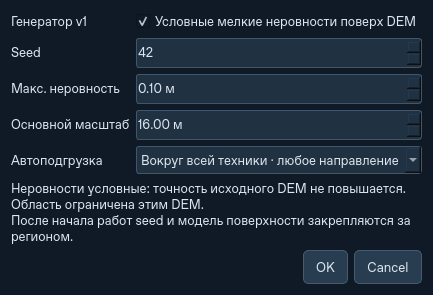

# Процедурный рельеф и подгрузка вокруг группы

Этап поверх `ced4216`: генерация условного мелкого рельефа по мировым
координатам, чтение соседних областей в двух измерениях и сохранение уже
изменённой поверхности. Физика использует один активный Terrain, прежний
инвентарь и единственный материальный баланс Landscape.

## Управление

Откройте **Ландшафт / импорт DEM… → Рельеф / подгрузка…**.

- Новая Каттара и новый импорт через это окно: генератор v1, seed **42**,
  амплитуда не более **0,10 м**, основной масштаб **16 м**. Это условные
  неровности, а не дополнительная геологическая съёмка.
- До начала работ генератор можно отключить, задать другой seed, амплитуду
  0…1 м и масштаб 4…1024 м. После открытия рабочего участка поверхность
  закрепляется. Изменение seed требует нового региона.
- Режим **Вокруг всей техники · любое направление** не требует канала.
  Режим **Следующий участок канала** сохраняет прежнее поведение.
- **Автоподгрузка областей** включает или отключает чтение. При выборе
  другого X/Y на региональной карте действует задержка 180 мс, после которой
  выбранная площадка читается в фоне. Кнопка ручной предзагрузки действует
  и для нового, ещё не открытого региона. При закрытии диалога автоматический
  режим снова следует за техникой.
  Для выбора окна щелчком снимите флажок **Рисовать маршрут (ЛКМ)**.
- **Отменить предзагрузку** останавливает запрос. Автоматический запрос с тем
  же набором окон не возобновляется сам, в том числе после загрузки состояния.
  Ручная команда позволяет повторить чтение.



Для нового DEM-региона из командной строки:

```bash
python -m ats --headless --qattara --procedural --terrain-seed 42 \
  --terrain-detail 0.1 --work-origin 150000 150000 --map-size 128 --steps 10 \
  --save-state terrain.atsstate
python -m ats --load-state terrain.atsstate
```

CLI без `--procedural` сохраняет прежнюю интерполяцию. Параметры генератора
нельзя применять к `--load-state` или `--landscape`: их поверхность уже задана.

## Поверхность и изменённые тайлы

Исходный DEM остаётся неизменным и задаёт крупный рельеф и отметки MSL.
Генератор v1 использует целочисленный хеш глобальных координат, seed и три
масштаба гладкого шума с весами 0,6 / 0,3 / 0,1. Для WGS84 координаты шума
получаются из долготы и широты в метрах проекции Меркатора; физическая сетка
сохраняет прежнюю локальную проекцию ATS. Порядок чтения, номер окна и
состояние генератора случайных чисел не участвуют.

Плавная огибающая обращает добавку в ноль на линиях исходной сетки DEM.
Добавка ограничена 25% абсолютной исходной отметки: знак высоты относительно
MSL сохраняется, новая деталь не переносит берег на сушу или обратно. NoData
остаётся ошибкой, а не автоматически заполненной землёй. Новый уровень моря,
вода и эрозия не добавлены.
Слои используют выбранный ранее профиль грунта; шум не создаёт измеренную
геологическую карту.

Укрупнённая ячейка берёт среднее своих исходных мелких столбцов. Поэтому
выбор рабочего разрешения не создаёт другой процедурный объём земли.
Высоты изменённых тайлов по-прежнему хранят **изменение относительно этой
закреплённой поверхности**. Снятый/насыпанный материал хранится в прежних
столбцах SoilField. Процедурный генератор не перегенерирует эти изменения.

Возвращение A→B→A восстанавливает выемку, отвал и состав материалов.
Подготовленное окно проверяет seed/версию и версии тайлов. Если грунт
изменился после чтения, применяется актуальное изменение и состав.
Физическое применение остаётся между шагами после безопасного переезда.

## Область интереса и память

Раз в пять модельных секунд выбираются до четырёх соседних окон вокруг
позиций и назначений всех баз, дронов и Кротов общей группы, включая точки
забора и выгрузки. Адреса привязаны к постоянной мелкой сетке; кандидаты
охватывают обе оси, не зависят от маршрута и остаются внутри исходного DEM.
Пока техника на паузе, повторного пересчёта каждый кадр нет. Выбор площадки
пользователем временно имеет приоритет.

Один фоновый читатель обслуживает ограниченный набор. Неизменившиеся готовые
окна повторно используются, старые запросы отменяются. Суммарный бюджет
сохранённых подготовленных массивов — **64 МиБ**, дополнительно к прежним
**64 МиБ RAM-кэша изменённых тайлов** по умолчанию. При недостатке бюджета
менее приоритетные готовые окна вытесняются. Это не предел всей RAM:
активный Terrain, DEM, индексы, NumPy/Qt и рабочие полосы считаются отдельно.

## Совместимость

`.atsstate` версии **14** читает версии **1–13**. `.atsregion` с генератором
использует версию **3**; версии **1–2** читаются без процедурной добавки.
Новые регионы без генератора могут сохраняться в прежней версии 2.
Старые файлы не переписываются при чтении. Для прежнего состояния фиксируется
прежний исходный рельеф. Seed, модель и режим подгрузки входят в сохранение;
потоки, временные файлы и готовые окна не входят. После загрузки запрос
возобновляется на сохранённом DEM и материалах.

## Границы этапа

Это подгрузка данных в любой точке **предела загруженного DEM**. Встроенный
DEM охватывает Каттару и побережье, а не всю Землю. Генерация не расширяет
измеренную географическую область и не повышает точность NOAA ETOPO1.

Активная физическая карта остаётся квадратной, до **1024 м**, с прежними
ограничениями разрешения. Величина 512 м не растёт автоматически при
приближении к краю. Увеличение карты существующей командой работает по двум
осям; переезд сохраняет увеличенный размер, не меняя идентичность канала.
Непрерывная физическая сетка произвольной ширины и одновременно удалённые
независимые области ещё требуют отдельного этапа.

Ручной выбор смещённого окна канала поддержан: проект формируется в мировой
привязке и не отмечает произвольный срез завершённым глобальным участком.
Переезд требует перекрытия окон, пригодной площадки, маршрута, посадки,
сборки платформ и энергии. Камера и чтение не телепортируют технику. Расчёт
наземного маршрута остаётся синхронным. Короткие испытания не подтверждают
устранение пользовательских пауз после 23 модельных часов.

## Проверка

```bash
python -m pytest -q
python scripts/benchmark_world_terrain.py --output world.json
python scripts/benchmark_world_terrain.py --procedural --output generated.json
python scripts/benchmark_world_terrain.py --root /tmp/ats-world-before \
  --runtime-fixtures /tmp/world-controls
python scripts/benchmark_runtime.py --state mission.atsstate --mode both \
  --offscreen --world-prefetch --steps 240 --output runtime.json
```

Тесты `tests/test_procedural.py` проверяют перекрытия и seed, NoData и берег,
укрупнение, лимиты/отмену/повторное использование чтения, совместимость,
переезды в двух осях с сохранением по пути и возвратом, материалы, массу,
энергию и фактический диалог настроек Qt. Результаты ограниченных замеров
публикуются рядом в `procedural-world-validation.json`.

Ограниченный контроль Linux/Python 3.12, Qt offscreen, окно 1280×900:

| Сценарий | Прежний режим, без карты | Чтение в любых направлениях, без карты | Прежний режим, UI | Чтение в любых направлениях, UI |
|---|---:|---:|---:|---:|
| Прибрежная Каттара, 45 PV-носителей, 240 с модели | 50,0× | 46,1× | 45,2× | 38,5× |
| 14×4, начало развёртывания, 20 с модели | 9,1× | 8,5× | 9,2× | 7,8× |
| 14×4, работа, 30 с модели | 18,5× | 13,5× | 14,1× | 13,3× |

Это медианы двух коротких измерений с одинаковыми входными снимками, а не
доказательство установившейся скорости на пользовательском компьютере.
В первом случае действует настоящий прибрежный проект с большим солнечным
полем. В 14×4 используется отдельный синтетический регион, сетка 512² по 1 м,
условные слои Каттары и 68 м² PV на комплекс. Готовые файлы для него создаёт
`--runtime-fixtures` под выбранным checkout. Во всех парных прогонах физические
отчёты совпали. Дополнительное фоновое чтение имеет вычислительную цену;
его можно отключить или оставить только следующий участок канала.

Для окна 1024² по 0,5 м отдельный читатель подготовил одно прежнее окно за
76 мс, четыре интерполированных за 341 мс и четыре процедурных за 2,64 с.
Холодное чтение процедурного окна заняло 772 мс, получение уже готовых массивов
— 14 мс. Максимальный интервал Qt-таймера этого отдельного контроля составил
15 мс. Это не время создания Terrain, проверки площадки или расчёта маршрута.

Удерживаемые подготовленные массивы заняли 16 / 64 / 64 МиБ соответственно.
RSS всего процесса после чтения составил приблизительно 90 / 142 / 135 МиБ;
различие RSS включает NumPy/Qt и распределение памяти, не только кэш.
Для 128 пар контрольных изменённых блоков высот и состава хранились
20 МиБ массивов на диске; их резидентная часть была 0 МиБ при обращении к
другому месту. Случай принудительного вытеснения проверяется отдельно тестами.

В малом физическом A→B→A с прежней поверхностью смена Terrain составила
53–55 мс до и 62–77 мс после; ID и состав восстановлены точно, ошибка массы
0 кг, энергии 2,74·10⁻⁷ Дж. Это контроль отсутствия регрессии, а не обещание
ускорения сложного переезда. Максимальные паузы полного UI в коротких
сценариях выше доходили до 0,97 с: подготовка кадра и физика остаются в
основном потоке, синхронный наземный планировщик не изменён.
