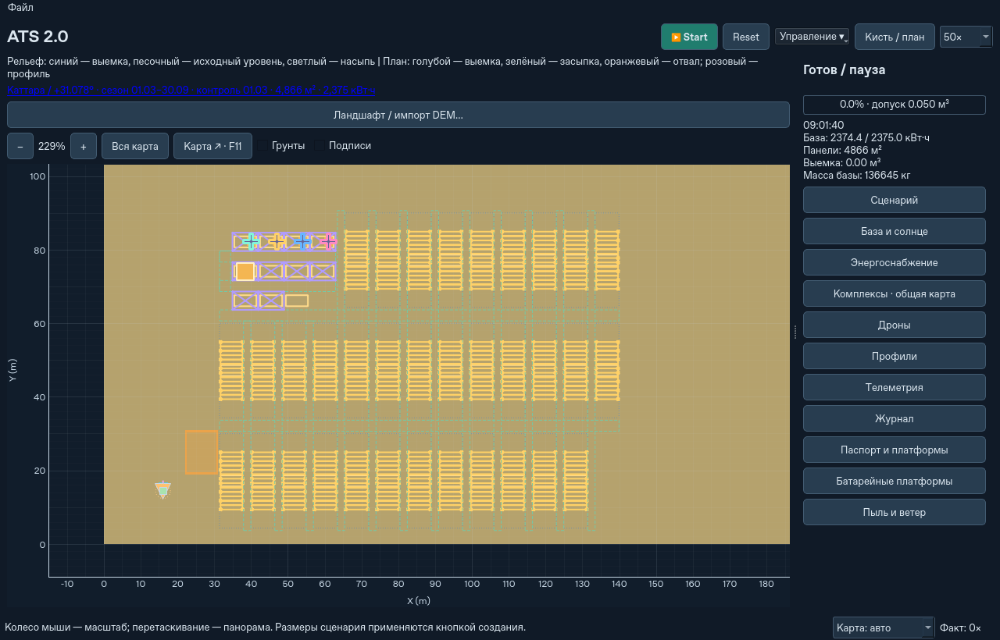
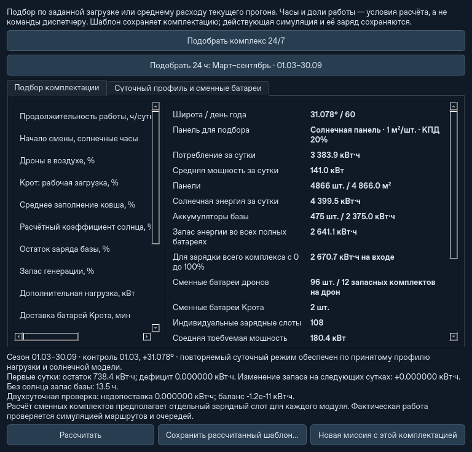

# Каттара: март–сентябрь и компактная компоновка

Новый обычный запуск `python -m ats` создаёт комплекс для широты **31,078° с.ш.**,
со стартом **21 июня** и энергетическим расчётом на **1 марта — 30 сентября
включительно**. Это 214 проверенных расчётных дней. Пресет задаёт широту,
сезон и оборудование; он не подменяет пользовательскую карту реальным DEM.
Для регионального рельефа остаётся существующий офлайн-импорт Каттары.

```bash
python -m ats
python -m ats --headless --energy-preset qattara-season --steps 0
python -m ats --energy-preset winter24h --latitude 31.078
python -m ats --energy-preset manual
```

Для GUI без пользовательской конфигурации новый сезонный пресет применяется
автоматически. Headless без явного пресета сохраняет прежний ручной режим.
Загрузка сохранения или пользовательского файла не запускает автоматический
переподбор. Явная дата, широта и оборудование из такого файла сохраняются;
явный запуск нового расчёта меняет оборудование только в новой миссии.

В окне **«Энергоснабжение»** доступны периоды «Март–сентябрь · 01.03–30.09»
и «Весь год · зимний минимум». Кнопка подбора проверяет выбранный период.
Прежний зимний подбор и полярный случай с конечным запасом энергии сохранены.

## Энергетический расчёт

Для стандартного состава (четыре дрона и Крот) получено:

| Показатель | Сезонный пресет |
|---|---:|
| Горизонтальные солнечные панели | 4866 м² |
| Накопитель базы | 2375 кВт·ч |
| Сменные комплекты на дрон | 12, по два модуля |
| Запасных модулей дронов всего | 96 |
| Индивидуальных зарядных гнёзд | 108, включая установленные/сменные модули |
| Запасных модулей Крота | 2 |
| Гусеничных носителей | 45, включая 34 солнечных |
| Расчётная транспортная масса | 137 295 кг |
| Контрольный день | 1 марта |
| Расчётная нагрузка | 141,0 кВт в среднем, 3383,9 кВт·ч/сутки |
| Генерация в контрольный день после коэффициента солнца | 4399,5 кВт·ч/сутки |
| Световой день 1 марта | 11,36 ч |
| Минимум запаса в двухсуточной минутной проверке | 476,18 кВт·ч, выше резерва 475 кВт·ч |
| Суточный дрейф запаса после первого цикла | 0 кВт·ч |

Нагрузка сохраняет прежние явные допущения: дроны в воздухе 80% времени с
полным ковшом, загрузка Крота 95%, запас генерации 30%, коэффициент солнца 0,8,
остаток BESS 20%. КПД панелей, зарядные потери, физические модули, индивидуальные
порты и ограничения преобразователей не урезались ради меньшего комплекта.
Запас аккумуляторов рассчитан на ночь и суточный оборот; это не запас энергии
на шесть месяцев без солнца. Без генерации расчётная автономность базы до
резервного SOC — около 13,48 ч при принятой средней нагрузке.

День минимального суточного прихода и день самой длинной ночи выбираются
отдельно. Для Каттары оба — 1 марта. После подбора проверяются **все 214 дней**:
два повторяющихся суточных цикла, ночной минимум, допустимые мощности, отсутствие
недопоставки и отрицательного суточного дрейфа. Дополнительно испытана действующая
цепь `SolarBase` с шагом 1 секунда на двух контрольных сутках и с реальными
пределами BESS. Условия оборота батарей берутся из существующего расчёта
длительности полёта, зарядки и количества отдельных комплектов.
Отдельно проверяется, что мощность свободных сменных гнёзд, без установленных
на работающей технике батарей, и шина каждой сервисной платформы покрывают
среднюю нагрузку зарядки. Невыполнимый запрос 100% работы Крота без времени
на обязательную смену батарей отклоняется.

Это модель горизонтальной установки при геометрическом солнечном потоке и
заданном коэффициенте, а не гарантия при любой погоде, пыльных бурях или
произвольной рабочей нагрузке. Долгая перевозка со сложенными панелями не входит
в стационарный суточный профиль. Действующее оборудование расходует энергию
на раскрытие и переезд по прежней физике.

На основном экране и в расчёте видны широта, границы сезона и контрольная дата.
Дата вне диапазона, изменение широты или ручной комплектации требуют
перепроверки; оборудование автоматически не заменяется. При переходе модельных
часов через 30 сентября статус тоже меняется. Входные файлы остаются нетронутыми.

## Геометрия всего комплекса

Компактная компоновка включается при **новом размещении комплекса с собственным
раскрывающимся полем**. Внутри сервисного блока платформы образуют короткие
колонки с общими проходами, а не длинный поезд. Сервисные платформы и доки
остаются на доступной стороне блока. Расположение зарядных гнёзд, посадок и
наземных точек ожидания учитывает обе координаты, включая смещение поперёк базы.
Подача батарей идёт по боковым проходам и общей поперечной сервисной трассе.

PV-ячейка резервирует полный ход шарниров и собственных опор, приблизительно
25,71 × 6,5 м; транспортное пятно 3 × 6 м не используется вместо этой площади.
Габарит ячейки дополнительно учитывает ширину сервисного блока. Соседние ряды
разделены проходами 2 м, колонки — 3 м; внутри сервисного блока проходы 3 м.
Подбор числа строк и колонок минимизирует наибольший габарит всего массива.
Прямоугольные раскрытые крылья могут дать прямоугольную сетку:

| Комплектация на 31,078° | Носителей | Полный развёрнутый массив с проходами |
|---|---:|---:|
| Март–сентябрь | 45 | 87 × 108,5 м |
| Прежний зимний контроль | 63 | 117 × 117 м |

Это размеры вдоль осей формации; при её повороте отображаемый мировой
прямоугольник поворачивается вместе с ней. Учтены PV, сервисные опоры, доки,
наземные точки ожидания и рабочие проходы. На карте проходы показаны зелёным
пунктиром. Полный развёрнутый габарит виден в паспорте базы и в окне
**«Управление → Солнечные платформы и отвал…»**.

Проверяется не только центр массива: каждое пятно раскрытия и проход должны
находиться на пригодной суше, вне выемки, отвала и чужой техники. Занятые проходы
зарезервированы для обслуживания; после безопасной упаковки формации они
освобождаются. Для переезда проверяются отдельные транспортные корпуса,
а место последующего раскрытия вместе с проходами проверяется в обоих окнах.

Расположение уже стоящей техники не уплотняется и не меняется бесплатно.
Небольшие поставки используют свободные места сервисного блока. Если они
исчерпаны, расширение отклоняется с понятной причиной, сохраняя действующее
оборудование; нужен новый шаблон. Независимая перестройка отдельных носителей
во время работы пока не моделируется. Общая формация переезжает с сохранением
взаимных координат, постоянных ID, времени, масс и электрического баланса.

## Сохранения и испытания

Новый снимок имеет версию **10**. Версии **1–9** читаются совместимо. В том числе
прежнее самораскрывающееся поле версии 9 сохраняет своё расположение: чтение
не превращает его молча в квадрат. Старые файлы не перезаписываются. Более
старый ATS должен отклонить новый снимок по версии, а не продолжать двумерное
размещение по старым правилам посадочных и сервисных координат.

Регрессии включают 214 сезонных дней, длинную ночь, зарядные пределы, два
контрольных дня на секундной цепи, изменение даты/широты, ручные файлы,
сохранение промежуточного раскрытия и совместный переезд A→B→A с загрузкой
в пути. Детальные результаты полного набора, CLI и 14×4 — в
`qattara-season-grid-validation.json` рядом с этим документом.

Итоговый полный набор: **575 тестов**, без ошибок и пропусков; **10 групп CLI**.
В секундной двухсуточной проверке минимум SOC — 20,0497%, недопоставка и дрейф
вторых суток нулевые. Численный остаток энергетического баланса — 0,084 Дж
на двух сутках при суммарной генерации около 8,8 МВт·ч.

В синтетическом сценарии 14 комплексов × 4 дрона (512 м, ячейка 1 м, по 68 м²
панелей) новая компактная формация дала **17,45×** без интерфейса и **7,19×**
в Qt offscreen. Максимальный физический шаг — 0,220 с, максимальный промежуток
между событиями GUI — 0,270 с. Грунтовой и электрический баланс сохранены,
оборудование не потеряно. На одном и том же прежнем снимке версии 9:
**12,24× до / 12,40× после**, с одинаковыми остатками балансов. Это короткие
замеры Linux/Python 3.12, а не воспроизведение пользовательского компьютера.
Разную начальную геометрию нельзя сравнивать как битово одинаковую миссию.




