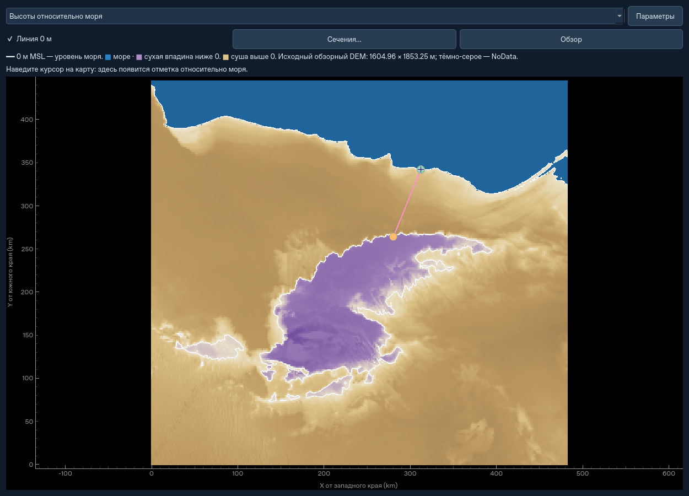
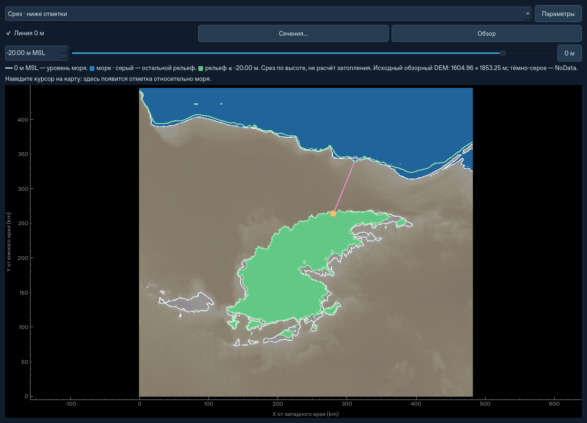
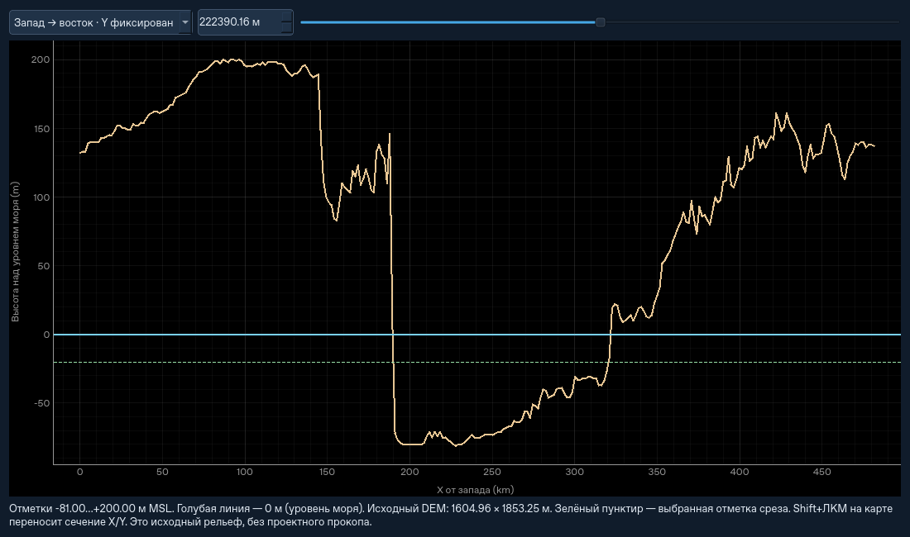

# Высоты относительно моря и сечения ландшафта

В пустом проекте откройте **Ландшафт и маршрут…**. В рабочем симуляторе то же
окно доступно через **Ландшафт / импорт DEM…**. Новые инструменты относятся
к обзорной карте региона при разметке канала. Физика миссии и форматы сохранений
не меняются.

## Чтение карты

Выпадающий список над картой выбирает вид:

| Вид | Что показано |
| --- | --- |
| Высоты относительно моря | Постоянная абсолютная палитра MSL: морское дно синее, сухая впадина ниже 0 м фиолетовая, положительные высоты песочные / коричневые. Это вид по умолчанию. |
| Общая шкала высот | Относительная палитра от минимальной до максимальной высоты видимого фрагмента, как у обычной карты высот. Цвет сам по себе не обозначает воду. |
| Срез · ниже отметки | Зелёным выделена суша с высотой **не выше** введённой отметки, включая сухую впадину. Море сохраняет синий цвет. |
| Слой · диапазон высот | Зелёным выделен диапазон вокруг выбранной отметки: например −20 м и толщина 10 м означают **−25…−15 м**. |

Ползунок и числовое поле задают абсолютную отметку, а кнопка **0 м** возвращает
её к уровню моря. **Линия 0 м** включает белую изолинию на карте и нулевые
линии на профилях. Белая линия проходит и по границе моря, и по отметке 0 м
вокруг сухой впадины: это изолиния высоты, не только береговая линия.
В режиме среза зелёные изолинии показывают выбранную отметку или границы слоя;
они могут проходить и по морскому дну.

Наведите мышь на карту, чтобы увидеть X/Y, высоту со знаком в метрах MSL,
координаты исходного DEM и тип области. Пропуски DEM остаются тёмно-серыми;
вне данных высота не подменяется нулём.

Морская маска использует существующий `channel.ocean_nodes` и правило
`channel.is_ocean`: конечные отрицательные узлы, связанные с краем DEM
по четырём соседям, затем та же проверка интерполированной точки. Поэтому
Каттара ниже нуля не закрашивается морем. Для произвольного DEM впадина,
обрезанная краем файла, по этому существующему правилу может определиться
как море. Это не новая гидрологическая модель и не карта фактических озёр.
Большая маска готовится в фоне; пока она не готова, легенда прямо сообщает,
что тип отрицательных областей ещё уточняется. Ошибка чтения также видна
в легенде. Смена DEM или закрытие окна исключает применение устаревшего
результата; начавшийся расчёт маски может закончиться в фоне.





## Вертикальные сечения

**Сечения…** открывает отдельное окно с большим графиком:

- **Вдоль нарисованной линии** — высота вдоль видимого маршрута; горизонтальная
  ось — накопленное расстояние по ломаной. Работает и до «Разметить канал».
- **Запад → восток · Y фиксирован** — горизонтальное сечение всей карты.
- **Юг → север · X фиксирован** — вертикальное сечение всей карты.

В двух последних режимах положение выбирается ползунком, числом либо
**Shift+ЛКМ на карте**. Голубой пунктир показывает положение сечения на карте;
Shift+ЛКМ перемещает сечение, не добавляя вершину маршрута. Обычный ЛКМ
продолжает прежнее действие разметки. После закрытия окна линия сечения
исчезает. Кнопка **Обзор** возвращает карту к полному DEM.

На графике голубая горизонталь — **0 м MSL**, зелёный пунктир — выбранная
отметка среза. Отсутствующие высоты дают разрыв, а не соединение через NoData.



## Параметры и сохранность проекта

Параметры канала, импорт, запуск, переезды и подгрузка доступны справа
в прокручиваемой панели. **Параметры** скрывает или возвращает её. Разделитель
между панелью и картой перетаскивается. Все прежние действия сохранены;
нижний проектный профиль коридора находится в той же панели.

Переключение вида, отметки, сечения и масштаба не очищает маршрут, не создаёт
технику, не меняет целевой профиль, тайлы, состав грунта, инвентарь, часы
или гидросценарий. Выбор вида/уровня/толщины/нулевой линии запоминается
при повторном открытии окна в том же сеансе. Эти настройки отображения
не записываются в файл миссии; старые `.atsstate` и `.atsregion` читаются
прежними механизмами.

## Разрешение и стоимость отображения

Это **исходный обзорный DEM**, а не детальная поверхность текущих земляных
работ и не результат проектного прокопа. Для встроенной Каттары шаг около
1605 × 1853 м. Мелкая сетка рабочего участка и знаки после запятой в курсоре
не увеличивают точность источника. Срезы по высоте не рассчитывают затопление.

Для карты создаётся не более **768 × 768** отображаемых отсчётов. При
приближении берётся соответствующий фрагмент и восстанавливаются исходные
узлы. Изолинии на общем виде большого DEM относятся к этому обзорному
представлению; мелкие особенности требуют приближения. Профиль ограничен
2048 отсчётами. Используется тот же билинейный интерполятор высот, что
и в `ElevationRaster.sample`; нет другой поверхности или баланса грунта.

Картинка обновляется по изменению вида/отметки и после масштабирования,
а не каждый модельный шаг; изменения ползунка объединяются таймером.
Подсказка под курсором ограничена 20 обновлениями в секунду. Подготовка
изолиний векторная, без обхода каждой ячейки на Python. Открытие карты
в рабочем симуляторе, как и раньше, ставит его на паузу.

## Проверка

```bash
QT_QPA_PLATFORM=offscreen python -m pytest -q \
  tests/test_landscape_display.py tests/test_landscape_display_ui.py \
  tests/test_landscape_ui.py tests/test_complex_setup_ui.py \
  tests/test_hydrology_workspace.py
python -m pytest -q
python -m ats --headless --qattara --steps 0 --json dem.json
```

Новые тесты проверяют абсолютные отметки и ориентацию осей, изолинию 0 м
без смещения на пол-ячейки, различие моря и сухой впадины, NoData,
горизонтальные диапазоны, три вида профиля, ограничение разрешения,
сохранность маршрута/проекта/физического состояния, Shift+ЛКМ,
отзывчивость событий при фоновой маске, отбрасывание старого результата,
ошибку чтения, повторное открытие и компоновку на небольшом экране.
Скриншоты получены из настоящих Qt-окон в режиме offscreen.

Локальный результат 11 ноября 2026: **918 / 918** полного набора, затем
**39 / 39** проверок итоговых окон и координат; **36 / 36** команд CLI
(включая проверки отчётов, точного продолжения сохранений, 20 комплексов
и осевой стоянки). Новых тестов — 20. Linux, Python 3.12, Qt offscreen;
Windows и CI нового коммита ещё не запускались, публикации нет.

Для встроенной Каттары, 241 × 301 отсчёт, подготовка данных кадра после
вычисления морской маски в 12 повторах: медиана **4,09 мс** для MSL и
**11,56 мс** при изменении отметки слоя, максимумы **6,39 / 21,33 мс**.
Это не стоимость полной отрисовки Qt, не FPS на компьютере пользователя
и не коэффициент ускорения симуляции.
[Машинный отчёт проверок](regional-elevation-validation.json).
