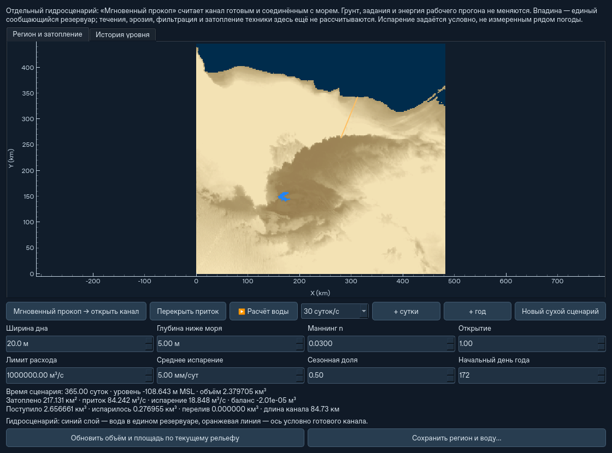

# Глобальное наполнение впадины при готовом канале

Первый ограниченный гидрологический этап поверх `980492b`. Это самостоятельный
расчёт «что будет, когда канал готов», с собственными часами. Он не заменяет
рабочий прогон, не засчитывает выемку дронам, не меняет грунт, инвентарь,
массу или энергию оборудования. Водная эрозия и подробное течение не добавлены.

## Интерфейс

1. **Ландшафт / импорт DEM…**: нарисуйте маршрут от моря до сухой впадины или
   нажмите **Пример: море → Каттара**, затем **Разметить канал**.
2. Откройте **Водоём / прокоп…**. На глобальной карте сухая впадина окрашена
   как суша, море выделено отдельно. Синий слой показывает воду, оранжевый —
   ось условного канала. Есть отдельная вкладка графика уровня.
3. **Мгновенный прокоп → открыть канал** включает условный приток. Основной
   рельеф остаётся прежним. Соединение с морем включает и береговой отступ
   проекта: гидросценарий считает эту перемычку открытой.
4. **Расчёт воды** запускает собственные часы. Доступны 1, 10, 30, 100 и
   365 модельных суток в секунду. **+ сутки**, **+ год** выполняют шаги;
   год идёт небольшими порциями через Qt, с возможностью паузы и закрытия.
5. **Перекрыть приток** оставляет испарение работающим. Ширину, глубину,
   открытие, шероховатость, лимит расхода и параметры испарения можно менять
   без сброса воды. **Новый сухой сценарий** явно обнуляет расчёт.
6. **Соль…** задаёт состав будущего притока и условный предел растворимости.
   Показаны концентрация в г/л, растворённая соль, осадок и невязка солевого
   баланса. Есть отдельная вкладка **История солёности**. Изменение солёности
   притока не пересчитывает уже накопленную соль.

Рабочий прогон на время этого окна приостановлен, его прежний режим
восстанавливается при закрытии. Вода при закрытии тоже ставится на паузу;
это ещё не совместная симуляция техники и затопления. Часы сценария и день
его календаря показаны отдельно от времени копания.

Новый регион и его воду сохраняйте кнопкой **Сохранить регион и воду…**
в `.atsregion`. Загрузка — **Открыть ландшафт…**, затем **Водоём / прокоп…**.
Черновой расчёт сохраняется в памяти при повторном открытии обзора региона,
но закрытие приложения требует обычного файлового сохранения.
Для уже активного региона гидросценарий также входит в `.atsstate` миссии.
Экспорт `.atsregion` активной миссии сохраняет прежнее требование: техника
должна быть посажена, грузы выгружены. Работать с грузом в воздухе позволяет
обычное сохранение всей миссии в `.atsstate`.

## Объём, площадь и уровень

Выбирается неморская связанная область ниже 0 м MSL возле конца канала.
Она рассматривается как **один сообщающийся резервуар** с горизонтальной
поверхностью. Сортировка отметок дна и накопленные площади позволяют
вычислять `V(h)`, `A(h)` и обратную зависимость `h(V)` без обхода всей карты
на каждом шаге. Максимальный уровень этого этапа — 0 м MSL.

Используется исходный обзорный DEM с объёмно согласованным усреднением
изменённых мелких блоков. Для блоков, целиком попавших в одну обзорную
ячейку, читается уже сохранённая сумма, без загрузки массива с диска.
Грунтовый баланс остаётся единственным прежним балансом `Landscape`;
гидросценарий только читает данные. Встроенный ETOPO1: 241×301 узел,
приблизительно 1,6×1,85 км. Процедурные мелкие неровности не превращаются
в измеренную батиметрию и отдельно по всему региону не генерируются.

Кривые пересчитываются при открытии после изменений грунта/окна или по
кнопке **Обновить объём и площадь по текущему рельефу**. Объём воды при
обновлении сохраняется; превышение новой вместимости записывается как
перелив, а не пропадает. Ошибка подготовки оставляет прежнее состояние и
приостанавливает расчёт. NoData у выбранной впадины и выход за DEM требуют
других исходных данных. Предел обзорного DEM для этого этапа — 1 млн узлов.

Внутренние перемычки, раздельные озёра и последовательность переливов между
чашами в первом приближении не разрешаются. Поэтому это оценка водного
баланса всей выбранной впадины, а не карта распространения фронта воды.

## Приток

Канал считается готовым, сообщающимся с морем, с установившимся течением и
постоянным трапецеидальным сечением. Его запас воды и время добегания
отдельно не интегрируются: расход задаёт внешнюю границу резервуара.

Оценка Маннинга: `Q = A R^(2/3) sqrt(ΔH/L) / n`, где `R = A/P`.
Сечение берётся при глубине воды от дна канала до уровня моря. Напор
ограничен свободным выпуском: `ΔH = max(0, 0 − max(h_озера, −глубина))`.
Впадина на −120 м не создаёт напор 120 м в канале с дном −5 м.
При подъёме озера приток уменьшается; при 0 м MSL прекращается.
Дополнительно действуют ограничение критического входного расхода,
пользовательский максимум и доля открытия 0…1.

По умолчанию `n = 0,03 с/м^(1/3)`, лимит 1 000 000 м³/с. Боковой уклон
для оценки берётся из проектного угла либо наиболее пологого заданного
естественного откоса материалов. Это условная оценка пропускной способности,
не решение Сен-Венана или расчёт подпора. Локальные сужения, сооружения,
волны, приливы, насосы и переходные режимы здесь не разрешаются.

## Испарение, интегрирование и покой

Баланс резервуара: `ΔV = приток − испарение − перелив`.
Начальное условное среднее испарение — **5 мм/сутки**, сезонная доля — **0,5**,
начальный день — **172**. Используется плавная годовая синусоида; фаза зависит
от полушария по координатам источника, год содержит 365 суток. Это не
измеренный климат Каттары и не расчёт по влажности, ветру, температуре,
солёности и энергетическому балансу испарения. Пользователь задаёт параметры.

Испарение умножается на текущую площадь, поэтому растущее озеро теряет больше
воды. Возможен равновесный уровень ниже моря. Без притока непустой водоём
продолжает испаряться. Отсутствующую воду испарить нельзя.

Консервативный неявный шаг ограничен шестью часами, календарной границей
и 2% вместимости по текущему изменению запаса. Односторонние расходы учитывают
частичное намокание новой ступени DEM: около такой береговой линии не
возникают искусственные циклы заполнения/осушения. Общие приток, испарение,
перелив и остаток показывают отдельную погрешность баланса объёма.

Для пустой впадины без притока, а также при полностью неизменном балансе с
постоянным испарением время можно пропустить аналитически. Положительные равные потоки
при этом продолжают учитываться в счётчиках. Мгновенное равновесие при
сезонном испарении не замораживает весь следующий год. Карта, геометрия
впадины и состояние техники не пересчитываются ради каждого шага воды.

## CLI и сохранения

```bash
python -m ats --headless --qattara \
  --channel-route docs/ats2/qattara-channel.json --steps 0 \
  --instant-channel --flood-days 365 \
  --flood-report flooding.json --save-state flooding.atsstate

python -m ats --headless --load-state flooding.atsstate --steps 0 \
  --flood-days 365 --save-state flooding-2years.atsstate
```

`--evaporation-mm-day` меняет условное среднее испарение. `--new-flood` явно
создаёт новый сухой сценарий. Параметры воды в CLI требуют `--headless`;
`--steps` относится только к рабочему прогону и не задаёт длительность воды.

`.atsstate` версии **16** читает версии **1–15**. Регион с водой имеет формат
**5**, читаются прежние **1–4**. В старых файлах без гидросценария вода остаётся
выключенной; прежний водный сценарий сохраняется. Рельеф и оборудование
не меняются. Сохраняются объём, расходные параметры,
открытие, собственный календарь, история и кривые впадины. У другого маршрута
прежний расчёт не заменяется молча: нужен явный новый сухой сценарий.

Состав старого водоёма помечается как оценка по накопленному притоку, если
сценарий начинался сухим и не имел перелива. Иначе солёность остаётся
неизвестной до явного задания исходной оценки. Прежние файлы не переписываются.
[Уравнения, допущения, миграция и новые испытания](salinity-and-runtime.md).

## Проверки и воспроизведение

```bash
python -m pytest -q
python scripts/benchmark_flooding.py --years 10 --output flooding-benchmark.json
```

Тесты проверяют аналитический приток/испарение, сухое дно, приближение к морю,
равновесие на ступени DEM, сезонное возобновление, сохранение и продолжение,
объёмное усреднение правок, отсутствие лишних чтений и фактические кнопки Qt.
Полные проверки исходной симуляции дополняются CLI-сравнением продолженного
и непрерывного гидросценария. Исходный грунт и отчёты техники сравниваются
на отсутствие изменений. Результаты — `regional-flooding-validation.json`.

Замеры — короткие контрольные прогоны Linux/Python 3.12 с offscreen Qt.
Они не являются пользовательским FPS, подтверждением реалистичности климата
или доказательством устранения ранее наблюдавшихся зависаний после 23 часов.



Контрольный пример: канал 20 м × 5 м, длина с открытым береговым участком
84,73 км, `n=0,03`, среднее испарение 5 мм/сутки с сезонной долей 0,5.

| Проверка | Результат |
|---|---:|
| Полный набор тестов исходного гидрологического этапа | 707, включая 21 гидрологический |
| Прежние группы CLI | 10 успешных |
| Подготовка 6543 узлов впадины | 0,049 с |
| Один модельный год, медиана десяти лет | 0,814 с |
| 1000 лет пустой впадины без притока | 0,00009 с, 0 численных шагов |
| Год через кнопку Qt, включая подготовку и отрисовку | 2,12 с |
| Максимальный интервал контрольного Qt-таймера | 89 мс |
| Уровень / объём после одного года | −108,643 м MSL / 2,3797 км³ |
| Уровень / объём после десяти лет | −89,550 м MSL / 12,7772 км³ |

Это результаты условного сценария, не прогноз строительства Каттары.
Год содержит 365 суток, первый день — 172. После десяти лет поступило
26,5666 км³, испарилось 13,7894 км³. Невязка объёма около 0,007 м³,
или 2,6·10⁻¹³ от поступившей воды, обусловлена арифметикой float64.
Сокращение максимального шага с 6 до 1,5 часа изменило годовой объём на
0,0052%, уровень на 0,00057 м. Это численная сходимость выбранной модели,
а не точность исходного DEM или климатических параметров.

Дополнительная CLI-проверка сравнивает 10+20 суток с сохранением по пути
и непрерывные 30 суток. Объём и поступление совпали в пределах 10⁻⁷ м³,
отчёты техники совпали точно, её часы остались на 0 с. Экспорт `.atsregion`
восстанавливает тот же водный сценарий. Окно Qt проверено на реальном пути
от кнопки обзора региона; все элементы помещаются в 1120×830.
