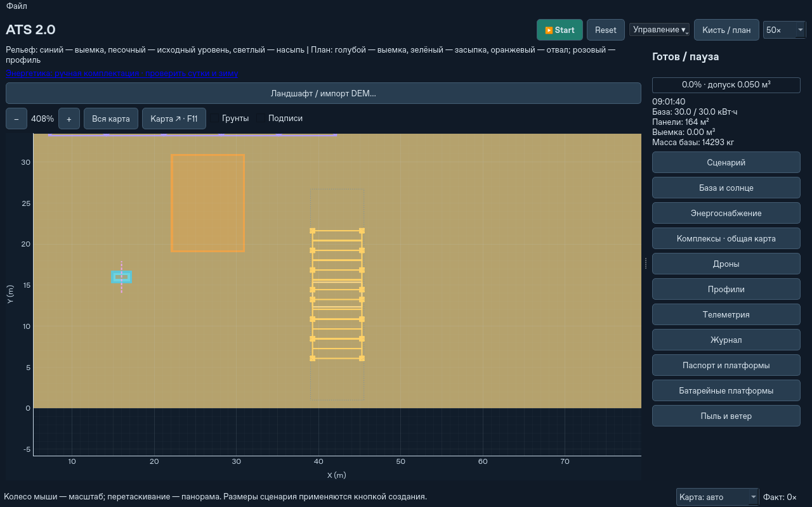

# Самораскрывающиеся солнечные носители

Новые комплексы ATS используют постоянно закреплённые солнечные крылья на
гусеничных платформах. Платформа собственными приводами выдвигает опоры,
раскрывает шарнирную гармошку и подключает панели к общей шине. Перед движением
выполняется обратная последовательность. Монтажники, выгрузка кассет и перенос
отдельных секций для этого режима не используются. BESS и сервисные батарейные
носители продолжают работать независимо от готовности солнечного поля.

Окно: **Управление ▾ → Солнечные платформы и отвал…**. Оно также доступно
в настройках, в группе «База и солнце». Команды «Сложить собственные крылья
и убрать опоры» и «Раскрыть / возобновить раскрытие» меняют направление
существующей операции, сохраняя фактическое положение механизма. Загрузка
сохранения в промежуточной стадии продолжает эту же операцию.

## Условная конструкция

Это модель изделия для симуляции, а не паспорт серийного оборудования.
Параметры находятся в `logistics.self_solar`; их допустимость проверяется.

| Элемент | Принято в модели |
|---|---|
| Несущий гусеничный модуль | 6 × 3 м, сухая масса 1570 кг, привод 12 кВт |
| Крылья | Два, по шесть листов 6 × 2 м; до 144 м² панелей |
| Упаковка | Листы стоят почти вертикально; панель 40 мм плюс шарнирный зазор 20 мм |
| Высота в пути | 3,2 м с технологическим зазором; нижние шарниры на высоте 1 м |
| Собственные рамы | 1,5 кг/м², 216 кг на полный механизм |
| Опоры | 16 опор по 8 кг, пятно 0,25 м² на опору |
| Приводы, корневые узлы, проводка | 180 кг на механизм |
| Полный механизм без панелей | 524 кг, включая рамы и опоры |
| Стандартные панели | 4 кг/м²; при 144 м² полезный груз 1100 кг, полная масса носителя 2670 кг |
| Проходы между рядами / колонками | Не меньше 2 / 3 м при первоначальной расстановке |
| Земля под опорами | Уклон до 8°, перепад в пределах всего хода до 0,6 м; проверяется несущая способность |

Солнечный носитель — низкая открытая рама с направляющими и гусеницами, без
аккумуляторного шкафа. Высота шкафов BESS к нему не применяется. Нижние чётные
шарниры перемещаются по земле на собственных опорах; верхние опускаются при
раскрытии. Листы и опоры остаются частями носителя. Два крыла раскрываются
симметрично; при неполной загрузке учитывается действительная масса панелей.
Масса пустых рам сохраняется. После горячего снятия панелей пустой носитель
не исчезает из инвентаря.

Полный ход механизма занимает приблизительно **25,71 × 6,5 м** при нулевом
повороте, хотя транспортное пятно шасси всего 3 × 6 м. Резерв учитывает небольшой
выход шарнирной гармошки за конечный горизонтальный размер. Проверяется весь
ход, включая края и опоры, а не только центр платформы. Ширина безопасного
проезда между такими зонами входит в первоначальную расстановку; пространство
под крыльями не считается наземным проездом.

## Время, электричество и движение

Цикл: `STOWED → DEPLOY_SUPPORTS → UNFOLDING → CONNECTING → DEPLOYED`.
Обратно: `DISCONNECTING → FOLDING → RETRACT_SUPPORTS → STOWED`.
Опоры работают 30 с при 250 Вт, шарниры 180 с при 750 Вт, подключение 10 с
при 100 Вт; переход в конечное состояние занимает ещё один физический шаг.
Полный цикл при непрерывном питании — 221 с. Носители работают параллельно,
пока хватает мощности и энергии общей шины; при недостатке питания прогресс
соответствующего привода останавливается с объяснением причины.

К электрическим затратам добавляются подъём массы листов при складывании
и условное сопротивление перемещению опор; КПД привода 0,75. Спуск не возвращает
электричество. Кинематика квазистатическая, без разгона и рекуперации. У каждой
платформы есть счётчик энергии приводов. Сохраняется единый электрический баланс
базы; BESS не дублируется внутри солнечных носителей. Управление потребляет
25 Вт на шасси и ещё 5 Вт на солнечный механизм, что входит в подбор энергетики.

Генерация поступает от подключённых и безопасно развёрнутых носителей.
Платформы вводятся в работу независимо; частичное поле даёт частичную суммарную
генерацию. Один лист в промежуточном положении к шине не подключён. До 20 м²
может оставаться на крыше центрального комплекса для первоначального питания.
В движении генерация отключена.

При переезде сохраняются ID платформ, панелей и механизмов, их взаимные
координаты и состав. До завершения складывания движение запрещено. Энергия
трения и положительного подъёма рассчитывается по действительной массе
и пути **каждого** носителя, а не по одной высоте центральной базы. Переезд
между окнами проверяет место для последующего раскрытия в обоих окнах.
Если места в перекрытии недостаточно, запрос отклоняется без потери оборудования.
Формация движется без изменения взаимного положения; отдельная перестройка
солнечных платформ после движения не моделируется и не подменяется телепортацией.

На карте пунктиром показан полный резерв раскрытия, жёлтым — текущие листья
в движении, голубым — подключённые крылья. Опоры показываются в своём текущем
положении. Отрисовка объединена в несколько графических объектов, без создания
отдельного Qt-объекта на каждую панель.

## Совместимость и ограничения

Сохранение версии 9 записывает геометрию, фазы, расход энергии и постоянные
привязки. Версии 1–8 читаются совместимо: отсутствие `self_solar` означает
прежнюю механику, без замены техники, удаления монтажников или перекомпоновки.
Тот же принцип действует для старых файлов конфигурации и шаблонов. Старый
режим явно доступен через `self_solar: null`; установка его не мигрирует уже
работающий механизм. Новые сохранения не предназначены для старой версии ATS.

Начальная расстановка и горячая поставка новых носителей выбирают пригодные
площадки. Координаты уже доставленных солнечных носителей при расширении поля
сохраняются. Новое оборудование и шасси проходят через журнал импорта массы.
Горячая поставка — существующая внешняя доставка оборудования; её транспортный
маршрут вне карты не моделируется. Если сухого места нет, поставка отклоняется
до изменения инвентаря. Для больших полей нужна большая карта.

Число носителей определяется площадью и собственными механизмами; плотность
упаковки не оптимизировалась за счёт неопределённой толщины или бесплатных опор.
Максимум 256 носителей на комплекс. Нет расчёта ветровых нагрузок, прочности
шарниров, упругости, кабельных трасс, взаимного затенения и индивидуального
наклона панелей. Солнечный поток остаётся существующей моделью ATS, а не новым
солнечным трекером. Ограждающий прямоугольник повёрнутого поля консервативен.
Препятствие в ходе раскрытия или складывания блокирует привод; оно не удаляется
и не обходится автоматически. Причина видна в окне, после устранения можно
продолжить. Масса, оборудование и достигнутая фаза при ожидании сохраняются.

Пример стандартного зимнего расчёта (четыре дрона, Крот, прежние коэффициенты
рабочей загрузки и потерь; это проектная нагрузка, а не обещание выработки):

| Широта | Панели | BESS | Все носители | Расчётная транспортная масса |
|---|---:|---:|---:|---:|
| 31° | 7350 м² | 2590 кВт·ч | 62 | 184 979 кг |
| Каттара, 31,078° | 7370 м² | 2590 кВт·ч | 63 | 187 153 кг |
| 55° | 31 471 м² | 3190 кВт·ч | 231 | 641 185 кг |

Количество и масса выросли относительно прежнего кассетного поля: теперь
каждые 144 м² действительно несут своё шасси, шарниры и опоры. Это следствие
выбранной консервативной конструкции, а не доказанный минимум числа платформ.
КПД панелей и потребление рабочих дронов ради уменьшения числа носителей
не менялись. В этих трёх расчётах сохраняется повторяемый зимний суточный
энергетический режим; для полярной ночи действует прежнее предупреждение
о конечном запасе энергии.

Проверки и замеры этапа находятся в `self-solar-validation.json` рядом с этим
документом; тесты механизма — `tests/test_self_solar.py`, совместимости и общего
переезда — также в прежних наборах ATS.

В финальном прогоне прошли **559 тестов** без пропусков и **10 групп CLI**.
На синтетической карте 512 м с 14 комплексами × 4 дрона, по 68 м² панелей,
получено 18,7× без GUI и 7,9× в Qt offscreen. На одном и том же сохранении
версии 8: 11,62× до и 11,48× после; это короткие замеры с обычным разбросом,
а не испытание пользовательского компьютера. Балансы грунта и оборудования
сохранились; ошибка электрического баланса нового сценария менее 0,00001 Дж.

На 55° полный зимний состав из 231 носителя закончил развёртывание к 225 с
модельного времени. В проверке с посадкой флота максимальный физический шаг
занял 0,193 с, сохранение / загрузка — 1,26 / 1,02 с. Один полный программный
кадр такого большого поля занял около 0,54 с: стоимость отрисовки остаётся
заметной. Повторная проверка всех площадок 219 PV после изменения рельефа
сокращена с примерно 1,0 до 0,029 с за счёт однократного построения геометрии
соседей; проверки грунта и пересечений сохранены. Эти испытания не воспроизводят
неподтверждённое зависание пользовательского сохранения после 23 часов.

