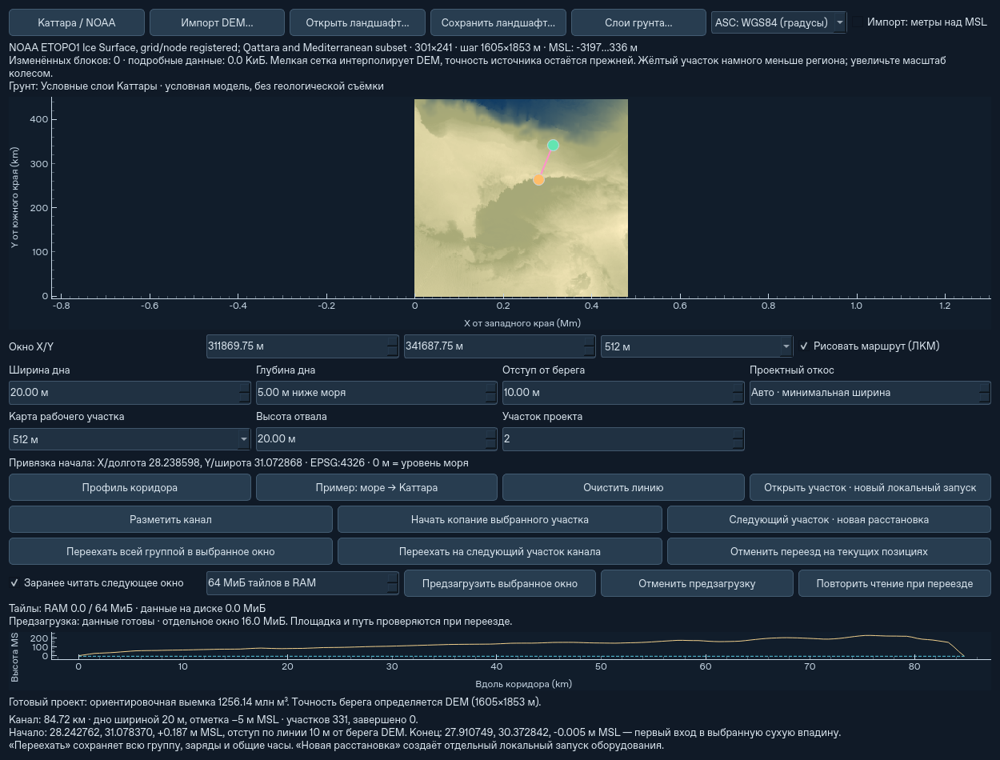

# Предзагрузка соседнего окна и файловый кэш тайлов

Это первый ограниченный этап после `68a837d`. Сохраняется одно активное
физическое окно и существующий переезд всей группы. Автоматически ехать,
перескакивать через окна или останавливать технику за пределами камеры
предзагрузка не заставляет.

## Управление

Откройте **Ландшафт / импорт DEM…**:

- **Заранее читать следующее окно** включает автоматическую подготовку
  соседнего участка размеченного канала во время работы или паузы.
- **Предзагрузить выбранное окно** читает заданные координаты вручную.
- **Отменить предзагрузку** немедленно отменяет запрос, сохраняя текущую
  миссию. Поздний результат фонового чтения не применяется. Автоматический
  запрос того же отменённого окна не возобновляется каждый кадр.
- **МиБ тайлов в RAM** задаёт общий лимит высот и состава грунта одного
  региона. Ноль разрешён: блоки читаются по необходимости без резидентного LRU.
- **Повторить чтение при переезде** доступно после ошибки файлового кэша
  при прибытии; возобновляет безопасную попытку переключения.

«Данные готовы» означает готовность чтения. Посадочные площадки, раскрытые
габариты, вода, выемка, отвал, препятствия, энергия и маршрут проверяются
существующим механизмом переезда. При недостаточном перекрытии переезд
по-прежнему отклоняется. Отмена чтения и отмена самого переезда — разные команды.

Если предзагрузка отключена, не готова, отменена или не помещается в её
бюджет, обычное чтение при переезде остаётся доступным. Настоящий NoData или
нечитаемые данные не заменяются нулевыми высотами.



## Хранение и память

Единственные изменённые высоты и столбцы материалов принадлежат `Landscape`.
`tiles` и `soil_tiles` — представления общего хранилища. После записи
неизменяемая версия блока имеет файл NumPy в собственной временной папке.
RAM содержит ограниченный LRU часто читаемых блоков. Вытеснение освобождает
память, сохраняя блок на диске; возврат в старое окно читает те же значения.

Лимит по умолчанию — **64 МиБ резидентных массивов тайлов** на регион.
У предзагрузки отдельный предел **64 МиБ сохранённых массивов одного окна**.
Одновременно есть один читатель и не больше одного заменяющего запроса.
Старый запрос отменяется, а не накапливает очередь окон.

Это не лимит всей памяти приложения: отдельно остаются исходный DEM,
активный Terrain и техника, индекс тайлов, подготовленное окно и временные
рабочие буферы. Индекс растёт с числом изменённых блоков; файловый объём
также не ограничен этим RAM-параметром. Интерполяция DEM идёт полосами по
64 строки, ограничивая промежуточные массивы и позволяя проверять отмену.
Она побитово совпадает с прежним полным вычислением на контрольных данных.

Запись блока копирует переданный массив: последующая правка исходного массива
не меняет сохранённую версию. Программный доступ `landscape.tiles[key]`
теперь возвращает read-only NumPy-массив. Для изменения назначьте новый
массив целиком или используйте `commit_window`. Это предотвращает незаметную
правку данных, уже читаемых в фоне.

Сохранение всего окна публикует высоты и состав вместе. Если место на диске
закончилось в середине записи, индекс остаётся прежним. Контрольная сумма
обнаруживает повреждение временного блока. Производные суммы в отчёте
вычисляются из записанных массивов; они не являются вторым балансом грунта.
Открытие инвентаря/отчёта не перечитывает все файлы тайлов.

Временный файловый кэш **не является автосохранением**. Его файлы принадлежат
только текущему процессу; ненужные версии и папки освобождаются после читателей.
Пользовательские файлы автоматически не удаляются. Для постоянного хранения
нужны обычные `.atsstate` или `.atsregion`.

## Фоновое чтение и применение

Фоновый поток получает снимок ссылок на неизменяемые версии тайлов. Он не
читает изменяемые массивы активной выемки, не меняет оборудование, часы,
резервы, заряд или общий инвентарь. Проверки отмены есть между полосами DEM
и чтениями тайлов. Ошибка чтения или запуска потока становится видимым
состоянием запроса и не останавливает текущую физику.

Подготовленные данные применяются в основном потоке между физическими
шагами, когда вся группа завершила существующую процедуру посадки, сборки
и движения. Перед переключением выполняются:

1. Снимок актуального хранилища региона и частный overlay живого окна,
   включая состав материалов и мелкие столбцы под укрупнёнными ячейками.
2. Сверка версий нужных блоков с началом предзагрузки. Изменившиеся данные
   пересчитываются на подготовленном исходном DEM; устаревший состав не берётся.
3. Создание целевого Terrain и прежняя проверка площадок.
4. Атомарная фиксация старого окна и только затем перенос системы локальных
   координат существующих объектов. ID, инвентарь и общие часы продолжаются.

Если дисковая операция при переключении не удалась, остаются старый Terrain,
привязка окна и вся техника. Причина показана в статусе переезда; повтор
требует команды пользователя, а не дорогой попытки каждый модельный тик.

## Сохранения и совместимость

`.atsstate` имеет версию **13**, читаются версии **1–12**. Все блоки включены
в файл; пути временного кэша, потоки и блокировки не сериализуются. Тайлы
записываются и восстанавливаются по одному, без общего словаря их массивов
в RAM. Сохранение во время чтения хранит запрос, который заново запускается
после загрузки; активное движение и его энергия не пересоздаются.
Отменённый запрос остаётся отменённым после загрузки.

`.atsregion` сохраняет совместимый ZIP/NumPy-формат версии 2, включая прежние
имена массивов. Старые файлы версии 1/2 читаются. Запись стала потоковой и
атомарной: ошибка не портит прежний файл. Новые поля лимита и переключателя
чтения необязательны. Старый файл не переписывается при чтении.

При первом чтении старого `.atsstate` его прежний словарь ещё декодируется
целиком, затем переносится в файловое хранилище. У этого однократного перехода
может быть прежний высокий пик RAM. Новые снимки используют потоковый путь.
Существующие ограничения размера снимков сохранены.

## Проверки и воспроизведение

Полный финальный набор: **667 тестов**, без ошибок и пропусков, в том числе
24 новых случая потокового чтения и кэша; все **10 групп CLI** из workflow.
Среда — Linux/Python 3.12.14, NumPy 2.5.4, Qt 6.12.0. Windows и удалённый CI
этого этапа не запускались: изменения подготовлены локально, без push.

Регрессии `tests/test_streaming.py` проверяют общий LRU, read-only версии,
вытеснение, транзакционный отказ записи, изменение перекрытия после чтения
при разрешениях 1/2/4, отмену и замену запроса, ошибки и повтор,
старый снимок версии 12, A→B→A, сохранение во время чтения и в движении,
состав грунта, объём, энергию и действия настоящего Qt-интерфейса.

Команды из корня проекта:

```bash
python -m pip install -e ".[test,dem]"
python -m pytest -q
python scripts/benchmark_streaming.py --tiles 1024 --cache-mib 2 --output after.json
python scripts/benchmark_streaming.py --root /path/to/68a837d --tiles 1024 --cache-mib 2 --output before.json
```

Используйте один Python и одинаковые параметры. Для сравнения общего рабочего
темпа применим также прежний `scripts/benchmark_runtime.py`. Входы для
побережья и 14×4 создаются `scripts/prepare_sector_benchmark.py` именно с
`--root` на `f250d84`, как указано в его справке; обе сравниваемые версии
загружают одни и те же старые снимки. Это продолжение контрольной миссии,
а не испытание свежей расстановки всех 14 баз или всего канала.

Для прибрежного контроля восстановлены метаданные того же проекта канала,
которых не было в старом контрольном файле. Никаких физических шагов при этом
не выполнялось. Оба движка получили один снимок версии 12; в новом GUI
действительно работала автоматическая предзагрузка следующего окна.
Пример подготовки после создания исходных файлов:

```bash
python - <<'PY'
import sys
sys.path.insert(0, '/path/to/68a837d')
from ats.checkpoint import load_state, save_state
from ats.channel import ChannelProject
s = load_state('/tmp/inputs/coast45-v10.atsstate')
r = s.landscape.raster
route = [list(map(float, r.to_metres(*p))) for p in [(28.3, 31.2), (27.5, 29.5)]]
p = ChannelProject.create(r, route, side_m=512)
assert p.identity == s.simulation.config.georeference['channel']['project_id']
s.landscape.channel_project = p.to_data()
save_state('/tmp/inputs/coast-project.atsstate', s.simulation, s.landscape)
PY
python scripts/benchmark_runtime.py --root /path/to/68a837d --state /tmp/inputs/coast-project.atsstate --steps 240 --trials 2 --mode both --offscreen --output before-runtime.json
python scripts/benchmark_runtime.py --state /tmp/inputs/coast-project.atsstate --steps 240 --trials 2 --mode both --offscreen --output after-runtime.json
```

Для 14×4 используйте соответственно `heavy14-start-v10.atsstate` с 20 шагами
и `heavy14-work-v10.atsstate` с 30. При итоговых замерах порядок был ABBA,
а не отдельная длинная серия каждой версии; исходные хэши есть в JSON.

Замеры Linux/Python 3.12, NumPy/Qt одинаковы для обеих версий, до/после/после/до:

| Контроль | 68a837d | Новый этап |
|---|---:|---:|
| RSS после создания 1024 тайлов высот и 1024 состава | 161,9 МиБ | 29,1 МиБ |
| Пик RSS при загрузке копии региона рядом с исходной | 325,2 МиБ | 35,8 МиБ |
| Подготовленные данные окна, резидентный кэш задан 2 МиБ | чтение при запросе | 50 МиБ отдельно от кэша |
| Чтение готовых данных окна 1024² | 138,6 мс | 20,0 мс |
| Максимальный интервал событий Qt при первом чтении, медиана запусков | 162,6 мс | 7,9 мс |
| Физическое переключение Terrain в малом A→B→A, медиана | 75,9 мс | 43,3 мс |

Архив содержит 160 МиБ несжатых массивов. В конце всего теста, с Qt и несколькими
рабочими копиями окна, пик RSS составил около 422,4 против 218,9 МиБ.
Резидентный кэш оставался в пределах 2 МиБ; этот предел не включает активные
массивы и предзагрузку. Запись и чтение через файлы дороже операций со словарём
RAM; все времена построения хранилища, сохранения и загрузки есть в
[машинном отчёте](terrain-prefetch-cache-validation.json).

Контроль Qt — маленький offscreen-виджет с таймером, не FPS полной карты.
Физический контроль использует двух дронов, условные слои и два соседних
128-метровых окна: прошло 521 модельная секунда. Итоговые отчёты до/после,
высоты и материалы совпали побитово; ошибка массы 0 кг, энергии около
2,74×10⁻⁷ Дж. Большие комплексы проверяются отдельно короткими runtime-контролями.

### Полная карта и общий рабочий темп

Те же снимки, обе версии, Qt offscreen 1280×900, карта «авто», два запуска
на вариант в порядке до/после/после/до. Медианы фактического ускорения:

| Сценарий | Без карты: до → после | С картой: до → после |
|---|---:|---:|
| Каттара, 45 носителей, модельные 600–840 с, автоматическое чтение следующего окна | 60,39× → 58,80× | 46,11× → 47,50× |
| 14×4, 630 носителей, первые 20 с раскрытия | 3,50× → 3,37× | 2,43× → 2,52× |
| 14×4, полётный цикл 235–265 с | 5,71× → 6,00× | 5,30× → 5,36× |

В полётной фазе Кроты ждут перевозки мешков. Это не сутки непрерывного
копания всеми 14 машинами. Отчёты до/после и с/без карты совпали во всех
трёх сценариях. Общего ускорения этих коротких прогонов результаты не
доказывают: побережье без карты в выборке оказалось на 2,6% медленнее.

Задержки полной карты остаются больше задержек одного чтения: медианы
максимального интервала событий составили 0,774→0,495 с на побережье,
1,682→1,704 с при начальном раскрытии 14 комплексов и 0,729→0,693 с в их
полётном цикле. Дорогие физические шаги, отрисовка и поиск маршрута остаются.
Эти числа не являются FPS пользовательского компьютера.

## Границы этапа

Активный Terrain пока заменяется целым окном после прежнего физического
переезда. Полностью скользящая карта, несколько независимых активных областей,
новая мировая система координат и потоковая симуляция осыпания на их границах
не добавлялись. Фоновый поток не планирует наземные маршруты: прежний
синхронный расчёт, занимавший около 24 с для 45 платформ, остаётся.
Эти короткие проверки не подтверждают устранение пользовательских зависаний
около 23 модельных часов. Гидрология и водная эрозия не добавлялись.
