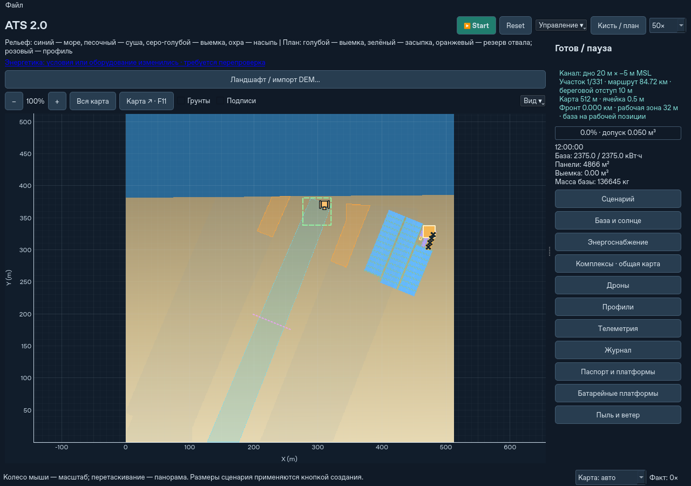
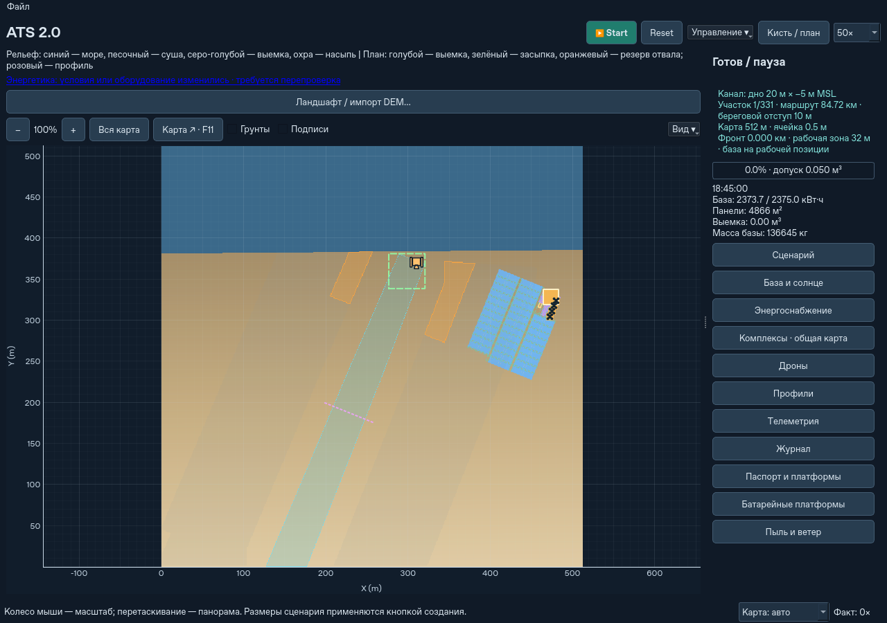
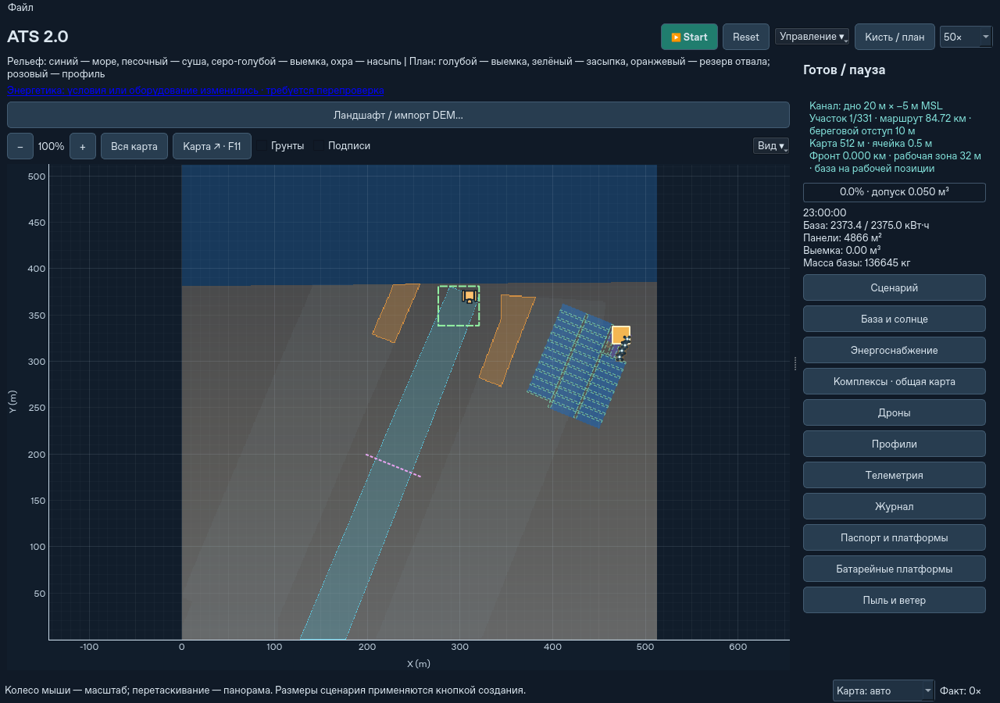
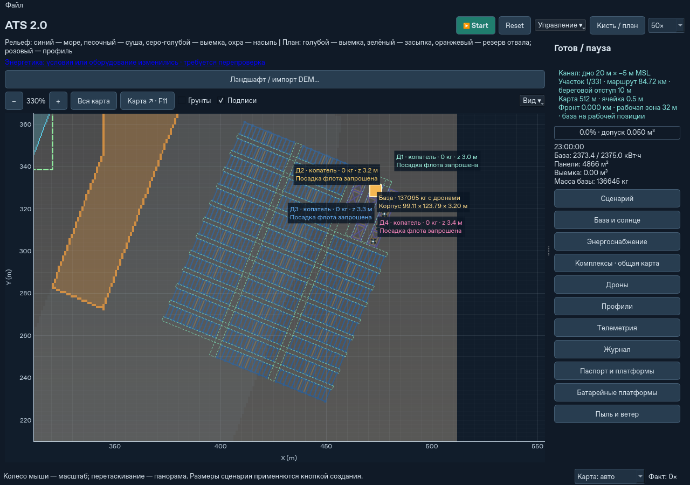

# Суточный свет и читаемая 2D-карта

Над картой откройте **«Вид ▾»**. В меню два независимых переключателя:

- **Суточное освещение** — плавный дневной, сумеречный и ночной оттенок по
  широте, дате и часам действующей миссии. Выключение оставляет постоянный
  читаемый светлый вид. Предпросмотр другой даты в настройках не меняет часы
  действующей миссии: он применяется при создании сценария.
- **Огоньки дронов** — небольшие навигационные точки с мягким ореолом ночью.
  Они могут работать и при выключенном затемнении карты. На земле огни меньше.

Оба режима включены по умолчанию. Выбор входит в настройки отображения внутри
сохранения, восстанавливается при загрузке и сохраняется при новом локальном
сценарии и переезде группы. Старые сохранения без этих полей читаются;
оборудование и параметры миссии автоматически не меняются.

Море окрашивается по существующей маске связности с морем. Отрицательная
отметка высоты сама по себе не делает сухую впадину морем. Суша песочная,
фактическая выемка серо-голубая, насыпь охристая. Цвет по материалу остаётся
доступен через «Грунты». Контуры плана, резерв отвала, выделение и подписи
находятся выше затемнения; панели интерфейса также не затемняются.

Силуэты дронов и Крота различаются. Минимальный размер значка на экране
поддерживает читаемость при удалении; это условный значок, а не паспортный
габарит. Площадки и носители сохраняют метрические контуры. Для выбранного
флота подписи стараются разойтись в свободное место; в очень тесном виде они
всё ещё могут перекрываться. Их можно скрыть существующим переключателем.






## Модель изображения

Глобальный оттенок меняется по модельным часам без пересчёта изображения
рельефа на каждом кадре. Направление затенения рельефа обновляется раз в
15 **модельных** минут. На больших ускорениях используется текущий интервал,
без очереди пропущенных обновлений. При паузе свет остаётся на месте; загрузка,
смена даты/широты и окна региона учитываются при следующем обновлении.

Энергетика продолжает считать солнечный поток с физическим шагом **1 секунда**.
Картинка не задаёт мощность панелей. Огни декоративные: новый прибор, его масса
и потребление не добавляются. Здесь нет расчёта прожекторов, падающих теней,
отражений, гидрологии или освещения через пыль. Это прежний PySide6/pyqtgraph
и вид сверху, без 3D-движка.

## Быстродействие и проверка

Неподвижные контуры PV, опор и проходов кэшируются отдельно для каждого
комплекса; при раскрытии, складывании, движении и изменении геометрии кэш
обновляется. Qt повторно использует растеризацию неизменных линий. При близком
увеличении, если охватывающий размер превышает 2048 пикселей, кэш растеризации
выключается, чтобы не создавать огромную картинку из контура всей базы.

Таблицы обновляются раз в 0,5 реальной секунды, профили — не чаще раза в 0,75 с
при изменениях. Явные команды и принудительное обновление работают сразу.
Цвет суток не запускает пересборку таблиц и профилей. Режим «Карта: авто» на
высоких ускорениях учитывает как подготовку сцены, так и фактическое время
рисования Qt; режим «Без карты» остаётся доступен.

Для воспроизводимого сравнения используется один и тот же физический снимок:

```bash
python scripts/benchmark_map_display.py --state run.atsstate --effects off --output view-off.json
python scripts/benchmark_map_display.py --state run.atsstate --effects on --output view-on.json
python scripts/benchmark_map_display.py --root /path/to/baseline --state run.atsstate --effects off --output view-before.json
```

Скрипт отдельно замеряет подготовку и рисование 20 кадров с готовым рельефом и
с его обновлением, затем 60 физических секунд с работающим Qt. Сравнение
проверяет одинаковый итоговый физический отчёт. Контрольные нагрузки:
14 комплексов × 4 дрона, 68 м² PV на комплекс, 98 носителей; отдельно один
большой зимний комплекс Каттары, 63 носителя. Результаты и условия — в
[отчёте](topdown-display-validation.json). Это короткие Linux/Qt offscreen
замеры, а не FPS на компьютере пользователя или испытание суток работы.

Медианы двух последовательных прогонов на вариант (порядок во втором
развёрнут; физический итог во всех вариантах совпал):

| Нагрузка | Прежний 1dd9e37 | Новый, эффекты выключены | Новый, эффекты включены |
|---|---:|---:|---:|
| 14 комплексов × 4 дрона | 10,01× | 10,34× | 10,10× |
| Один комплекс, 63 носителя | 11,19× | 13,50× | 12,75× |

Для 14×4 подготовка неподвижного кадра сократилась с 22,45 до 4,20 мс,
рисование — с 63,12 до 34,90 мс при включённых эффектах. Для 63 носителей —
соответственно с 42,74 до 2,32 мс и со 187,70 до 26,58 мс. Влияние эффектов
на скорость модели относительно нового режима без них — около 2–6% в этих
нагрузках; небольшие различия не следует переносить на другой компьютер.

Снимки начинаются после 235 физических секунд развёртывания. Контроль 14×4
использует 55° с.ш., большой комплект — 31,078°; в обоих случаях 21 июня,
около 21:04 местного солнечного времени. Включены стадии фактической работы
техники, а не только перерисовка неподвижной картинки. Число объектов Qt
увеличилось ровно на три: один оттенок карты и два общих слоя огней.
